算术运算指令是 ALU（算术逻辑单元）最核心的职责所在。前面的章节已经介绍过补码表示法、CF/OF 标志位的本质区别，本篇将在此基础上，系统学习 x86 中完整的算术指令家族——从最基础的加减法，到支持跨寄存器拼接的多精度运算，再到乘除法指令中那些极易踩坑的隐式寄存器绑定规则。

理解这些指令不仅是写出正确汇编代码的前提，更是读懂编译器生成的大数运算、溢出检测代码的关键。

---

## 一、 ADD 与 SUB：基础加减法

### 1. 基本语义与标志位的全面刷新

`ADD`（加法）与 `SUB`（减法）是最基础的双操作数算术指令，语义上等价于高级语言中的 `+=` 和 `-=`：

```nasm
add eax, ebx          ; EAX = EAX + EBX
sub eax, ebx          ; EAX = EAX - EBX
add eax, 10            ; EAX = EAX + 10 (立即数)
add dword [rdi], 5     ; 内存中的值直接加 5
```

这两条指令执行后，会**完整地刷新全部六个算术标志位**：`CF`、`OF`、`SF`、`ZF`、`AF`、`PF`。这意味着紧随其后的条件跳转指令可以直接利用这次运算产生的任意一个标志位进行分支决策。

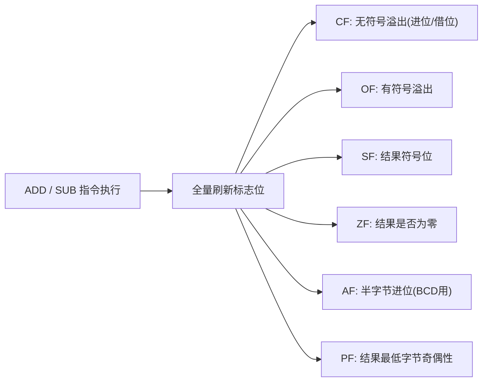

### 2. SUB 与 CMP 的底层同源关系

回顾前面标志位章节的内容：`CMP A, B` 在硬件层面执行的正是 `A - B` 这个减法运算，唯一的区别是**`CMP` 丢弃计算结果，只保留标志位**；而 `SUB` 会将差值真正写回目的操作数。两者刷新标志位的规则完全一致。

```nasm
sub eax, ebx           ; EAX = EAX - EBX，同时产生标志位，EAX 被修改
cmp eax, ebx           ; 计算 EAX - EBX 但丢弃结果，同样产生标志位，EAX 保持不变
```

### 3. CF 与 OF 的对比复习：谁在管辖哪个数域

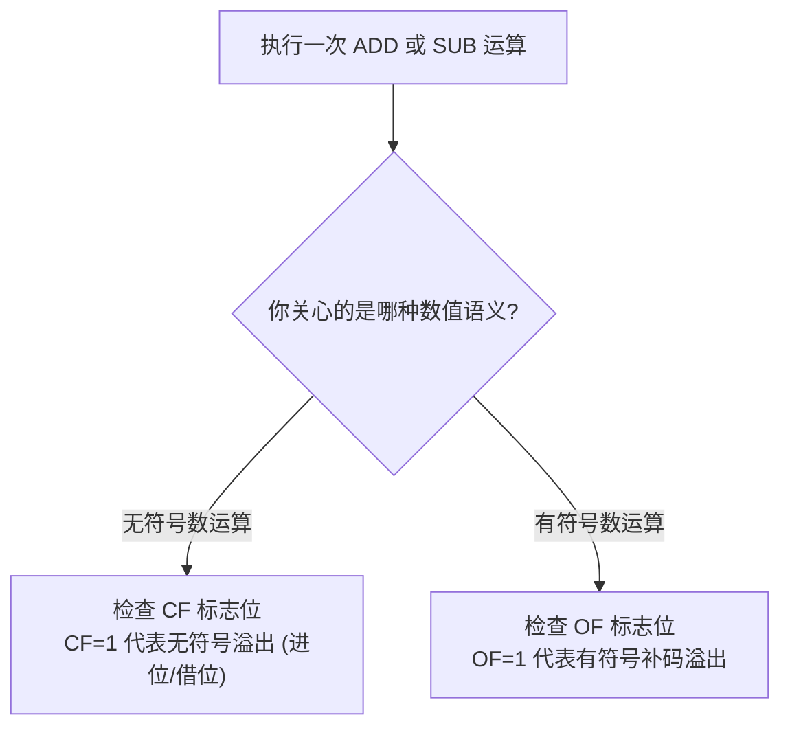

```nasm
mov al, 0xFF          ; 无符号视角: 255；有符号视角: -1
add al, 1              ; AL = 0x00
; 此时: CF = 1 (无符号 255+1 产生进位溢出)
;       OF = 0 (有符号 -1+1=0，完全正常，没有溢出)
```

同一次运算，`CF` 和 `OF` 可能给出完全不同甚至相反的判断结果——这正是因为它们服务于两种互不相干的数值解释方式。

---

## 二、 ADC 与 SBB：带进位的加减法与多精度运算

### 1. 核心语义：把上一次运算的进位/借位计入这一次

`ADC`（Add with Carry，带进位加法）和 `SBB`（Subtract with Borrow，带借位减法）在普通加减法的基础上，额外加上（或减去）当前的 `CF` 标志位：

```text
ADC dest, src  等价于  dest = dest + src + CF
SBB dest, src  等价于  dest = dest - src - CF
```

### 2. 为什么需要这两条指令：突破寄存器位宽的枷锁

x86 的通用寄存器最大是 64 位，但如果程序需要处理 128 位、256 位甚至更大的整数（例如密码学中的大数运算），就必须把一个超大整数拆分成多个 64 位的"数位"，分别存放在多个寄存器或内存单元中，再通过**进位链**把它们逐段连接起来。

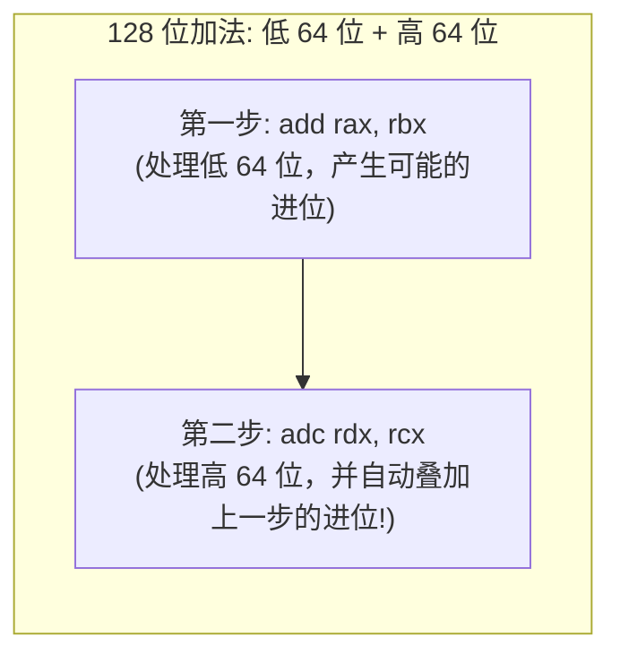

### 3. 实战示例：128 位整数加法

```c
// C 语言中的 128 位加法概念 (需要编译器内建支持或手动拆分实现)
// result = a + b (均为 128 位，拆分为高低两个 64 位部分存储)
```

```nasm
; 假设:
;   加数 A 的低 64 位在 RAX，高 64 位在 RDX
;   加数 B 的低 64 位在 RBX，高 64 位在 RCX
; 计算 128 位的 A + B，结果覆盖回 RAX:RDX

add rax, rbx            ; 低 64 位相加，若发生进位则 CF=1
adc rdx, rcx             ; 高 64 位相加，并自动把上一步的 CF 累加进来!
; 此刻 RDX:RAX 即为完整的 128 位加法结果
```

**关键点**：第二条 `adc` 指令中的"进位输入"完全是隐式的——它直接读取当前的 `CF` 标志位，程序员不需要（也无法）显式地把这个进位值当作一个普通操作数传入。这正是"标志寄存器充当跨指令状态传递媒介"这一设计思想的典型应用。

### 4. SBB 实现多精度减法的对称逻辑

```nasm
; 128 位减法: (RDX:RAX) - (RCX:RBX)
sub rax, rbx            ; 低 64 位相减，若需要借位则 CF=1
sbb rdx, rcx              ; 高 64 位相减，并自动减去上一步产生的借位
```

### 5. 使用前必须手动清空 CF

由于 `ADC`/`SBB` 会读取当前已存在的 `CF` 值，**在开始一组多精度运算链条之前，必须确保 `CF` 处于已知的初始状态（通常是 0）**，否则链条中第一步的进位输入会残留上一次无关运算遗留下来的垃圾值：

```nasm
clc                     ; 显式清空进位标志，确保 CF = 0
add rax, rbx            ; 开始第一段加法 (低位)
adc rdx, rcx             ; 后续段落依次叠加
```

---

## 三、 INC 与 DEC：自增自减及其不影响 CF 的历史细节

### 1. 基本语义

`INC`（自增 1）和 `DEC`（自减 1）是专为"计数器递增/递减"场景优化的单操作数指令：

```nasm
inc eax                 ; EAX = EAX + 1
dec eax                  ; EAX = EAX - 1
inc dword [counter]      ; 直接对内存中的计数器自增
```

### 2. 关键细节：INC/DEC 刻意不修改 CF 标志位

这是初学者极易忽略、却在逆向分析和底层代码审查中至关重要的一条规则：**`INC` 和 `DEC` 会正常刷新 `OF`、`SF`、`ZF`、`AF`、`PF`，但唯独不触碰 `CF`（进位标志）**。

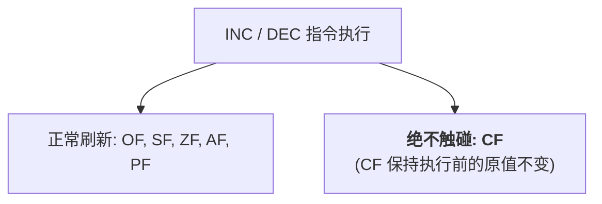

```nasm
clc                      ; 显式清空 CF
mov al, 0xFF
add al, 1                 ; AL 变为 0x00，产生无符号溢出 -> CF 被置为 1

clc                       ; 显式清空 CF
mov al, 0xFF
inc al                     ; AL 同样变为 0x00，ZF 被置为 1，但 CF 依然保持为 0 不变!
```

### 3. 历史设计原因：保护多精度运算的进位链不被意外破坏

这条规则的存在，正是为了服务于上一节介绍的 `ADC`/`SBB` 多精度运算场景。设想一个典型的编程模式：**在执行多精度加法循环的同时，还需要用一个独立的计数器变量来追踪已经处理了多少个数位**。


如果 `INC` 像 `ADD` 一样会刷新 `CF`，那么程序员每递增一次循环计数器，就会意外覆盖掉刚刚由 `ADC` 产生、本应传递给下一轮迭代的真实进位值，导致整个多精度运算逻辑彻底失效。**x86 的硬件设计者为此专门将 `INC`/`DEC` 排除在 CF 的修改范围之外**，使得程序员可以放心地在进位链运算的间隙插入计数器自增操作，而不必担心污染进位状态。

### 4. 如果确实需要 INC/DEC 影响 CF 该怎么办

如果某些场景下确实需要一个"会修改 CF 的自增"效果，直接使用 `add reg, 1` 即可，没有必要强行让 `INC` 承担这个职责。

---

## 四、 NEG：单操作数求补运算

### 1. 基本语义：计算算术负值

`NEG`（Negate）对单个操作数执行取负运算，底层直接对应补码的数学定义：

```text
NEG dest  等价于  dest = 0 - dest  (即按位取反后加一)
```

```nasm
mov eax, 5
neg eax                   ; EAX = -5 (即 0xFFFFFFFB)

mov eax, -5                ; (以补码形式存入，即 0xFFFFFFFB)
neg eax                     ; EAX = 5 (负负得正)
```

### 2. NEG 对标志位的特殊影响

`NEG` 对 `CF` 标志位的设置规则略显特殊：**只要操作数不为 0，`CF` 就永远被置为 1**；只有当操作数本身恰好为 0 时，`CF` 才会被置为 0。

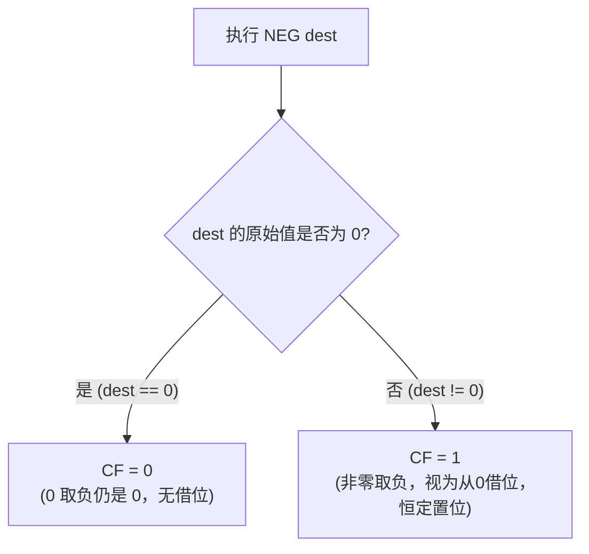

```nasm
mov eax, 0
neg eax                     ; EAX 仍为 0，CF = 0

mov eax, 5
neg eax                     ; EAX = -5，CF = 1
```

### 3. 补码体系下的特殊边界情况：最小负数无法被 NEG 正确取反

这是一个极易被忽视、却在安全审计中屡见不鲜的整数溢出陷阱：**在补码表示法下，最小的负数取负后会发生溢出，结果仍是它本身**。

```nasm
mov eax, 0x80000000         ; 32 位补码下的最小负数 (即 -2147483648)
neg eax                      ; 期望得到 +2147483648，但这超出了 32 位有符号数的表示范围！
; 实际结果: EAX 仍然是 0x80000000 (-2147483648 保持不变)，同时 OF 被置为 1，提示发生了溢出
```

这正是著名的"**INT_MIN 取负溢出**"问题在汇编层面的直接体现——补码的表示范围是非对称的（$-2^{N-1}$ 到 $2^{N-1}-1$），最小负数没有与之对应的正数可以落在同一位宽内表示。

---

## 五、 MUL 与 IMUL：乘法指令的隐式寄存器绑定

### 1. MUL：无符号乘法的固定寄存器模式

`MUL`（Unsigned Multiply）是一条**单操作数**指令，它隐式地将操作数与 `AL`/`AX`/`EAX`/`RAX`（取决于操作数位宽）相乘，并将结果强制写入一组固定的寄存器组合：

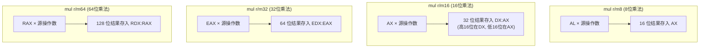

```nasm
mov eax, 1000
mov ebx, 2000
mul ebx                   ; EDX:EAX = EAX * EBX = 2,000,000
                           ; 由于结果未超出32位，EDX 此时为 0
```

### 2. IMUL：有符号乘法及其更灵活的三种编码形式

`IMUL`（Signed Multiply）在语义上处理有符号数乘法，但它比 `MUL` 更为"现代化"——除了保留与 `MUL` 对称的单操作数隐式形式外，还额外提供了**双操作数**和**三操作数**两种更灵活、不污染 `EAX`/`EDX` 的编码形式：

```nasm
; 形式一: 单操作数 (与 MUL 对称，隐式使用 AL/AX/EAX/RAX，结果写入 AX/DX:AX/EDX:EAX/RDX:RAX)
imul ebx                 ; EDX:EAX = EAX * EBX (有符号)

; 形式二: 双操作数 (结果直接写回第一个寄存器操作数，不触碰 EAX/EDX，截断丢弃高位)
imul eax, ebx              ; EAX = EAX * EBX (仅保留低 32 位结果，忽略溢出的高位)

; 形式三: 三操作数 (目的寄存器、源操作数、立即数，最灵活，编译器最常用)
imul eax, ebx, 10           ; EAX = EBX * 10
```

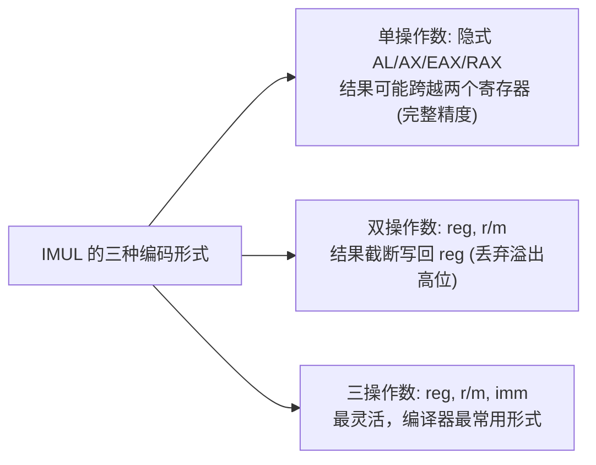

**编译器在处理高级语言中的普通乘法表达式（如 `c = a * b`）时，几乎总是优先选择双操作数或三操作数形式的 `IMUL`**，因为这两种形式语义清晰、不会像单操作数 `MUL`/`IMUL` 那样强制污染 `EDX` 寄存器（这在 `EDX` 被用作其他用途时会带来额外的保存/恢复开销）。

### 3. 为什么有符号乘法和无符号乘法需要不同的指令

这是一个常见的困惑点：乘法难道不是"无论有符号无符号，底层算法都一样"吗？**事实上，只要结果位宽不超过操作数位宽的加和（即不发生截断），`MUL` 和 `IMUL` 产生的底层比特模式确实完全相同**。两者真正的差异体现在：
* **标志位的判定条件不同**：`MUL` 根据乘积的高位部分是否为 0 来设置 `CF`/`OF`（用于检测"无符号乘法结果是否超出了低位寄存器的容纳范围"）；`IMUL` 则根据乘积的高位部分是否是低位部分符号位的完美延伸来判定溢出。
* **IMUL 提供的截断形式需要有符号语义**：双操作数/三操作数的 `IMUL` 在截断高位时，依然遵照有符号数的运算规则来设置溢出标志。

---

## 六、 DIV 与 IDIV：除法指令与异常处理

### 1. 基本语义与隐式寄存器组合

除法指令同样是单操作数形式，且隐式绑定的寄存器组合与乘法完全对称，只是角色互换——**此次是用一个双倍宽度的被除数（跨两个寄存器），除以一个单倍宽度的除数**：

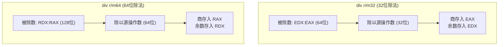

```nasm
mov eax, 100              ; 被除数低位
xor edx, edx                ; 必须手动清零 EDX! (否则 EDX:EAX 会把 EDX 中的垃圾值也算进被除数)
mov ebx, 7
div ebx                      ; EAX = 100 / 7 = 14 (商)，EDX = 100 % 7 = 2 (余数)
```

### 2. 极易踩坑的细节：必须手动初始化 EDX/RDX

这是除法指令中最常见的新手错误。由于被除数是**跨两个寄存器拼接而成的双倍宽度数值**，如果在执行普通的无符号 32 位除法前忘记将 `EDX` 清零，`EDX` 中残留的任意垃圾值都会被当作被除数的高 32 位参与运算，导致除法结果完全错误（通常还会直接触发下面提到的除法错误异常）：

```nasm
; 错误示范: 忘记清空 EDX
mov eax, 100
mov ebx, 7
div ebx                   ; 危险! EDX 中可能残留上一次运算的垃圾值，
                           ; 实际参与运算的被除数可能是一个巨大的错误数值
```

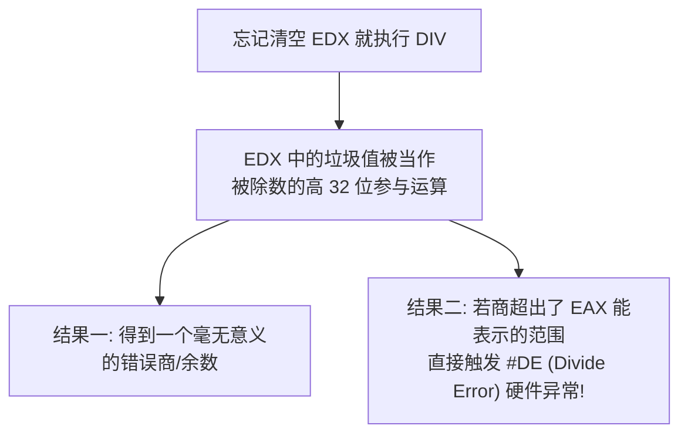

### 3. IDIV 中符号扩展的正确做法：CDQ / CQO 指令

对于**有符号除法**，正确的高位初始化方式不是简单的清零，而是需要对低位部分执行**符号扩展**，将符号位正确地铺展到高位寄存器中。x86 专门为此提供了配套的符号扩展指令：


```nasm
mov eax, -100             ; 被除数 (有符号)
cdq                          ; 关键一步! 将 EAX 的符号位扩展铺满整个 EDX
                              ; 若 EAX 为负数，CDQ 后 EDX 全为 0xFFFFFFFF；若为正数，EDX 全为 0
mov ebx, 7
idiv ebx                     ; EAX = -100 / 7 = -14 (商，向零截断)，EDX = -100 % 7 = -2 (余数)
```

**绝不能用 `xor edx, edx` 来处理有符号除法的高位初始化**——这只适用于被除数已知为非负数的情况。如果被除数是负数却用零清空 `EDX`，等同于把一个负数错误地解读成了一个巨大的正数，必然得到完全错误的商和余数。

### 4. 除法硬件异常：#DE (Divide Error)

除法指令存在两种会触发 CPU 硬件异常（中断向量号 0，`#DE`）的情况，这是算术指令家族中唯一会直接导致程序崩溃（若无异常处理机制介入）的指令类别：

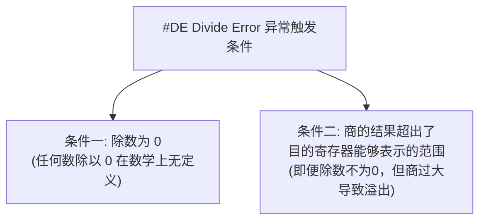

```nasm
mov edx, 0
mov eax, 100
mov ebx, 0
div ebx                   ; 触发 #DE: 除数为零

mov edx, 1                 ; 故意设置一个很大的高位
mov eax, 0
mov ebx, 1
div ebx                     ; 触发 #DE: 商 (0x100000000) 超出了 EAX 的 32 位容量
```

在用户态程序中，这个硬件异常通常被操作系统转换为 **`SIGFPE`（Linux）** 或相应的结构化异常（Windows 的 `EXCEPTION_INT_DIVIDE_BY_ZERO`）信号投递给进程，这也是"除零错误"这一经典运行时崩溃现象在底层硬件上的真实来源。

---

## 七、 BCD 运算指令概览（历史遗留特性）

### 1. 什么是 BCD 编码

**BCD（Binary-Coded Decimal，二进制编码的十进制）** 是一种用 4 个二进制位（半字节）表示一位十进制数字（0~9）的编码方式，常见于早期需要精确十进制运算的财务与计算器类应用（避免二进制浮点数表示十进制小数时的精度误差）。

### 2. x86 提供的 BCD 调整指令家族

在 32 位及以前的模式中，x86 提供了一组专门在普通二进制算术指令之后"修正"结果使其符合 BCD 编码规则的辅助指令：

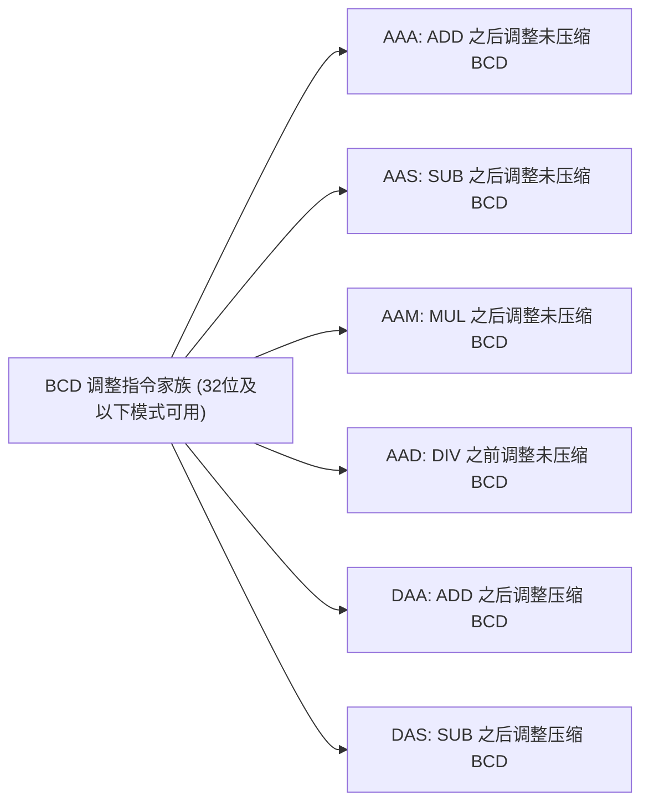

```nasm
; 未压缩 BCD 加法示例 (每个字节存放一位十进制数字，高4位置0)
mov al, 0x05            ; 代表十进制数字 5
add al, 0x07              ; 代表十进制数字 7，二进制加法结果为 0x0C (并非合法 BCD)
aaa                         ; 调整后: AL 变为 0x02，AH 自动加 1 (进位)，代表十进制 "12"
```

### 3. 重要事实：64 位长模式已彻底移除 BCD 指令

**这是一个极易让学习者感到意外的事实**：`AAA`、`AAS`、`AAM`、`AAD`、`DAA`、`DAS` 这整组指令，**在 x86-64 的 64 位长模式下已被完全移除，执行会直接触发 `#UD`（无效操作码）异常**。它们只能在 32 位兼容模式或更早的传统模式下使用。

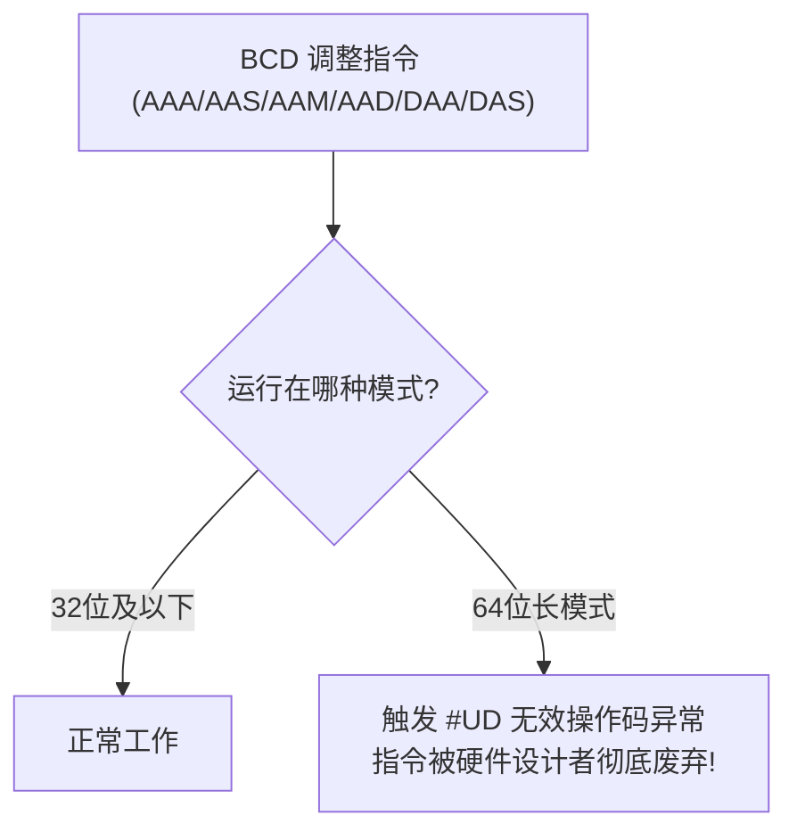

这一废弃决策反映了现代处理器设计的取舍哲学：**BCD 运算在现代软件中已经极为罕见**（现代财务计算普遍改用软件层面的高精度十进制库，或直接使用整数以最小货币单位——如"分"——进行运算，从根本上避免精度问题），继续在硬件中维护这组指令的译码电路和晶体管开销已不再具有性价比，因此在设计全新的 64 位指令集时被彻底淘汰。

---

## 八、 实战演练：综合验证算术指令家族

### 1. 源码：`arithmetic_demo.asm`

```nasm
default rel
global _start

section .text
_start:
    ; 1. 验证 ADD/SUB 的 CF 与 OF 独立性
    mov al, 0xFF
    add al, 1                  ; AL=0x00, CF=1(无符号溢出), OF=0(有符号未溢出)

    mov al, 0x7F
    add al, 1                   ; AL=0x80, CF=0(无符号未溢出), OF=1(有符号溢出)

    ; 2. 验证 ADC 实现 128 位加法
    mov rax, 0xFFFFFFFFFFFFFFFF  ; 低64位: 全 1 (接近溢出边界)
    mov rdx, 0x0000000000000001  ; 高64位: 1
    mov rbx, 0x0000000000000001  ; 加数低64位: 1 (将触发进位)
    mov rcx, 0x0000000000000000  ; 加数高64位: 0
    add rax, rbx                  ; 低位相加，产生进位 CF=1，RAX 变为 0
    adc rdx, rcx                   ; 高位相加并叠加进位: RDX = 1+0+1 = 2

    ; 3. 验证 INC 不影响 CF
    clc                            ; 显式清零 CF
    mov al, 0xFF
    inc al                          ; AL 变为 0，ZF=1，但 CF 依然保持为 0!

    ; 4. 验证 NEG 对最小负数的溢出行为
    mov eax, 0x80000000            ; 32位最小有符号负数
    neg eax                         ; 结果仍是 0x80000000, OF 被置为 1

    ; 5. 验证 MUL 与 IMUL 的隐式寄存器
    mov eax, 50000
    mov ebx, 60000
    mul ebx                         ; EDX:EAX = 50000*60000 = 3,000,000,000 (超出32位，EDX非零)

    ; 6. 验证 DIV 与 CDQ 配合实现有符号除法
    mov eax, -100
    cdq                              ; 符号扩展 EAX 到 EDX:EAX
    mov ebx, 7
    idiv ebx                          ; EAX = -14 (商), EDX = -2 (余数)

    ; 正常退出
    mov eax, 60
    xor edi, edi
    syscall
```

### 2. 编译链接与 GDB 验证

```bash
nasm -f elf64 -g -F dwarf arithmetic_demo.asm -o arithmetic_demo.o
ld arithmetic_demo.o -o arithmetic_demo
gdb -q ./arithmetic_demo
```

```text
pwndbg> b *_start+70
pwndbg> r
pwndbg> info registers rax rdx
rax            0x2         2           # 验证 128 位加法: 低位结果 (RAX=0)已被覆盖，继续往下看 rdx
rdx            0x2         2           # 验证 128 位加法: 高位正确累加了进位 (1+0+1=2)

pwndbg> ni 5
pwndbg> info registers rax rdx
rax            0xfffffff2  -14          # 验证 IDIV 商: -100/7 = -14
rdx            0xfffffffe  -2           # 验证 IDIV 余数: -100%7 = -2
```

---

## 九、 本章小结

1. **ADD/SUB 全量刷新标志位**，其中 `CF` 服务于无符号数溢出判定，`OF` 服务于有符号数溢出判定，二者互不相干甚至可能给出相反结论。
2. **ADC/SBB 通过隐式读取 `CF` 实现跨寄存器的进位/借位传递**，是突破原生寄存器位宽、实现任意精度大数运算的基石；使用前必须用 `clc` 显式初始化 `CF`。
3. **INC/DEC 刻意不触碰 `CF`**，这是为了保护多精度运算的进位链不被循环计数器等无关操作意外破坏，是 x86 指令集中一个极具针对性的历史设计细节。
4. **NEG 在补码体系下存在最小负数无法正确取负的固有缺陷**，取负后结果保持不变并置位 `OF`，这是整数安全审计中的常见检查点。
5. **MUL/IMUL 与 DIV/IDIV 均隐式绑定 `AL/AX/EAX/RAX` 及其高位搭档 `AH/DX/EDX/RDX`**；执行除法前必须根据有符号/无符号语义正确初始化高位（`xor` 清零或 `cdq`/`cqo` 符号扩展），否则极易触发 `#DE` 硬件异常或得到错误结果。
6. **BCD 调整指令是已被 64 位长模式彻底淘汰的历史遗留特性**，仅在 32 位及以下兼容模式中可用，反映了现代处理器设计中"性价比优先"的指令集演化取舍。

在下一篇文章中，我们将继续学习算术运算的另一半——**逻辑、位运算与移位指令**，系统拆解 `AND`/`OR`/`XOR`/`NOT` 与 `SHL`/`SHR`/`SAR`/`ROL`/`ROR` 的语义细节及其在位掩码、哈希算法中的经典应用。