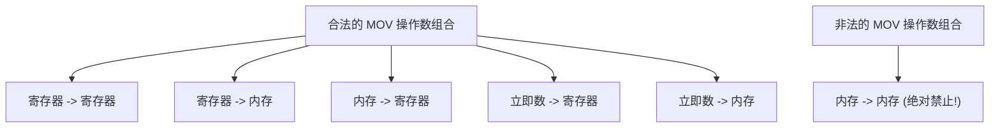
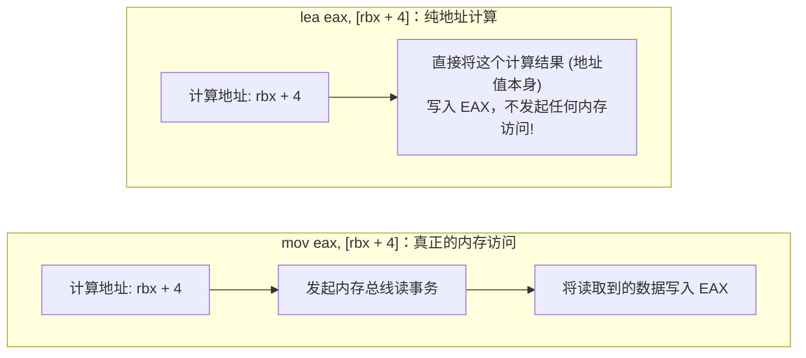
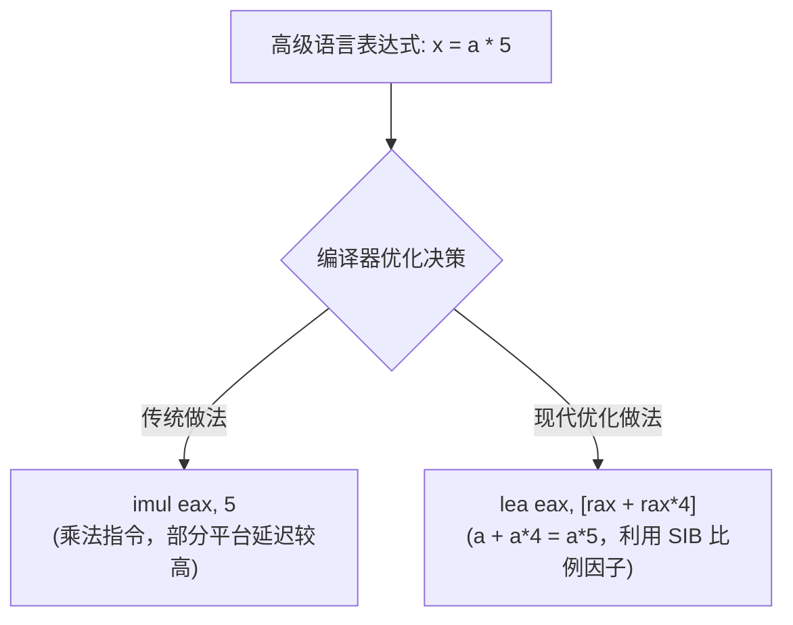
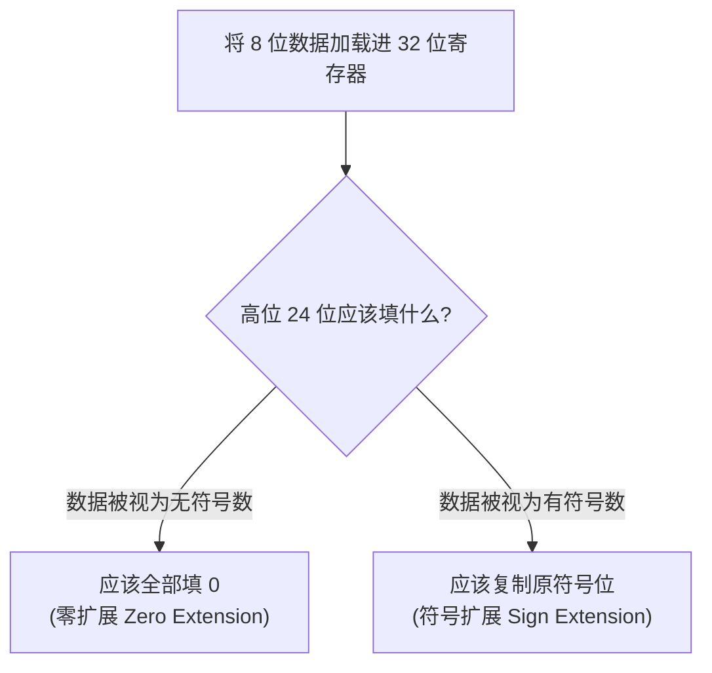
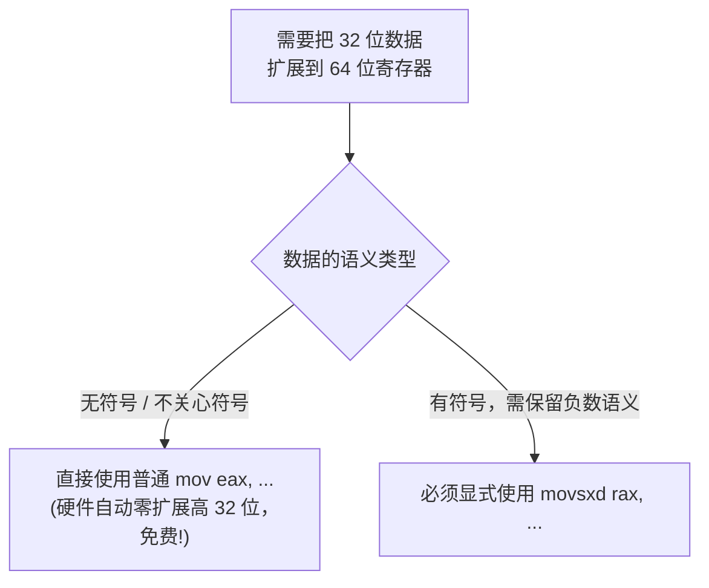
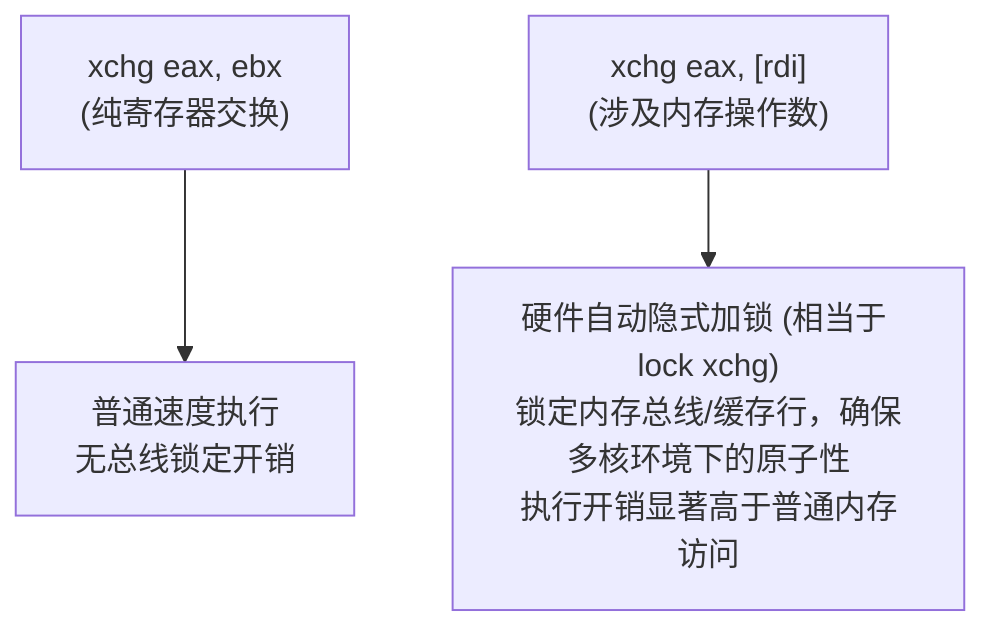
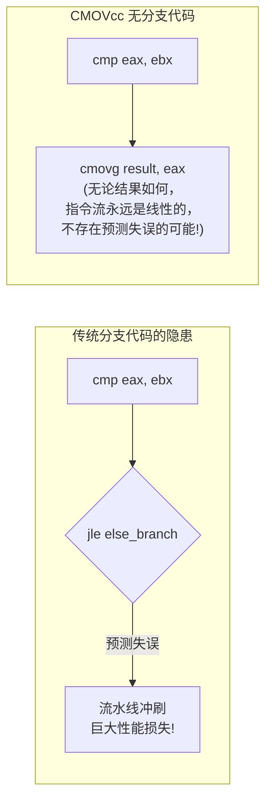
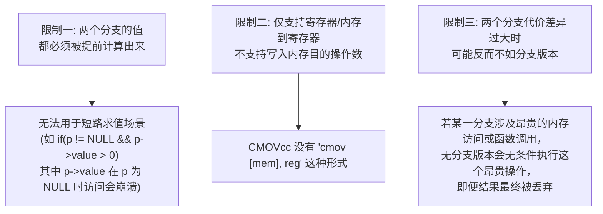

数据传送指令是汇编语言中使用频率最高的一类指令——几乎每一段程序逻辑的执行都离不开"把数据从一个地方搬到另一个地方"。然而，这类看似简单的操作背后，隐藏着许多容易被忽视的硬件限制、编码规则与性能陷阱。

本篇将系统拆解五类核心数据传送指令：**`MOV`（通用传送）、`LEA`（地址计算）、`MOVZX`/`MOVSX`/`MOVSXD`（位宽扩展传送）、`XCHG`（原子交换）** 以及 **`CMOVcc`（条件传送）**，并结合编译器实际生成的汇编模式，理解它们各自的适用边界。

---

## 一、 MOV：最基础也最受限的传送指令

### 1. 核心限制：内存不能直接到内存

`MOV` 虽然支持寄存器、内存、立即数之间的多种组合，但存在一条硬件层面的铁律：**源操作数和目的操作数不能同时都是内存**。



```nasm
mov eax, ebx            ; 合法: 寄存器 -> 寄存器
mov [rdi], eax           ; 合法: 寄存器 -> 内存
mov eax, [rsi]           ; 合法: 内存 -> 寄存器
mov eax, 100              ; 合法: 立即数 -> 寄存器
mov dword [rdi], 100      ; 合法: 立即数 -> 内存

; mov [rdi], [rsi]        ; 非法! 汇编器会直接报错，内存不能直接到内存
```

### 2. 为什么硬件不支持内存到内存？

这并非编码空间不足，而是源于 x86 指令集的历史设计哲学：**每条指令通常只允许访问一次内存操作数**。如果允许一条指令同时读一次内存、写一次内存，会让地址生成单元（AGU）和指令流水线的设计复杂度大幅上升（需要在一条指令内完成两次独立的地址计算和两次总线事务）。

因此，若要实现"内存到内存"的拷贝，必须**借助一个寄存器作为临时中转站**：

```nasm
; 将 [rsi] 处的数据拷贝到 [rdi] 处，必须经过寄存器中转
mov eax, [rsi]            ; 第一步: 内存 -> 寄存器
mov [rdi], eax             ; 第二步: 寄存器 -> 内存
```

> **延伸说明**：x86 确实提供了 `MOVS`（Move String）系列指令（`movsb`/`movsw`/`movsd`/`movsq`），它们看起来像是"一条指令完成内存到内存的拷贝"。但从微架构的角度看，这类指令内部依然被硬件拆解为多个微操作（先读后写），只是在指令编码和使用体验层面对程序员屏蔽了中间寄存器的存在。这部分内容将在后续的字符串指令专题中详细展开。

### 3. 位宽推断与显式限定符

正如前面寻址模式章节所述，当 `MOV` 的操作数双方都不携带位宽信息时（例如立即数写入纯内存地址），必须显式声明位宽：

```nasm
mov eax, [rbx]             ; 不需要限定符: eax 已经暗示了 32 位
mov [rbx], eax               ; 不需要限定符: eax 已经暗示了 32 位
mov dword [rbx], 100         ; 必须显式声明: 立即数与裸内存地址都不带位宽信息
```

### 4. 段寄存器与特殊寄存器的 MOV 限制

`MOV` 还存在一些针对特殊寄存器类别的隐藏规则：

```nasm
mov ds, ax                 ; 合法: 可以用通用寄存器给段寄存器赋值
; mov ds, 0x10             ; 非法! 段寄存器不能直接接收立即数
mov ax, cs                  ; 合法: 可以读取段寄存器的值
; mov cs, ax                ; 非法! CS 寄存器不能通过 mov 直接写入，只能通过远跳转/远调用间接修改
```

**`CS`（代码段寄存器）是唯一一个无法通过 `mov` 直接写入的段寄存器**——因为直接修改 `CS` 意味着立即改变当前取指的代码段上下文，这必须通过 `jmp far`、`call far`、中断返回等明确的控制转移指令来完成，不能通过普通数据传送指令"偷偷"篡改。

---

## 二、 LEA：计算地址而非访问内存

### 1. 核心语义：LEA 不读内存，只做地址运算

`LEA`（Load Effective Address，装载有效地址）是一条极易被误解的指令。它的语法看起来和内存寻址一模一样，但**它的本质是一个纯粹的加法/乘法运算器，完全不会真正去访问内存总线**。



```nasm
mov eax, [rbx + 4]          ; 读取内存地址 (rbx+4) 处的数据，存入 EAX
lea eax, [rbx + 4]          ; 计算 (rbx+4) 这个数值本身，存入 EAX (不触碰内存!)
```

### 2. C 语言视角的直观理解

```c
int *p = &array[i];     // 取地址运算 -> 对应 LEA
int  v = array[i];      // 解引用取值运算 -> 对应 MOV
```

```nasm
lea rax, [rsi + rcx*4]       ; RAX = &array[i]  (等价于 C 中的取地址 &)
mov eax, [rsi + rcx*4]       ; EAX = array[i]   (等价于 C 中的解引用 *)
```

### 3. 编译器的经典用法：借用 SIB 实现"免费乘加"

由于 `LEA` 的操作数解析完全复用了内存寻址公式 $\text{Base} + \text{Index} \times \text{Scale} + \text{Disp}$，编译器经常"滥用"它来执行与内存访问毫不相关的纯算术运算，这是一种极其常见且高效的优化手段：



```nasm
; x = a * 5  等价于  x = a + a*4
lea eax, [rax + rax*4]       ; EAX = a*5 (比例因子仅支持 1/2/4/8，这里用 *4 凑出 *5)

; x = a * 3
lea eax, [rax + rax*2]       ; EAX = a*3 (a + a*2)

; x = a * 9
lea eax, [rax + rax*8]       ; EAX = a*9 (a + a*8)

; x = a + b + 10 (三元加法，一条指令完成!)
lea eax, [rax + rbx + 10]    ; EAX = a + b + 10
```

**这种技巧之所以有效，是因为地址生成单元（AGU）与算术逻辑单元（ALU）在物理上是两套独立的硬件电路**，现代超标量 CPU 可以将 `LEA` 指令派发给 AGU 并行执行，与 ALU 正在处理的其他运算完全不冲突，从而提升指令级并行度（ILP）。

### 4. 关键特性：LEA 绝不修改标志寄存器

与 `add`、`sub` 等真正的算术指令不同，**`LEA` 无论执行何种加法或乘法运算，都完全不会触碰 RFLAGS 寄存器的任何标志位**。这是它区别于"看起来等价"的算术指令的本质特征：

```nasm
cmp eax, ebx                 ; 设置好一组标志位 (假设接下来要根据这些标志位跳转)
lea ecx, [eax + ebx*2]       ; 借用 LEA 计算一个临时值，完全不会破坏上面 cmp 产生的标志位!
jg  greater_branch            ; 依然能正确地根据之前 cmp 的结果跳转
```

这使得 `LEA` 在需要"顺便计算一个值，但又不能打扰当前标志位状态"的场景中（例如条件判断与地址计算紧邻的代码段）具有不可替代的价值。

### 5. LEA 在 64 位下结合 RIP 相对寻址

正如前面文章所述，`LEA` 也是获取全局变量/字符串地址的标准手段，并天然支持 RIP 相对寻址：

```nasm
default rel
lea rax, [rel my_global_var]   ; RAX = &my_global_var (位置无关的地址获取方式)
```

---

## 三、 MOVZX、MOVSX 与 MOVSXD：位宽扩展传送

当源操作数的位宽小于目的寄存器的位宽时，普通的 `MOV` 无法正确处理高位的填充问题，必须使用专门的扩展传送指令。

### 1. 为什么需要专门的扩展指令



一个 8 位数值 `0x8F`：
* 若按**无符号数**解读，其值为 `143`，扩展到 32 位应得到 `0x0000008F`（高位补 0）。
* 若按**有符号数**解读，`0x8F` 的最高位为 1，代表负数（`-113`），扩展到 32 位应得到 `0xFFFFFF8F`（高位补 1，保持数值不变）。

**普通的 `MOV` 指令根本不存在"同时读取一个小尺寸内存、写入一个大尺寸寄存器"的编码形式**，因此必须依赖专门指令来显式指定扩展策略。

### 2. MOVZX（零扩展）

```nasm
movzx eax, byte [rsi]        ; 读取 1 字节，零扩展至 32 位 (无符号语义)
movzx eax, word [rsi]        ; 读取 2 字节，零扩展至 32 位
movzx rax, byte [rsi]        ; 读取 1 字节，零扩展至 64 位
```

适用场景：当源数据的 C 语言类型是 `unsigned char`、`uint8_t`、`unsigned short` 等无符号小整数时。

### 3. MOVSX 与 MOVSXD（符号扩展）

```nasm
movsx eax, byte [rsi]        ; 读取 1 字节，符号扩展至 32 位 (有符号语义)
movsx eax, word [rsi]        ; 读取 2 字节，符号扩展至 32 位
movsxd rax, dword [rsi]      ; 读取 4 字节，符号扩展至 64 位 (64 位模式专属指令)
```

适用场景：当源数据的 C 语言类型是 `char`、`int8_t`、`short`、`int16_t` 等有符号小整数时。

> **注意 `MOVSXD` 的特殊地位**：从 32 位扩展到 64 位的符号扩展操作（`dword -> qword`）拥有一条独立命名的指令 `MOVSXD`，而不是简单复用 `MOVSX` 的编码。这是因为 64 位模式下的指令编码空间分配历史遗留所致——`MOVSX` 原本的操作码空间在 64 位模式下被赋予了新的含义，因此需要单独的 `MOVSXD` 操作码来承载"32 位到 64 位"这一扩展路径。

### 4. 一个容易被忽视的事实：32 位到 64 位的"零扩展"不需要专门指令

回忆前面寄存器章节讲过的硬件铁律：**在 64 位模式下，任何对 32 位寄存器切片的写入，都会自动将对应 64 位寄存器的高 32 位清零**。这意味着：

```nasm
mov eax, [rsi]              ; 读取 4 字节到 EAX
; 此时 RAX 的高 32 位已经被硬件自动清零，等价于完成了一次"32位到64位的零扩展"!
; 完全不需要写类似 "movzx rax, dword [rsi]" 这样的指令 (事实上这种编码也不存在)
```

**没有 `movzx reg64, dword mem` 这样的指令形式**，因为它根本没有存在的必要——普通的 `mov eax, ...` 已经免费附带了这个效果。只有当你明确需要**符号扩展**（保留负数语义）到 64 位时，才需要特意使用 `movsxd`。



### 5. 完整扩展指令矩阵速查

| 源位宽 \ 目的位宽 | 16 位 | 32 位 | 64 位 |
| :--- | :--- | :--- | :--- |
| **8 位，无符号** | `movzx r16, r/m8` | `movzx r32, r/m8` | `movzx r64, r/m8` |
| **8 位，有符号** | `movsx r16, r/m8` | `movsx r32, r/m8` | `movsx r64, r/m8` |
| **16 位，无符号**| — | `movzx r32, r/m16`| `movzx r64, r/m16`|
| **16 位，有符号**| — | `movsx r32, r/m16`| `movsx r64, r/m16`|
| **32 位，无符号**| — | — | 直接用 `mov r32, r/m32`（高位自动清零） |
| **32 位，有符号**| — | — | `movsxd r64, r/m32` |

---

## 四、 XCHG：原子交换与隐式总线锁

### 1. 基本语义

`XCHG`（Exchange）用于交换两个操作数的值，其效果等价于借助一个临时变量完成的三步交换，但由硬件原子地一步完成：

```nasm
xchg eax, ebx                ; 等价于: temp=eax; eax=ebx; ebx=temp (但是硬件原子完成)
xchg eax, [rdi]                ; 交换寄存器与内存中的值
```

### 2. 隐式总线锁定：内存操作数带来的沉重代价

这是 `XCHG` 最关键也最容易被忽视的特性：**当 `XCHG` 的其中一个操作数是内存地址时，该指令会自动附带相当于 `LOCK` 前缀的总线锁定效果，即便你没有显式书写 `LOCK` 关键字**。



```nasm
xchg eax, ebx                 ; 快速：纯寄存器间交换，无需考虑多核竞争
xchg eax, [shared_counter]    ; 缓慢：隐式总线锁，专为多线程原子操作设计
```

这个"隐式加锁"特性正是 `XCHG` 在**多线程同步原语（如自旋锁 Spinlock 的实现）**中被广泛使用的根本原因——程序员无需显式编写 `lock` 前缀，即可获得跨核心安全的原子交换语义：

```nasm
; 一个最简化的自旋锁获取逻辑 (lock_flag: 0=未锁定, 1=已锁定)
acquire_lock:
    mov eax, 1
.retry:
    xchg eax, [lock_flag]     ; 原子地将 1 写入 lock_flag，并取出其交换前的旧值到 EAX
    test eax, eax               ; 检测旧值: 若旧值是 0，说明抢锁成功
    jnz .retry                   ; 若旧值是 1 (说明已被其他线程占用)，继续自旋重试
    ret
```

### 3. 历史彩蛋：NOP 与 XCHG 的渊源

前面章节提到过，`NOP` 指令的机器码 `0x90` 实际上是 `xchg eax, eax` 的别名编码——**一个寄存器与自身交换，逻辑上等价于什么都不做**，这正是硬件设计者巧妙复用已有编码空间的典型案例。

---

## 五、 CMOVcc：条件传送与无分支代码

### 1. 问题的起源：分支预测失败的高昂代价

正如标志寄存器章节所述，现代 CPU 依赖**分支预测器**提前猜测条件跳转的走向并进行投机执行。一旦猜错，流水线必须被彻底冲刷重来，带来十几到二十个时钟周期的惩罚。对于**数据高度随机、难以预测的条件分支**（例如对未排序数组进行条件求和），分支预测器的命中率会急剧下降，此时传统的 `cmp + jcc` 模式反而成为性能瓶颈。



### 2. CMOVcc 的基本语义

`CMOVcc` 系列指令（Conditional Move）会**始终无条件地从源操作数读取数据**，但只有当特定的标志位条件满足时，才会真正将这个值写入目的寄存器；条件不满足时，目的寄存器保持原值不变——**整个过程中不存在任何跳转，指令流永远是线性顺序执行的**。

```c
// C 语言的三目运算符，是 CMOVcc 最典型的编译目标
int max(int a, int b) {
    return (a > b) ? a : b;
}
```

```nasm
; 对应的无分支汇编实现 (假设 a 在 EDI，b 在 ESI)
max_func:
    mov   eax, edi          ; 预先假设结果是 a (先把 a 放入返回值寄存器)
    cmp   edi, esi            ; 比较 a 和 b
    cmovle eax, esi            ; 如果 a <= b (即 a 不是更大值)，则用 b 覆盖 eax
    ret                         ; 无论走哪条逻辑路径，全程没有一次条件跳转!
```

### 3. CMOVcc 完整条件码速查

`CMOVcc` 支持与条件跳转指令 `jcc` 完全相同的条件码体系：

```nasm
cmove  eax, ebx        ; 若 ZF=1 (相等) 则传送
cmovne eax, ebx        ; 若 ZF=0 (不相等) 则传送
cmovg  eax, ebx        ; 若有符号 > (SF=OF 且 ZF=0) 则传送
cmovl  eax, ebx        ; 若有符号 < (SF≠OF) 则传送
cmova  eax, ebx        ; 若无符号 > (CF=0 且 ZF=0) 则传送
cmovb  eax, ebx        ; 若无符号 < (CF=1) 则传送
```

### 4. CMOVcc 的使用限制与适用边界

`CMOVcc` 并非万能替代方案，使用时需要注意几个关键限制：



* **限制一：两个结果必须预先计算完毕**。这意味着 `CMOVcc` 不能替代涉及**短路求值**语义的逻辑（例如 C 语言中 `&&` 和 `||` 的短路特性，用于避免访问空指针）。
* **限制二：目的操作数只能是寄存器**。不存在能够直接条件性写入内存的 `CMOVcc` 形式。
* **限制三：权衡计算代价**。如果 `if` 分支和 `else` 分支中有一方包含代价极高的运算（如除法、内存访问、函数调用），强行使用无分支化反而可能更慢，因为 CPU 必须无条件执行两条路径的全部计算，再挑选其中一个结果丢弃另一个。

### 5. 编译器的自动决策

现代编译器（GCC/Clang/MSVC）在开启优化（`-O2` 及以上）时，会根据代码模式**自动判断**是否将简单的条件赋值语句转换为 `CMOVcc`，程序员通常无需手写：

```c
// 简单的条件选择，编译器大概率生成 CMOVcc
int result = (flag) ? value1 : value2;

// 涉及短路逻辑的条件，编译器必须保留真实分支
if (ptr != NULL && ptr->field > 0) { ... }
```

可以通过 Compiler Explorer（godbolt.org）实际观察不同条件表达式在开启 `-O2` 后，究竟被编译为 `cmovcc` 还是传统的 `cmp + jcc`，这是验证编译器优化决策的最佳实践方式。

---

## 六、 实战演练：五类传送指令综合验证

### 1. 源码：`data_transfer_demo.asm`

```nasm
default rel
global _start

section .data
    val8    db  0x8F            ; 有符号视角为 -113，无符号视角为 143
    val32   dd  0x12345678

section .bss
    result  resq 1

section .text
_start:
    ; 1. MOV: 寄存器与内存基础传送
    mov eax, [val32]            ; EAX = 0x12345678

    ; 2. LEA: 利用 SIB 实现 x*5 的"免费乘法"，验证不影响标志位
    cmp eax, 0                   ; 预先设置一组标志位 (ZF=0，因为 eax 非零)
    mov ebx, 10
    lea ecx, [rbx + rbx*4]       ; ECX = 10 + 10*4 = 50 (即 10*5)
    jnz .flags_preserved          ; 验证: 若 LEA 没有破坏标志位，这里应正常跳转
    jmp .flags_broken
.flags_preserved:
    mov r15, 1                   ; 标记: 标志位被正确保留
    jmp .continue
.flags_broken:
    mov r15, 0                   ; 标记: 标志位被意外破坏 (不应该发生)
.continue:

    ; 3. MOVZX / MOVSX: 对比零扩展与符号扩展的差异
    movzx edx, byte [val8]       ; EDX = 0x0000008F (143，零扩展)
    movsx r8d, byte [val8]       ; R8D = 0xFFFFFF8F (-113，符号扩展)

    ; 4. XCHG: 验证寄存器交换
    mov r9, 111
    mov r10, 222
    xchg r9, r10                 ; 交换后: R9=222, R10=111

    ; 5. CMOVcc: 无分支求两数最大值 max(r9, r10)
    mov   r11, r9                ; 预设结果为 r9
    cmp   r9, r10
    cmovl r11, r10                ; 若 r9 < r10，则用 r10 覆盖结果

    ; 正常退出
    mov eax, 60
    xor edi, edi
    syscall
```

### 2. 编译链接与 GDB 验证

```bash
nasm -f elf64 -g -F dwarf data_transfer_demo.asm -o data_transfer_demo.o
ld data_transfer_demo.o -o data_transfer_demo
gdb -q ./data_transfer_demo
```

```text
pwndbg> b *_start+60
pwndbg> r
pwndbg> info registers rax rbx rcx r15 rdx r8 r9 r10 r11
rax            0x12345678   305419896   # 验证 MOV
rcx            0x32         50          # 验证 LEA 的 x*5 乘法
r15            0x1          1           # 验证 LEA 未破坏标志位 (值应为 1)
rdx            0x8f         143         # 验证 MOVZX 零扩展结果
r8             0xffffff8f   -113        # 验证 MOVSX 符号扩展结果
r9             0xde         222         # 验证 XCHG 交换后的值
r10            0x6f         111         # 验证 XCHG 交换后的值
r11            0xde         222         # 验证 CMOVcc 求得的最大值 (max(111,222)=222)
```

---

## 七、 本章小结

1. **`MOV` 存在内存到内存的硬件铁律**：任何跨内存拷贝都必须借助寄存器中转；当操作数双方位宽信息不明确时，必须显式使用 `byte`/`word`/`dword`/`qword` 限定符消除歧义。
2. **`LEA` 是一台伪装成内存指令的纯算术运算器**：它从不真正访问内存，却因为复用了 SIB 寻址的乘加能力，成为编译器实现"免费乘法"（乘以 3/5/9 等常数）的经典优化手段，且绝不触碰标志寄存器。
3. **`MOVZX`/`MOVSX`/`MOVSXD` 三者各司其职**：零扩展用于无符号小整数，符号扩展用于有符号小整数；而 32 位到 64 位的零扩展无需专门指令，因为普通 `mov` 写入 32 位寄存器切片已自动免费附带此效果。
4. **`XCHG` 在涉及内存操作数时会隐式触发总线锁定**，这一特性使其成为实现自旋锁等底层同步原语的基石，但也意味着其开销远高于纯寄存器交换。
5. **`CMOVcc` 通过消除分支，彻底规避了分支预测失败的流水线冲刷代价**，是现代编译器处理简单条件赋值（如三目运算符）的首选优化策略，但不适用于涉及短路求值或分支代价悬殊的场景。

在下一篇文章中，我们将进入核心指令集的下一个关键模块——**算术运算指令**，系统学习 `ADD`/`SUB`/`MUL`/`DIV` 等指令的隐式寄存器绑定规则与标志位联动机制。