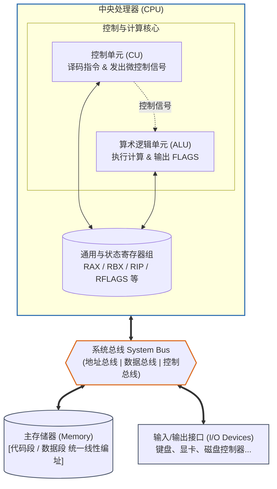
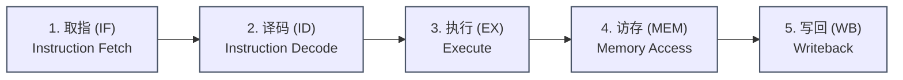
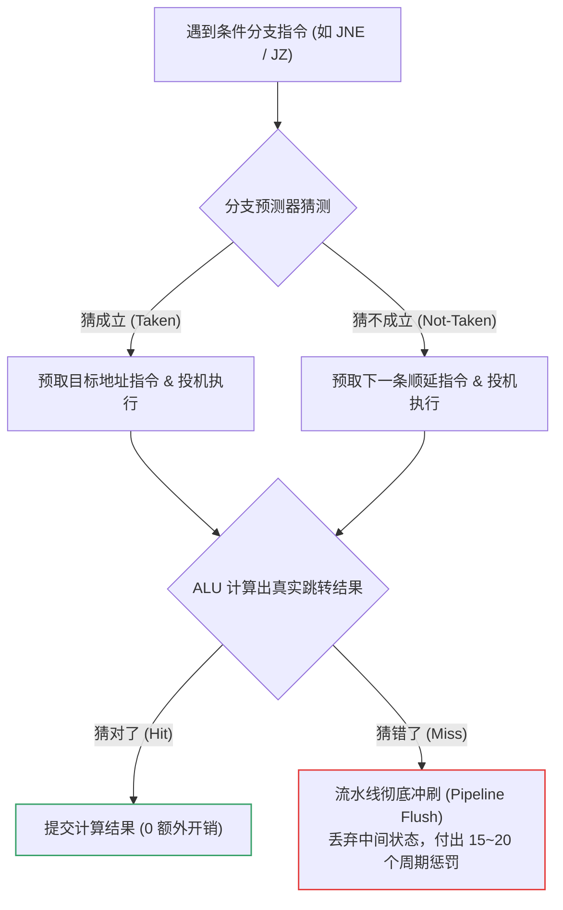
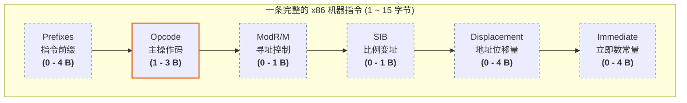

汇编语言并不是凭空捏造的高级语法，它是**物理硬件行为的字符化映射**。

写下一行 `mov eax, [ebx + 4]`，在软件工程师眼里是一次内存赋值；但在 CPU 眼里，它是一串高低电平触发的信号、一段总线通信、若干个时钟周期的寄存器状态流转。理解 CPU 是如何吞吐和解释机器码的，是真正掌握底层逆向、系统开发与性能调优的第一道门槛。

---

## 一、 冯·诺依曼结构与存储程序模型

现代通用计算机（包括所有标准的 x86/x86-64 PC 和服务器）在体系结构层面均奠基于**冯·诺依曼结构（von Neumann architecture）**。



### 1. 核心思想：存储程序（Stored-Program）
在冯·诺依曼结构之前，早期计算设备（如 ENIAC）执行新任务需要物理重新接线。冯·诺依曼提出了革命性的构想：
* **指令即数据**：指令与数据以相同的二进制形式存放在**同一片存储器（内存）**中。
* **线性统一编址**：无论是操作系统代码、用户数据、还是图片文本，在内存中都只是一串连续的字节序列。

### 2. 软件安全与底层编程的深远影响
因为“指令和数据在物理上没有本质区别”，CPU 只是机械地把 `CS:IP / RIP` 指向的内存当成指令执行：
* **代码注入（Shellcode）**：黑客将一段原本是用户输入的数据写入内存，如果诱导 CPU 将指令指针跳转到该数据区，数据便会被当作代码执行。
* **硬件级防护演进**：为了应对这一问题，现代 x86 CPU 引入了 **NX/XD 位（No-Execute / Execute-Disable）**，配合操作系统实现 **W^X（Write XOR Execute，即不可同时具有写和执行权限）**，强行在逻辑上划分数据与代码。
* **哈佛结构（Harvard Architecture）修正**：虽然 x86 宏观上是冯·诺依曼架构，但**在 CPU 芯片内部实际上采用了“修正的哈佛结构”**——L1 缓存物理上分离为 **L1i（指令缓存）** 与 **L1d（数据缓存）**，以此消除取指和访存对总线的争抢。

---

## 二、 硬件中枢：ALU、控制单元、时钟与总线

CPU 并不是一个单一的黑盒，它由数个高度特化的功能单元协同工作：

### 1. 算术逻辑单元（ALU, Arithmetic Logic Unit）
* **职责**：负责所有实际的运算工作。
  * **算术运算**：加（ADD）、减（SUB）、带进位加（ADC）、乘、除。
  * **逻辑运算**：与（AND）、或（OR）、异或（XOR）、非（NOT）、位移（SHL/SHR）。
* **标志位输出**：ALU 每次运算后，会将状态反映到 **FLAGS/EFLAGS/RFLAGS** 寄存器上（如溢出 OF、符号 SF、结果为零 ZF、进位 CF），成为后续条件跳转指令（`jz`, `jge` 等）的判断依据。

### 2. 控制单元（CU, Control Unit）
* **职责**：CPU 的“指挥中枢”。
* **工作机制**：负责从内存中抓取指令，译解出指令的意图，随后向 ALU、寄存器、总线接口发出相应的**微控制信号**（如“允许写入 RAX”、“将总线数据送到 ALU 端口 A”）。

### 3. 系统时钟（Clock）与主频
* CPU 内部由同步时钟信号驱动。晶振产生稳定频率的高低电平交替脉冲（方波）。
* **时钟周期（Clock Cycle）**：CPU 执行操作的最小时间基准单位。
  $$\text{主频} = 3.0\text{ GHz} \implies 1 \text{ 周期} \approx 0.33 \text{ 纳秒 (ns)}$$
* **IPC（Instructions Per Cycle）**：现代 CPU 依靠多核与超标量架构，一个周期内能够并行退休（Retire）多条指令。因此：
  $$\text{性能} = \text{时钟主频} \times \text{IPC}$$

### 4. 三大总线系统（Bus System）
CPU 与外部组件（内存、北桥/南桥/PCH、PCIe 外设）通过三类物理连线交互：

| 总线类别 | 传输内容 | 物理宽度决定了什么？ |
| :--- | :--- | :--- |
| **地址总线 (Address Bus)** | CPU 要访问的内存/IO 物理地址 | **最大寻址空间**。<br>• 8086（20位）：$2^{20} = 1\text{ MB}$<br>• 32位 x86（32位）：$2^{32} = 4\text{ GB}$<br>• x86-64（目前通常为 48/57位）：数十 TB 到数 PB |
| **数据总线 (Data Bus)** | 实际读取或写入的二进制数据 | **单次内存传输位宽**。<br>64位 CPU 一次内存读取周期（Memory Transaction）物理线路上传输 64 位数据。 |
| **控制总线 (Control Bus)** | 控制信号（读/写、就绪、中断、总线锁） | 协调设备同步，发送 `MEMR`（读内存）、`MEMW`（写内存）、`INTR`（外部中断）等信号。 |

---

## 三、 指令执行周期与流水线（Pipeline）

CPU 执行每一条指令，都在周而复始地进行一个称为 **指令周期（Instruction Cycle）** 的状态机循环。



### 1. 经典五阶段模型分解
以指令 `add dword ptr [rbx], eax` 为例：

1. **取指（Instruction Fetch, IF）**：
   * 控制单元将 `RIP` 寄存器中的地址送上地址总线。
   * 从 L1 指令缓存（或内存）中读取机器码字节序列。
   * 更新 `RIP`，使其指向下一条候选指令。
2. **译码（Instruction Decode, ID）**：
   * 译码器拆解这串机器码，分析出操作类型（ADD）、目的操作数（内存地址 `[rbx]`）、源操作数（寄存器 `eax`）。
   * 现代 x86 CPU 会在此阶段将 CISC 的“宏指令”切碎拆解成若干条类 RISC 的 **微操作（$\mu$-ops）**。
3. **执行（Execute, EX）**：
   * 计算有效地址（`rbx` 内的值），ALU 准备好加法运算电路。
4. **访存（Memory Access, MEM）**：
   * 发起数据总线读事务，将内存 `[rbx]` 处的原有数值读入 CPU 内部的临时锁存器。
   * ALU 将该数据与 `eax` 执行相加，并生成状态标志。
5. **写回（Writeback, WB）**：
   * 将计算结果通过总线写回内存 `[rbx]`。
   * 将产生的新标志位更新至 RFLAGS。

---

### 2. 指令流水线（Pipelining）与分支预测

如果必须等一条指令彻底完成 WB 阶段才开始下一条指令的 IF，硬件利用率将极其低下。流水线将不同指令的处理阶段在时间上重叠：

```mermaid
gantt
    title 经典 5 级流水线时序重叠示意 (无气泡状态)
    dateFormat X
    axisFormat 时钟周期 %s
    section 指令 1
    IF 取指   :0, 1
    ID 译码   :1, 2
    EX 执行   :2, 3
    MEM 访存  :3, 4
    WB 写回   :4, 5
    section 指令 2
    IF 取指   :1, 2
    ID 译码   :2, 3
    EX 执行   :3, 4
    MEM 访存  :4, 5
    WB 写回   :5, 6
    section 指令 3
    IF 取指   :2, 3
    ID 译码   :3, 4
    EX 执行   :4, 5
    MEM 访存  :5, 6
    WB 写回   :6, 7
```



#### 流水线面临的三大挑战（Hazards，冒险）：
1. **结构冒险（Structural Hazard）**：两个阶段同时争用同一个硬件资源（如两个阶段同时想要访问同一份内存，内部哈佛结构解决了此问题）。
2. **数据冒险（Data Hazard / RAW）**：后面的指令需要使用前一条指令还未写回的结果。
   * *优化手段*：**旁路转发技术（Forwarding/Bypassing）**，ALU 计算刚完成就直接将输出引脚连入下一个 ALU 的输入端，无需等待写回寄存器。
3. **控制冒险（Control Hazard / 分支惩罚）**：遇到条件跳转指令（`jne`、`call`），CPU 在译码甚至执行完之前不知道下一条指令该取谁。



---

## 四、 机器码（Opcode）与助记符的映射全貌

汇编语言是人类书写的符号，而机器只认**字节码（Bytecode）**。编译器（汇编器）所做的核心工作，就是将文本形式的**助记符（Mnemonic）**无损地查表转码为符合 x86 硬件解码规范的二进制串。

### 1. 概念澄清：Mnemonic vs. Opcode

* **助记符（Mnemonic）**：人类可读的汇编命令单词，例如 `MOV`, `ADD`, `XOR`, `NOP`。
* **操作码（Opcode）**：机器码中指定操作特性的核心字节（例如 `0x90`, `0x89`, `0x01`）。
* **机器指令（Instruction）**：完整的二进制指令序列，除了 Opcode 之外，通常还携带寻址模式、立即数、偏移量等补充字节。

---

### 2. x86 变长指令编码格式（Instruction Encoding）

x86 是典型的 CISC 架构，一条合法指令的长度可以从 **1 字节** 变化到 **15 字节**（超过 15 字节会触发 CPU 异常）。其通用二进制格式结构如下：



> **图例说明**：橙色粗框为**必须包含**的字段（Opcode），灰色虚线框为根据寻址需求**可选出现**的字段。

#### 各字段拆解说明：

1. **Prefixes（前缀，可选）**：
   * 改变指令默认行为。例如 `0x66`（操作数大小覆写，让 32 位代码处理 16 位数据）、`0xF0`（`LOCK` 总线锁前缀）、`REX 前缀`（64位特有，用于访问 R8~R15 寄存器）。
2. **Opcode（操作码，必需）**：
   * 规定最基础的操作动作。
3. **ModR/M 字节（寻址模式字段，可选）**：
   * 极其核心的寻址控制字节。8 位被拆解为：
     * `Mod` (2 位)：区分寻址是寄存器还是内存，以及是否有偏移。
     * `Reg/Opcode` (3 位)：指出源/目的寄存器，或者充当 Opcode 的延伸位。
     * `R/M` (3 位)：配合 Mod 指定另一个寄存器或内存寻址形式。
4. **SIB 字节（Scale-Index-Base，比例变址，可选）**：
   * 当出现复杂内存寻址（如 `[rax + rcx*4 + 0x10]`）时出现，规定缩放比例（1/2/4/8）与基址变址寄存器编号。
5. **Displacement（位移量，可选）**：
   * 内存基准地址后的相对偏移数值（8 位、16 位或 32 位）。
6. **Immediate（立即数，可选）**：
   * 指令硬编码的常数（如 `mov eax, 100` 中的 `100`）。

---

### 3. 实战映射案例分析

通过以下反汇编实例，可以观察机器码是如何严丝合缝组装出来的：

#### 案例 A：单字节简单指令
```nasm
nop
```
* **机器码**：`90`
* **底层机制**：x86 中 `NOP` 的机器码就是 `0x90`，它硬件层面上其实是 `xchg eax, eax` 的同义别名，不做任何有效工作，消耗一个时钟周期。

#### 案例 B：带立即数的寄存器传送
```nasm
mov eax, 0x12345678
```
* **机器码**：`B8 78 56 34 12`
* **拆解**：
  * `B8`：Opcode，专用于“将 32 位立即数送入 EAX”这一特化操作。
  * `78 56 34 12`：立即数 `0x12345678` 的 **小端序（Little-Endian）** 存储（低位字节存放在前）。

#### 案例 C：通用内存寻址指令
```nasm
mov dword ptr [rax + rcx*4 + 0x20], edx
```
* **机器码**：`89 54 88 20`
* **拆解**：
  * `89`：Opcode（表示两操作数间的通用 `mov`，从通用寄存器向内存/寄存器写）。
  * `54`：ModR/M 字节（二进制 `01_010_100`），指示操作数之一为 `EDX`，且寻址需要 SIB 介入并携带 8 位位移。
  * `88`：SIB 字节（二进制 `10_001_000`），说明变址寄存器为 `RCX`，比例因子为 $2^2=4$，基址为 `RAX`。
  * `20`：Displacement（8 位位移常量 `0x20`）。

---
