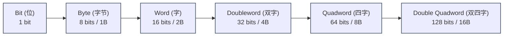
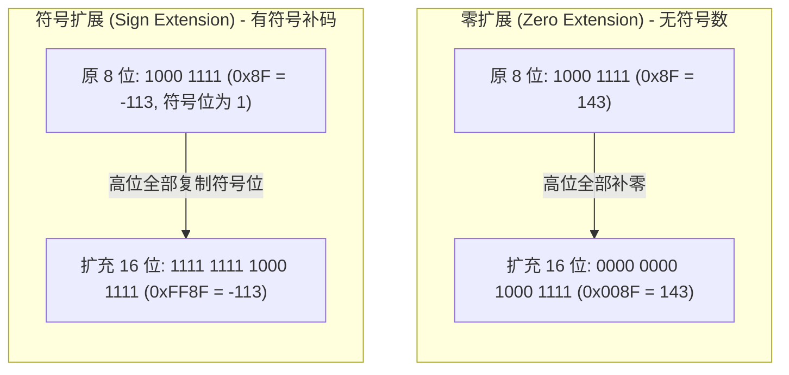
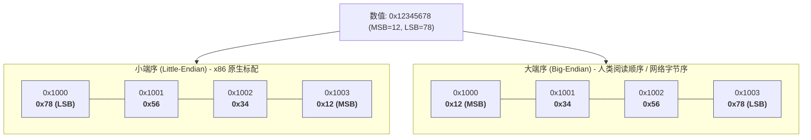
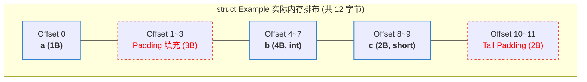

在高级语言中，变量有丰富的类型系统：`int`、`float`、`bool`、指针或对象。然而一旦代码被编译为机器指令进入内存，**所有的高级语义全部灰飞烟灭**。

在 CPU 眼中，内存仅仅是一维连续排布的物理字节；寄存器里也只有由高低电平呈现的 `0` 和 `1`。至于一段内存到底代表一个负数、一个无符号整数、一个浮点数还是一个内存地址，**完全取决于程序员（或编译器）使用了哪一条指令来解释它**。

理解数据在底层的物理呈现与排布规则，是写出正确汇编代码和深入逆向工程的必备基本功。

---

## 一、 数制系统与数据宽度（Data Widths）

### 1. 为什么是十六进制？
现代计算机底层采用二进制（Base-2），但在汇编开发与反编译中，二进制过长难以阅读，十进制与底层位模式脱节。因此我们普遍使用 **十六进制（Hexadecimal, Base-16）**：
* 每一个十六进制字符（`0` ~ `F`）恰好对应 **4 个二进制位（1 个半字节 / Nibble）**。
* 两个十六进制字符恰好拼成 **1 个字节（8 位）**，如 `0xFF = 1111 1111b`。

### 2. x86 核心数据宽度术语
x86 架构保留了极其深厚的历史包袱。在 8086 时代，处理器的原生处理宽度是 16 位，因此 x86 将 **16 位定义为一个“字（Word）”**，后续的 32 位和 64 位以此为基准成倍扩展：



各汇编器定义伪指令及高级语言映射表如下：

| 数据单位 | 包含字节数 | 位宽 | NASM 伪指令 | MASM 伪指令 | C/C++ 经典类型 (LP64) |
| :--- | :--- | :--- | :--- | :--- | :--- |
| **Byte** | 1 字节 | 8 bits | `db` (define byte) | `BYTE` | `char`, `int8_t`, `uint8_t` |
| **Word** | 2 字节 | 16 bits | `dw` (define word) | `WORD` | `short`, `int16_t` |
| **Doubleword** | 4 字节 | 32 bits | `dd` (define dword)| `DWORD` | `int`, `long` (Win64), `int32_t` |
| **Quadword** | 8 字节 | 64 bits | `dq` (define qword)| `QWORD` | `long` (Linux64), `long long`, 指针 |
| **Double Quadword** | 16 字节 | 128 bits | `do` / `oword` | `XMMWORD` | `__m128` (SSE 向量数据) |

---

## 二、 有符号数、无符号数与补码机制

一个字节 `0xFF`，如果它是无符号数，值是 `255`；如果它是有符号数，值是 `-1`。**内存中的比特本身没有属性，属性是由操作它的 CPU 指令赋予的。**

### 1. 为什么计算机必须使用“补码（Two's Complement）”？
早期计算机曾尝试过“原码（Sign-Magnitude）”和“反码（Ones' Complement）”，但它们存在两个致命缺陷：
1. **存在正零与负零**：`+0`（`00000000`）和 `-0`（`10000000`）占用两个编码，浪费资源且带来逻辑判断冗余。
2. **减法需要专门的减法器硬件**：无法与加法器电路复用。

**补码彻底解决了这一问题**：它将数学上的减法直接转化为加法运算：
$$A - B = A + (-B) = A + (\sim B + 1)$$
在补码体系下，加法器只需要一套纯粹的模加电路，即可无差别处理有符号加法、无符号加法与减法。

### 2. 补码的求法与数学本质
* **快速求负数补码规则**：**按位取反，末位加一**（$\sim X + 1$）。
* **x86 原生指令**：`neg`。
  ```nasm
  mov eax, 5        ; EAX = 0x00000005
  neg eax           ; EAX = 0xFFFFFFFB (即 -5 的补码表示)
  ```

| 位宽 $N$ | 无符号表示范围 ($0 \sim 2^N - 1$) | 有符号补码表示范围 ($-2^{N-1} \sim 2^{N-1} - 1$) |
| :--- | :--- | :--- |
| **8 位 (Byte)** | $0 \sim 255$ (`0x00` ~ `0xFF`) | $-128 \sim 127$ (`0x80` ~ `0x7F`) |
| **16 位 (Word)** | $0 \sim 65,535$ | $-32,768 \sim 32,767$ |
| **32 位 (Dword)** | $0 \sim 4,294,967,295$ (约 42.9 亿) | $-2,147,483,648 \sim 2,147,483,647$ (约 $\pm 21.4$ 亿) |
| **64 位 (Qword)** | $0 \sim 2^{64}-1$ (约 $1.84 \times 10^{19}$) | $-2^{63} \sim 2^{63}-1$ (约 $\pm 9.22 \times 10^{18}$) |

---

### 3. 数据类型提升：零扩展 vs. 符号扩展
当你需要把一个较小位宽的数据（如 8 位 `char`）搬运到一个较大位宽的寄存器（如 32 位 `EAX`）时，必须做出扩充策略：



* **零扩展指令**：`movzx`（用于无符号数提升）。
  ```nasm
  movzx eax, byte ptr [rsi]  ; 读入 1 字节，EAX 高 24 位全部清零
  ```
* **符号扩展指令**：`movsx` / `movsxd`（用于有符号数提升）。
  ```nasm
  movsx eax, byte ptr [rsi]  ; 若原最高位为 1，则高 24 位全置 1；若为 0 则全置 0
  movsxd rax, edx            ; 64 位专属：将 32 位 EDX 符号扩展到 64 位 RAX
  ```

---

### 4. 溢出的本质：CF 标志 vs. OF 标志
ALU 在完成加减法后，并不知道你意图进行的是有符号运算还是无符号运算，因此它会**同时计算并设置两个独立的溢出标志位**：

* **进位标志 CF (Carry Flag)**：**针对无符号数**。最高位产生了进位或借位。
  * 例：`0xFF + 0x01 = 0x00`（超出 8 位最大上限 255，**CF = 1**）。
* **溢出标志 OF (Overflow Flag)**：**针对有符号补码**。两个同号数相加，得到了相反符号的结果（正 + 正 = 负，或 负 + 负 = 正）。
  * 例：`0x7F (+127) + 0x01 (+1) = 0x80 (-128)`。本应是正数，符号位却变成了 1，**OF = 1**。

后续代码根据你的意图选择对应的跳转指令：
* 判定无符号结果大小：使用依赖于 `CF` 的分支（`ja`, `jb`, `jae`, `jbe`）。
* 判定有符号结果大小：使用依赖于 `OF` 与 `SF` 的分支（`jg`, `jl`, `jge`, `jle`）。

---

## 三、 字节序（Endianness）：大端序 vs. 小端序

当一个数据占用的存储空间**大于 1 个字节**（如 Word、Dword、Qword）时，就产生了一个哲学问题：**究竟是先存最高有效字节（MSB），还是先存最低有效字节（LSB）？**

### 1. 规则剖析
假设在内存地址 `0x1000` 处写入一个 32 位的 16 进制整数：`0x12345678`。
* **最高有效字节 (MSB, Most Significant Byte)**：`0x12`
* **最低有效字节 (LSB, Least Significant Byte)**：`0x78`



> **🔥 小端序记忆口诀**：**“低存低，高存高”**（低位字节存放在低内存地址，高位字节存放在高内存地址）。

### 2. 为什么 x86 固执地选用小端序？
许多初学者觉得小端序极其“反人类”，因为在十六进制内存转储（Hex Dump）中观察内存时，高位字节全都是倒着排布的。但对于处理器芯片设计来说，小端序带来了巨大的工程优势：
1. **类型截断天然免费（Zero-cost Truncation）**：
   * 假设有一个 32 位整数 `x = 0x00000042`，存放在 `0x1000`。
   * 如果通过类型强转将其当作 8 位 `char` 读取（只取一个字节），其指针地址依然是 `0x1000`（读出 `0x42`）。
   * **读取同一地址，只需改变读取位宽，无需修改地址偏移指针。**
2. **多精度算术高效（Multi-precision Arithmetic）**：
   * 芯片加法器从最低位（LSB）开始计算进位并向高位传递。小端序让取指与进位处理自然顺流而下。

### 3. 网络字节序与 `bswap` 指令
TCP/IP 协议栈统一规定网络传输采用 **大端序（Network Byte Order）**。因此在编写底层网络通信汇编时，必须进行字节序翻转。
* **x86 原生翻转指令**：`bswap`（Byte Swap）。
  ```nasm
  mov eax, 0x12345678  ; EAX = 0x12345678
  bswap eax            ; EAX = 0x78563412 (瞬间完成大小端互换)
  ```

---

## 四、 内存排布、对齐（Alignment）与填充（Padding）

现代 CPU 并非单字节地从内存中提取数据，而是以 **字、双字、四字甚至 64 字节的缓存行（Cache Line）** 为颗粒度成块吞吐。

### 1. 自然对齐规则（Natural Alignment）
**一个 $N$ 字节大小的数据，其存放的首地址必须能够被 $N$ 整除**（$\text{Address} \pmod N == 0$）。
* 2 字节数据（Word）的首地址必须是 2 的倍数（末位二进制为 0）。
* 4 字节数据（Dword）的首地址必须是 4 的倍数（末两位二进制为 00）。
* 8 字节数据（Qword）的首地址必须是 8 的倍数（末三位二进制为 000）。

### 2. 非对齐访问的性能惩罚与硬件异常
如果一个 4 字节的整数横跨了 `0x1003` 到 `0x1006` 的地址空间：
* **跨缓存行惩罚**：CPU 必须发起两次物理内存读取事务，将两个 64 字节的 Cache Line 读入芯片，再通过内部移位与拼接电路拼出原始数据。性能大幅降低。
* **原子操作失效**：原本一条 `lock cmpxchg` 指令可以实现的无锁原子操作，一旦跨越缓存行，将升级为最昂贵且卡死整个总线的“总线锁（Bus Lock）”。
* **SIMD 硬件崩溃**：在执行某些 SIMD 向量指令时（如 `movaps` - Move Aligned Packed Single-Precision），如果内存未按 **16 字节对齐**，CPU 会直接抛出 **`#GP` (通用保护性故障) 导致程序直接崩溃**。

---

### 3. 结构体填充（Struct Padding）实战分析

考虑以下 C 语言结构体在 64 位系统下的内存布局：

```c
struct Example {
    char   a;      // 1 字节
    int    b;      // 4 字节
    short  c;      // 2 字节
};
```
直觉上，它消耗的内存是 $1 + 4 + 2 = 7$ 字节。然而，编译器为了满足自然对齐，会在汇编层面插入**无意义的填充字节（Padding）**：



#### 填充原因推导：
1. `a` 占用 `Offset 0`。
2. 成员 `b` 是 4 字节，起始地址必须被 4 整除。因此编译器放弃 `Offset 1, 2, 3`，在此填充 3 个无用字节，将 `b` 推迟到 `Offset 4` 开始。
3. `c` 占用 `Offset 8, 9`（9 符合 2 的倍数）。
4. **尾部填充（Tail Padding）**：整个结构体的最大成员宽度是 4 字节，因此整个结构体的大小必须向上取整为 4 的倍数（否则定义结构体数组时，第二个元素的成员 `b` 就会失去对齐）。末尾补齐 2 字节，**最终整个结构体占用 12 字节，内存膨胀了 71%！**

---

### 4. 64 位 ABI 栈对齐规范（The 16-byte Stack Alignment）
在 System V AMD64 ABI（Linux / macOS）以及 Windows x64 规范中，有一条写入体系规格的死命令：

> **在任何 `CALL` 指令发起之前，栈指针寄存器 `RSP` 的值必须是 16 的倍数（16-byte aligned）。**

* 当调用方发起 `call func` 时，硬件自动把 8 字节的返回地址（RIP）压入栈中，这会导致此时的 `RSP` 变为 $16k + 8$（失去了 16 字节对齐）。
* 因此，在被调用函数的序言部分（Prologue），通常必须进行适当的调整：
  ```nasm
  my_function:
      push rbp             ; rsp 减少 8 字节 -> 此时 rsp 恢复为 16 的倍数 (16k)
      sub  rsp, 32         ; 局部变量分配必须是 16 的倍数 (32 满足)，维持对齐
      
      ; ... 调用其他函数或执行 SIMD 计算 ...
      
      add  rsp, 32
      pop  rbp
      ret
  ```
如果你在手写 64 位汇编时调用 `printf` 或其他 C 库函数频繁遭遇 `Segmentation Fault`，99% 的原因就是**在发起 `call` 的瞬间，你的 `RSP` 没有满足 16 字节对齐要求**，导致库内部依赖的 SIMD 指令触发硬件异常。


