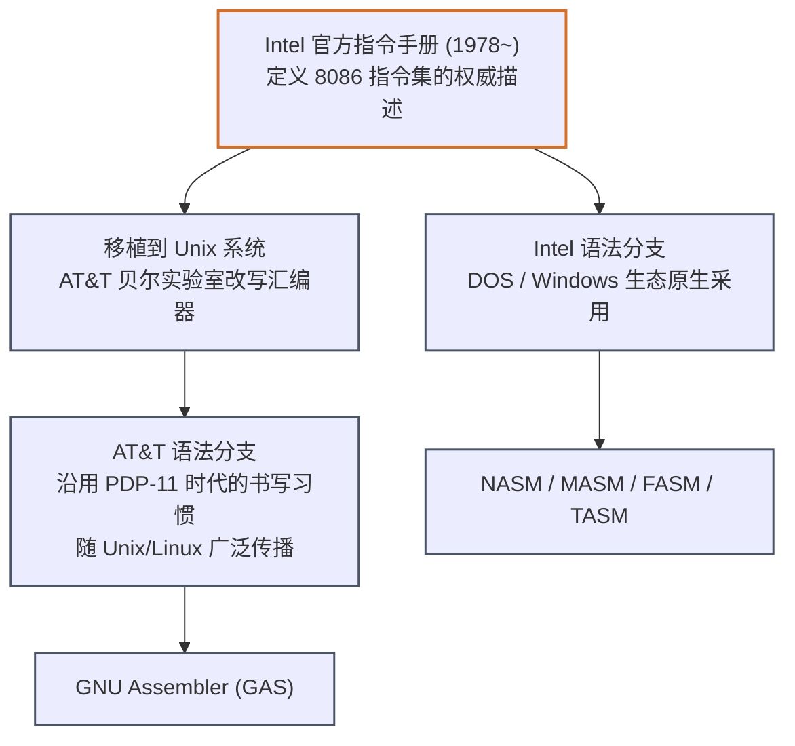
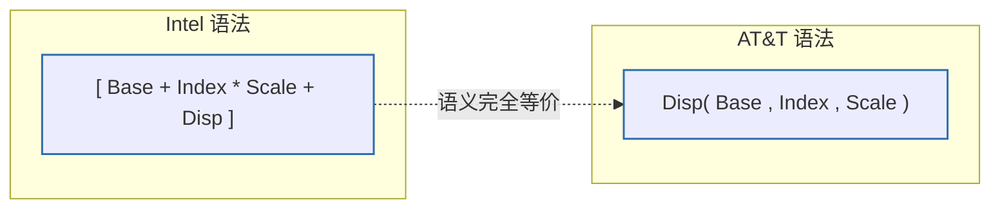
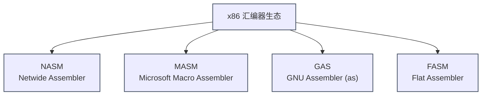

## 一、 两大语法流派：Intel 语法 vs AT&T 语法

### 1. 分裂的历史根源



Intel 在发布 8086 处理器时，于官方手册中确立了一套书写规范，微软的 MASM 和后来的 NASM、FASM 均严格遵循。而 AT&T 贝尔实验室在把 Unix 移植到 x86 平台时，为了与其已有的 PDP-11、VAX 等架构的汇编书写习惯保持一致，自行设计了一套语法规则并集成进了 `as`（后来的 GNU Assembler, GAS）。由于 Linux 内核与 GCC 工具链长期依赖 GAS，AT&T 语法也就此在类 Unix 系统中扎根。

### 2. 核心差异逐项对照

| 对比维度 | Intel 语法 | AT&T 语法 |
| :--- | :--- | :--- |
| **操作数顺序** | 目的在前，源在后：`mov eax, ebx` | 源在前，目的在后：`movl %ebx, %eax` |
| **寄存器前缀** | 无前缀：`eax` | 必须加 `%`：`%eax` |
| **立即数前缀** | 无前缀：`mov eax, 5` | 必须加 `$`：`movl $5, %eax` |
| **内存引用符号** | 方括号：`[ebx + ecx*4 + 8]` | 括号 + 逗号：`8(%ebx, %ecx, 4)` |
| **操作数位宽标注** | 显式关键字：`byte ptr`, `dword ptr`, `qword ptr` | 助记符后缀：`b`(8位) `w`(16位) `l`(32位) `q`(64位) |
| **立即数进制** | `0x1F` 或 `1Fh` | `$0x1f`（必须 `0x` 前缀，不支持 `h` 后缀）|
| **跳转/调用目标** | `call func` | `call func`（相同，但远跳转格式有差异）|
| **x87 浮点操作数顺序**| 遵循文档顺序 | **反转**（历史遗留 Bug，官方承认） |

### 3. 并列对比示例

同一段逻辑（将 `[ebx+4]` 处的双字加 1，结果存入 `eax`）在两种语法下的书写：

**Intel 语法（NASM）：**
```nasm
mov  eax, dword ptr [ebx + 4]
add  eax, 1
mov  dword ptr [ebx + 4], eax
```

**AT&T 语法（GAS）：**
```gas
movl 4(%ebx), %eax
addl $1, %eax
movl %eax, 4(%ebx)
```

### 4. 内存寻址公式的符号映射

两种语法描述的是完全相同的硬件寻址公式：
$$\text{有效地址} = \text{Base} + (\text{Index} \times \text{Scale}) + \text{Displacement}$$



例如 `[eax + ebx*4 + 0x10]`（Intel）与 `0x10(%eax, %ebx, 4)`（AT&T）是同一条硬件指令的两种文本表达。

### 5. 如何选择？

* **逆向工程 / Windows 开发 / 阅读 Intel 官方文档**：优先掌握 **Intel 语法**。本系列教程后续内容统一采用 Intel 语法。
* **阅读 Linux 内核源码 / glibc 内联汇编 / GDB 默认反汇编输出**：需要具备 **AT&T 语法**的阅读能力。
* **GDB 可随时切换显示语法**：
  ```gdb
  (gdb) set disassembly-flavor intel
  (gdb) set disassembly-flavor att
  ```

---

## 二、 四大主流汇编器选型



| 汇编器 | 语法 | 典型使用场景 | 核心特点 |
| :--- | :--- | :--- | :--- |
| **NASM** | Intel | 跨平台独立开发、CTF Pwn、教学 | 语法简洁清晰、自由度高、依赖外部链接器（`ld`/`link.exe`）、宏系统强大 |
| **MASM** | Intel | Windows 原生开发、Visual Studio 集成 | 与 Windows SDK/C 运行时深度集成、语法较为繁琐（`proc/endp`、`.model`）、内置高级伪指令（如 `invoke`） |
| **GAS** | AT&T（也支持 Intel）| GCC 内联汇编、Linux 内核、编译器后端输出 | 与 GCC 工具链无缝衔接、几乎所有 Linux 发行版默认自带、通过 `.intel_syntax noprefix` 可切换为 Intel 语法 |
| **FASM** | Intel | 独立可执行文件打包、Bootloader/OS 开发 | **自举（self-hosting，用汇编写成）**、无需外部链接器即可直接生成 PE/ELF、单遍汇编速度极快 |

### 1. NASM：最适合入门与跨平台学习
```bash
# 安装（以 Debian/Ubuntu 为例）
sudo apt install nasm

# 汇编 64 位 ELF 目标文件
nasm -f elf64 hello.asm -o hello.o

# 汇编 64 位 Windows 目标文件
nasm -f win64 hello.asm -o hello.obj
```

### 2. GAS：理解 GCC 输出与内联汇编的必备技能
GAS 默认使用 AT&T 语法，但可以通过指令切换为 Intel 语法阅读：
```gas
.intel_syntax noprefix
.global _start
_start:
    mov eax, 1
    mov ebx, 0
    int 0x80
```
编译：
```bash
as --64 hello.s -o hello.o
```

### 3. FASM：面向独立系统开发的"自举式"选择
FASM 的最大亮点是它**自身就是用汇编语言写成的**，并且不依赖外部链接器：
```fasm
format ELF64 executable 3
entry start

segment readable executable
start:
    mov rax, 60
    xor rdi, rdi
    syscall
```
```bash
fasm hello.fasm hello    # 直接产出可执行文件，无需 ld
```

### 4. MASM：Windows 生态的官方选择
MASM 语法相对繁琐，通常配合 Visual Studio 的 `ml64.exe`：
```bash
ml64 /c /Fo hello.obj hello.asm
link hello.obj /subsystem:console /entry:main
```

---

## 三、 节（Section）、段（Segment）、标签与注释

### 1. 现代汇编文件的三大标准节区

无论使用哪种汇编器，一个结构完整的程序通常都会按"用途"划分内存区域：


| 节区名称 | NASM 声明方式 | 典型存放内容 | 读写属性 |
| :--- | :--- | :--- | :--- |
| `.text` | `section .text` | 机器指令代码 | 只读 + 可执行 |
| `.rodata`| `section .rodata` | 字符串字面量、`const` 常量 | 只读 |
| `.data` | `section .data` | 有初始值的全局/静态变量 | 可读写 |
| `.bss` | `section .bss` | 无初始值的全局/静态变量（运行时清零）| 可读写 |

> **为什么 `.bss` 不占文件体积？** 因为它只记录"需要在加载时预留多大空间、清零即可"的元信息，不需要在磁盘文件中实际存储一长串 `0`，从而减小可执行文件体积。

### 2. 标签（Label）

标签是指向某个内存地址（通常是代码位置或数据位置）的符号名，本质上会被汇编器替换为具体地址或相对偏移：

```nasm
section .text
global _start

_start:                 ; 全局标签，作为程序入口
    mov ecx, 5
.loop:                  ; 局部标签（以 . 开头，作用域绑定到最近的全局标签）
    dec ecx
    jnz .loop
    ret
```

* **全局标签**：可以被其他文件通过 `extern` 引用（需要配合 `global` 导出）。
* **局部标签**（NASM 中以 `.` 开头）：仅在当前全局标签作用域内有效，常用于避免循环体内部标签命名冲突。

### 3. 注释

| 汇编器 | 行内注释符 | 块注释 |
| :--- | :--- | :--- |
| NASM | `;` | 不支持，仅行注释 |
| GAS (AT&T 默认) | `#` | `/* ... */` |
| MASM | `;` | 不支持，仅行注释 |
| FASM | `;` | 不支持，仅行注释 |

---

## 四、 数据定义伪指令完全对照

伪指令（Pseudo-op / Directive）不会被编译为 CPU 指令，而是指挥汇编器如何组织字节、分配空间。

### 1. 已初始化数据：`db` / `dw` / `dd` / `dq`

| 伪指令 | 含义 | 占用字节 | NASM 示例 | GAS 等价写法 |
| :--- | :--- | :--- | :--- | :--- |
| `db` | define byte | 1 | `msg db "Hi", 0` | `.byte` / `.ascii` / `.asciz` |
| `dw` | define word | 2 | `val dw 0x1234` | `.word` / `.short` |
| `dd` | define dword | 4 | `num dd 100` | `.long` / `.int` |
| `dq` | define qword | 8 | `ptr dq 0x1000` | `.quad` |

```nasm
section .data
    greeting   db  "Hello, world!", 0x0A, 0   ; 字符串 + 换行 + NUL 终止符
    magic_num  dd  0xDEADBEEF
    pointer    dq  0x0000000000401000
    array      dw  1, 2, 3, 4, 5              ; 连续定义多个 word
```

### 2. 未初始化数据（预留空间）：`resb` / `resw` / `resd` / `resq`

这些伪指令只在 `.bss` 节区中使用，不写入任何初始值，仅告诉链接器"预留多少字节"：

```nasm
section .bss
    buffer     resb  256      ; 预留 256 字节的字符缓冲区
    counter    resd  1        ; 预留 1 个 dword (4 字节) 作为计数器
    big_array  resq  64       ; 预留 64 个 qword (512 字节)
```

| NASM | MASM 等价 | GAS 等价 |
| :--- | :--- | :--- |
| `resb N` | `db N dup (?)` | `.space N` / `.zero N` |
| `resd N` | `dd N dup (?)` | `.skip N*4` |

### 3. 符号常量：`equ` 与 `$` / `$$`

* **`equ`**：定义一个编译期常量（不占用内存，纯粹是文本替换/符号绑定）。
  ```nasm
  BUFFER_SIZE equ 1024
  section .bss
      buf resb BUFFER_SIZE
  ```
* **`$`**：代表"当前行的地址"（Current Location Counter）。
* **`$$`**：代表"当前节区的起始地址"。

常见用法：计算字符串长度（无需手动数字符数）：
```nasm
section .data
    msg     db "Hello, world!", 0x0A
    msg_len equ $ - msg      ; $ 减去 msg 起始地址 = 字符串长度
```

---

## 五、 完整工具链：从源码到可执行文件

### 1. 标准构建流程全景


* **汇编（Assemble）**：将文本助记符转换为机器码字节，生成包含符号表的目标文件（`.o`/`.obj`），此时外部函数引用（如 `printf`）尚未解析为具体地址。
* **链接（Link）**：将一个或多个目标文件、库文件合并，解析所有符号引用，重定位地址，最终生成可直接运行的可执行文件。

### 2. Linux 平台实战命令

```bash
# 第一步：汇编
nasm -f elf64 -g -F dwarf hello.asm -o hello.o
#   -g -F dwarf  : 生成调试符号信息，供 GDB 使用

# 第二步：链接（纯汇编，无 libc 依赖）
ld hello.o -o hello

# 第二步（替代）：若使用了 libc 函数（如 printf），改用 gcc 作为链接驱动
gcc hello.o -o hello -no-pie   # -no-pie 便于调试时地址固定，初学阶段推荐

# 运行
./hello
```

### 3. Windows 平台实战命令（NASM + link.exe）

```powershell
# 第一步：汇编为 Windows COFF 目标文件
nasm -f win64 hello.asm -o hello.obj

# 第二步：使用 MSVC 链接器链接（需在 "Developer Command Prompt" 环境下）
link hello.obj /subsystem:console /entry:mainCRTStartup libcmt.lib legacy_stdio_definitions.lib
```

### 4. 调试工具选型

| 平台 | 推荐调试器 | 特点 |
| :--- | :--- | :--- |
| Linux | **GDB** + **GEF** / **pwndbg** 插件 | 命令行为主，插件极大增强寄存器/内存可视化，是 CTF Pwn 的事实标准 |
| Windows | **x64dbg** | 图形化界面，寄存器、堆栈、反汇编窗口联动直观，对新手友好 |
| 跨平台静态分析 | **IDA Pro** / **Ghidra** | 反编译伪代码 + 控制流图，适合无源码场景的深度逆向 |

---

## 六、 实战：编写、构建并调试第一个 64 位程序

我们用一个贯穿本文所有知识点的完整示例：读取两个 `.data` 中的整数相加，并通过系统调用退出，退出码即为结果。

### 1. 源代码（NASM, Intel 语法）

```nasm
; file: add_demo.asm
; 功能：计算 a + b，并以该值作为进程退出码返回
; 构建：nasm -f elf64 -g -F dwarf add_demo.asm -o add_demo.o
;       ld add_demo.o -o add_demo

section .data
    a       dd  10              ; 使用 dd 定义已初始化双字数据
    b       dd  32

section .bss
    result  resd 1              ; 使用 resd 预留未初始化的结果空间

section .text
    global _start

_start:
    mov  eax, [a]                ; 从 .data 节读取 a
    add  eax, [b]                ; 加上 .data 节中的 b
    mov  [result], eax           ; 结果写回 .bss 节

    ; sys_exit(result)
    mov  edi, [result]           ; 退出码 = a + b = 42
    mov  eax, 60                 ; __NR_exit 系统调用号
    syscall
```

### 2. 构建与验证

```bash
nasm -f elf64 -g -F dwarf add_demo.asm -o add_demo.o
ld add_demo.o -o add_demo
./add_demo
echo $?          # 输出 42，验证 10 + 32 计算正确
```

### 3. 使用 GDB 单步调试，观察寄存器变化

```bash
gdb ./add_demo
```
```gdb
(gdb) set disassembly-flavor intel      ; 确保以 Intel 语法显示反汇编
(gdb) break _start                      ; 在入口处下断点
(gdb) run
(gdb) info registers eax                ; 查看 eax 当前值
(gdb) stepi                             ; 单步执行一条机器指令
(gdb) x/1dw &result                     ; 以十进制 dword 格式查看 result 内存内容
(gdb) continue
```

典型交互片段：
```
Breakpoint 1, 0x0000000000401000 in _start ()
(gdb) stepi
0x0000000000401007 in _start ()
(gdb) info registers eax
eax            0xa                 10
(gdb) stepi
(gdb) info registers eax
eax            0x2a                42
```

通过逐条执行，你可以亲眼观察到 `mov eax, [a]` 后 `eax` 变为 `10`，`add eax, [b]` 后变为 `42`，这正是建立"汇编指令 ↔ 寄存器状态变化"直觉的最佳练习方式。

### 4. Windows + x64dbg 调试要点

若在 Windows 下用 MASM/NASM 构建了带调试符号的 PE 文件，用 x64dbg 打开后：
1. 在 **CPU 窗口**中找到 `_start`/`main` 对应地址，按 `F2` 下断点。
2. 按 `F9` 运行至断点，使用 `F7`（Step Into）/`F8`（Step Over）逐指令执行。
3. 右侧 **寄存器窗口** 实时显示 `RAX`/`RBX` 等变化，**下方内存窗口** 可定位查看 `.data`/`.bss` 节内容。

