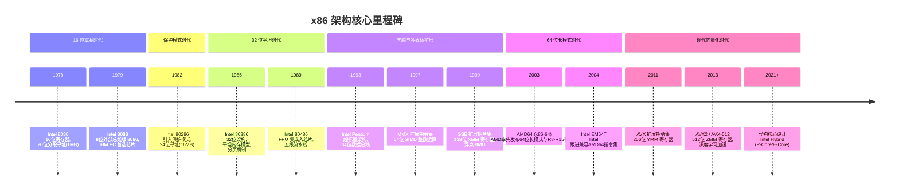
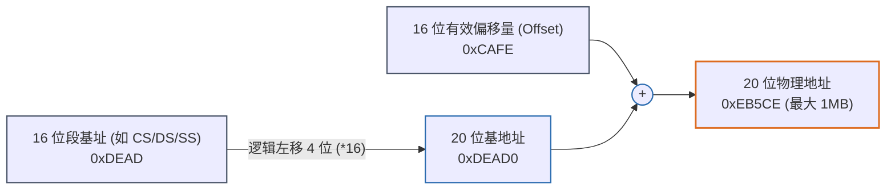
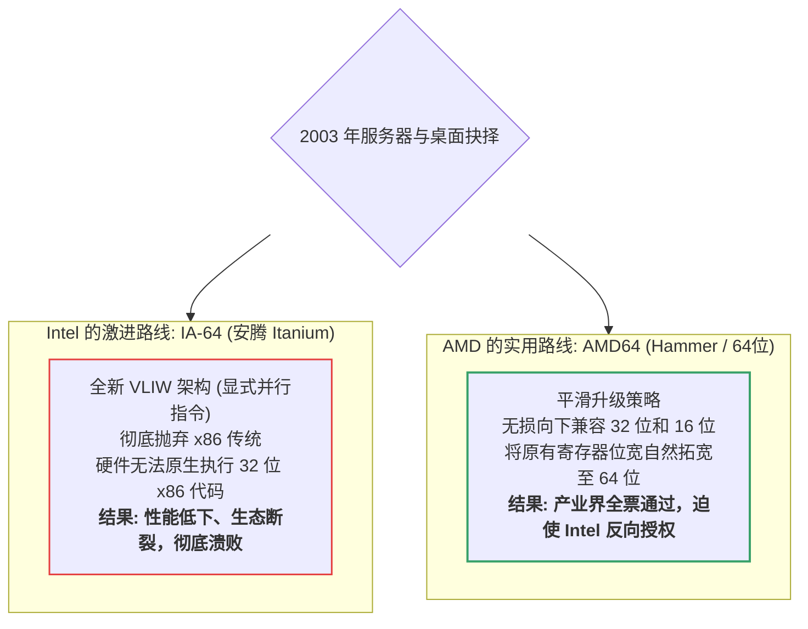
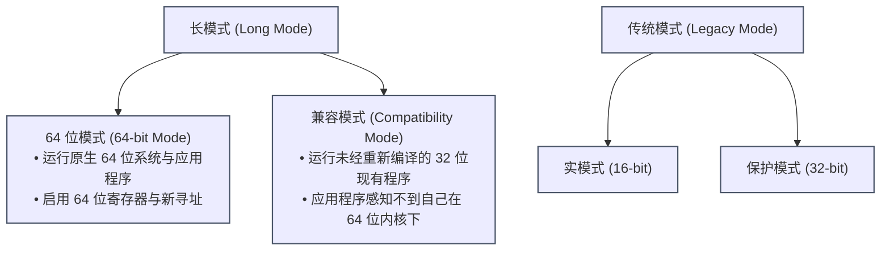
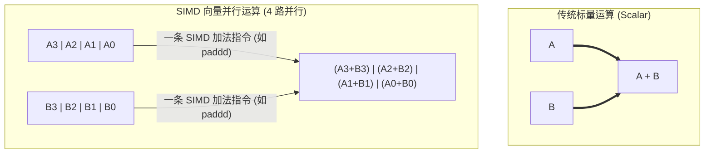

在当今科技界，很难再找到第二种像 x86 这样拥有近半个世纪连续兼容史的技术。

今天一台搭载最新 Intel Core i9 或 AMD Ryzen 处理器的超级台式机，在加电开机的第一微秒，**其内部硬件仍然运行在一个完全模拟 1978 年 16 位 8086 处理器的古老状态下**。这种为了向后兼容（Backward Compatibility）而不断叠加的架构设计，使 x86 既成了一座宏伟的技术丰碑，也背负了计算机体系结构中最沉重的“历史包袱”。

理解 x86 的演进路线，本质上是在解构现代操作系统的底层是如何一步步摆脱硬件桎梏、迈向现代通用计算的。

---

## 一、 演进全景路线图

---

## 二、 16 位黎明：8086 与 80286 的蹒跚探索

### 1. 8086 / 8088（1978~1979）：实模式与分段寻址
8086 是一款纯粹的 16 位微处理器，其内部寄存器和算术单元均为 16 位。然而，如果单纯使用 16 位地址，只能寻址 $2^{16} = 64\text{ KB}$ 的内存，这在当年已被预见将成为巨大瓶颈。

为了打破 64 KB 限制，Intel 工程师设计了 **20 位地址总线**（寻址空间达 $2^{20} = 1\text{ MB}$），并引入了臭名昭著的 **实模式分段机制（Real Mode Segmentation）**：

* **8088 的商业妥协**：IBM PC（1981）之所以选择 8088 而非 8086，是因为 8088 内部核心虽然是 16 位，但**外部数据总线缩减为 8 位**。这允许 IBM 使用极其低廉的 8 位周边芯片主板，直接引爆了个人电脑革命。
* **致命缺陷**：无内存权限保护（Ring 等级不存在），任何程序都可以随意覆写 BIOS 和系统代码区；且同一物理内存可用不同的 `段:偏移` 组合表达（例如 `0000:0010` 与 `0001:0000` 等价），造成了巨大的混乱。

### 2. 80286（1982）：有缺陷的“保护模式”初试水
80286 首次引入了 **保护模式（Protected Mode）**，将地址总线扩充至 24 位（最大 16 MB 内存），并带来了特权级（Ring 0 ~ Ring 3）和描述符表（GDT/LDT）的概念。

* **致命缺陷（“脑残芯片”）**：80286 的段内偏移依然被死死限制在 16 位（单个段依然最大 64 KB）。更致命的是，**CPU 一旦进入保护模式，无法通过软件指令切回实模式**，必须向键盘控制器发信号强制硬件复位（Triple Fault 重启 CPU）才能脱离！比尔·盖茨曾公开称其为“一颗不成熟的死胡同芯片”。

---

## 三、 32 位的黄金时代：80386 到奔腾架构

### 1. 80386（1985）：IA-32 架构的真正奠基者
80386 是现代计算史上最伟大的芯片之一。它扫清了 80286 的所有缺陷，构筑了称霸 IT 界三十年的 **IA-32（Intel Architecture 32-bit）** 体系：

1. **32 位平坦内存模型（Flat Memory Model）**：
   * 寄存器全面升级（`EAX`, `EBX`, `ESP`, `EIP` 等）。
   * 偏移量可以直接从 `0` 到 `0xFFFFFFFF`（$4\text{ GB}$）。程序员终于可以把段寄存器全部固定指向同一个基地址，实现无需换段的平坦线性寻址。
2. **硬件分页机制（Paging）与虚拟内存**：
   * 引入了 `CR0`、`CR3` 寄存器与两级页表结构（页目录 + 页表）。
   * 每个进程拥有独立的虚拟 4 GB 空间，实现了物理内存与逻辑地址的解耦，为 Windows NT、Linux、BSD 等现代操作系统的多任务内存隔离提供了硬件根基。
3. **虚拟 8086 模式（VM86）**：
   * 允许在保护模式的监管下，以硬件沙盒的形式并发运行老旧的 16 位 DOS 实模式程序。

### 2. 80486（1989）与奔腾 Pentium（1993）：硬件级性能狂飙
* **80486 整合协处理器**：在 80386 之前，浮点运算需要用户额外在主板上加插昂贵的 **8087 / 80387 协处理器**。80486 首次将 **x87 FPU 浮点单元** 和 8 KB L1 缓存直接蚀刻在同一颗芯片上，极大提升了 3D 图形与科学计算速度。
* **Pentium（P5 架构）迈入超标量**：首次具备了 **超标量（Superscalar）双流水线结构（U 管道与 V 管道）**，可以在一个时钟周期内同时并发执行两条整数指令。从此，指令级并行（ILP）和分支预测机制成为 x86 性能优化的核心引擎。

---

## 四、 64 位大革命：AMD64 的绝地反击与长模式

进入 21 世纪初，服务器领域的 4 GB 物理内存墙全面撞线。如何过渡到 64 位，引发了计算机史上最著名的一次路线战争。

### 1. 世纪之争：Intel IA-64 vs. AMD64

Intel 曾自信地认为 x86 的历史包袱不可救药，试图用完全不兼容的 **IA-64（Itanium / 安腾）** 替代 x86。而竞争对手 AMD 抓住了历史机遇，于 2003 年发布了 **AMD64（Opteron / Athlon 64）**。

由于 AMD64 能够以 100% 的原生性能毫无损耗地运行已有的海量 32 位 Windows / Linux 软件，同时提供优雅的 64 位扩充，市场迅速淘汰了安腾。Intel 最终被迫妥协，获得授权并在自家 CPU 上跟进实现（曾称 EM64T / Intel 64），**AMD 事实上成为了现代 64 位 x86 架构的制定者**。

---

### 2. 核心架构跃迁：长模式（Long Mode）

在 x86-64 体系下，CPU 增加了全新的运行模式——**长模式（Long Mode）**：

#### 64 位模式带来的革命性硬件升级：
1. **通用寄存器扩容至 16 个**：
   * 原有 8 个寄存器全部拓宽为 64 位（`RAX`, `RBX`, `RCX`, `RDX`, `RSI`, `RDI`, `RBP`, `RSP`）。
   * 全新增加了 8 个通用寄存器：**`R8` 到 `R15`**。寄存器溢出（Spill）到内存栈上的概率降低了 50% 以上。
2. **传参 ABI 规范质的飞跃**：
   * 不再频繁依赖低效的内存栈传递参数，改为由寄存器优先传参（Linux 下优先使用 `RDI, RSI, RDX, RCX, R8, R9`）。
3. **原生 RIP 相对寻址（RIP-Relative Addressing）**：
   * 允许直接相对于当前指令位置寻址数据（`mov rax, [rel symbol]`），使动态链接库和**位置无关可执行文件（PIE）**的构建性能开销降为 0。
4. **大刀阔斧的“垃圾指令清理”**：
   * 废除绝大多数单字节操作码（如用于 BCD 码调整的 `AAA`, `DAA` 等历史遗留指令）。
   * 丢弃 `pusha` / `popa`（全量寄存器压栈指令，因固定针对 32 位设计）。
   * 彻底禁用 CS、DS、ES、SS 分段机制（段基址强制恒定为 0），仅保留 `FS` 与 `GS` 段寄存器用于线程本地存储（TLS）。

---

## 五、 并行计算进化：SIMD 向量扩展指令集

随着多媒体、图形渲染、密码学和当今人工智能的发展，传统的标量运算（单指令单数据，SISD）已无法满足吞吐需求。x86 逐步演化出强大的 **SIMD（单指令多数据，Single Instruction Multiple Data）** 体系：

### 1. 向量扩展的技术迭代全景

| 扩展集代号 | 推出年份 | 关键硬件寄存器 | 寄存器宽度 | 核心突破点与特性 |
| :--- | :--- | :--- | :--- | :--- |
| **MMX** | 1997 | `MM0` ~ `MM7` | 64 位 | 借用已有的 x87 浮点栈寄存器物理空间，切换浮点/向量运算必须执行 `emms` 指令清空状态，使用极其繁琐。 |
| **SSE** | 1999 | `XMM0` ~ `XMM7` (32位) `XMM0` ~ `XMM15` (64位) | 128 位 | **独立专用硬件寄存器**。首次提供 4 路单精度浮点并发运算能力。 |
| **SSE2** | 2001 | 沿用 `XMM` | 128 位 | 补全双精度浮点与整型并行计算。自此之后，**x87 浮点栈被官方弃用**，现代编译器全面改用 SSE2 编译常规浮点代码。 |
| **SSE3 ~ 4.2** | 2004~2008 | 沿用 `XMM` | 128 位 | 引入水平加法、非对齐内存快速载入、字符串/文本专用比对指令、**硬件级 CRC32 与 POPCNT 计算**。 |
| **AVX / AVX2** | 2011/2013 | `YMM0` ~ `YMM15` | **256 位** | **低 128 位映射为 XMM**。引入 **VEX 编码**（支持非破坏性三操作数指令，如 `vaddps dest, src1, src2`），AVX2 强化全量整型 256 位计算与 FMA（融合乘加）。 |
| **AVX-512** | 2016 | `ZMM0` ~ `ZMM31` + `k0` ~ `k7` (掩码) | **512 位** | 32 个 512 位寄存器，引入 **Opmask 谓词掩码机制**，支持在向量内部进行极其精细的按位条件分支计算，用于极限科学计算与 AI 算子。 |
| **AMX** | 2022 | `TMM0` ~ `TMM7` (Tile) | 2维矩阵 | 专为深度学习设计的脉动阵列矩阵计算协处理器（Advanced Matrix Extensions）。 |

---

## 六、 架构演进对程序员与逆向者的启示

了解这段历史后，许多汇编中的“诡异现象”都有了合理解释：

1. **为什么 64 位寄存器清零总用 `xor eax, eax` 而不是 `xor rax, rax`？**
   * 因为 AMD64 规则规定“向 32 位寄存器写入会自动切断并把高 32 位清零”，且 32 位指令机器码更短（少一个 REX 字节），能节省宝贵的代码缓存空间。
2. **为什么现代逆向很难看到 `fld` / `faddp` 之类的浮点指令？**
   * 现代编译器（GCC/Clang/MSVC）在 64 位下默认关闭了拥有数十年历史的 x87 栈式浮点模型，全面采用寄存器模型更为直观的 `movss`, `addss`, `movsd`（SSE/AVX 标量模式）替代。
3. **为什么段寄存器仍然存在却“几乎没用”？**
   * 它们是 16 位向后兼容的活化石。现代平坦内存模型下段基址被锁定为 0。但在多线程与安全防护中，系统依然巧妙利用剩余的 `FS`（Linux 存储 `pthread` 线程控制块 TCB）与 `GS`（Windows 存储 TEB 线程环境块），用来迅速定位线程私有变量和栈保护金丝雀（Stack Canary）。

---
