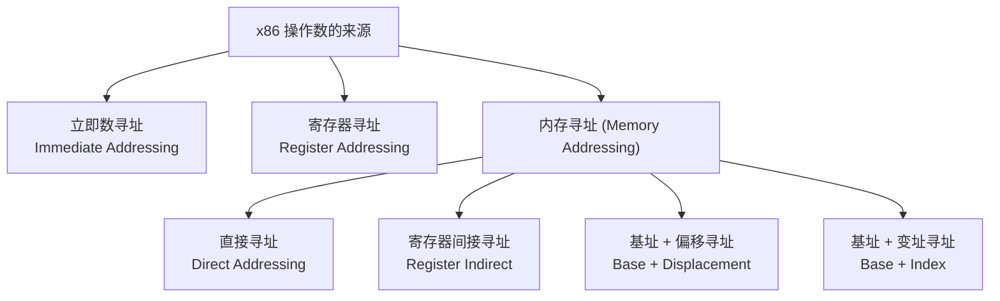
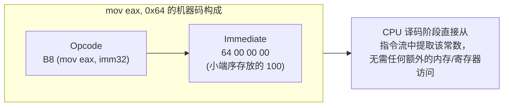
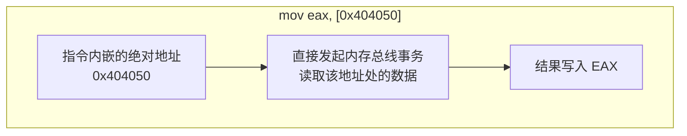
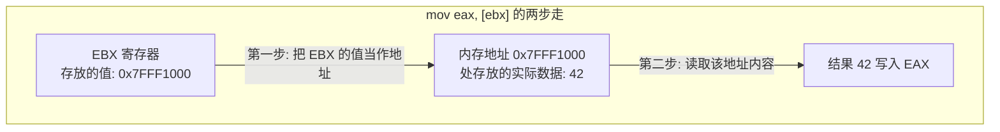
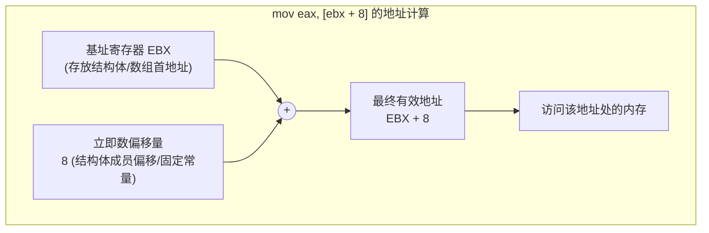
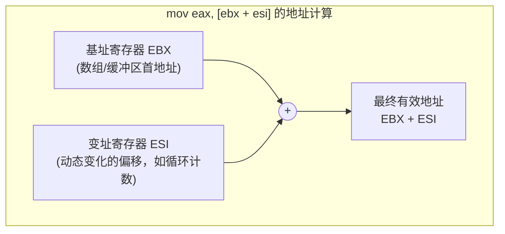
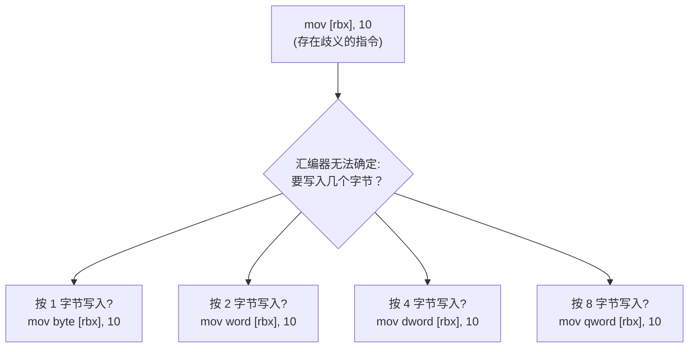

一条 x86 指令，例如 `mov`，其操作的对象可以是一个硬编码在指令中的常数，一个寄存器里的值，也可以是内存中某个地址上的数据。**寻址模式（Addressing Mode）** 正是用来描述"操作数到底从哪里来、到哪里去"的一整套规则体系。

理解寻址模式，本质上是在回答一个问题：**当 CPU 看到 `[ebx + 4]` 这样的表达式时，它究竟要做哪些硬件层面的计算，才能最终定位到内存中的那个字节？**

x86 的寻址能力极其丰富，这是 CISC 架构相较于精简指令集（RISC）的核心优势之一——它允许在一条指令中完成复杂的地址运算，省去了额外的 `lea` + `mov` 组合开销。本篇文章聚焦于最基础、最高频使用的几种寻址形态；更复杂的 SIB（比例变址）与 RIP 相对寻址将在后续章节专门展开。

---

## 一、 寻址模式全景分类

在正式拆解之前，先建立一张整体地图，理解各类寻址模式之间的递进关系：



| 寻址模式 | 典型语法 (Intel) | 操作数的物理来源 |
| :--- | :--- | :--- |
| **立即数寻址** | `mov eax, 100` | 直接编码在指令机器码内部的常数 |
| **寄存器寻址** | `mov eax, ebx` | CPU 内部寄存器，无需访问内存总线 |
| **直接寻址** | `mov eax, [0x404000]` | 内存中一个硬编码的绝对地址 |
| **寄存器间接寻址** | `mov eax, [ebx]` | 寄存器中存放的值被当作内存地址 |
| **基址 + 偏移寻址** | `mov eax, [ebx + 8]` | 寄存器值加上一个常数，构成最终地址 |
| **基址 + 变址寻址** | `mov eax, [ebx + esi]` | 两个寄存器相加，构成最终地址 |

---

## 二、 立即数寻址（Immediate Addressing）

立即数是指**直接嵌入在指令机器码字节流中的常量值**，它不占用任何寄存器或内存槽位，而是作为指令本身的一部分被硬编码。



### 1. 核心特征
* **只能作为源操作数**：立即数永远不能是目的操作数。`mov 5, eax` 是非法语法——常数不能被赋值。
* **访问速度最快**：由于常数已经随指令一起被预取进 CPU 流水线，不存在额外的内存或寄存器读取延迟。
* **位宽受限**：在 32 位模式下，立即数通常最大为 32 位；在 64 位模式下，大多数指令的立即数仍被截断在 32 位并符号扩展至 64 位（只有 `mov reg64, imm64` 这一条特殊指令支持真正的 64 位立即数）。

### 2. 实战示例
```nasm
mov eax, 100          ; EAX = 100 (十进制立即数)
mov ebx, 0x1A2B3C4D   ; EBX = 0x1A2B3C4D (十六进制立即数)
add ecx, 1            ; ECX = ECX + 1 (立即数作为加法的第二操作数)
cmp edx, 0            ; 将 EDX 与立即数 0 比较
mov rax, 0x1122334455667788  ; 64 位专属的大立即数传送指令
```

---

## 三、 寄存器寻址（Register Addressing）

寄存器寻址是最高效的寻址方式——**操作数本身就存放在 CPU 内部的寄存器中**，整个操作完全在芯片内部电路间完成，不需要经过较慢的系统总线访问外部内存。


### 1. 性能优势的底层原因
寄存器物理上位于 CPU 核心内部，距离 ALU 仅几个晶体管的路径。相较于动辄需要数十甚至上百个时钟周期的内存访问（即便命中 L1 缓存也需要若干周期），寄存器间的操作通常能在 **单个时钟周期内完成**，且不占用内存总线带宽。

### 2. 实战示例
```nasm
mov eax, ebx          ; EAX = EBX (寄存器到寄存器)
add ecx, edx          ; ECX = ECX + EDX
xchg eax, ebx         ; 交换 EAX 与 EBX 的值
mov al, bl            ; 8 位切片之间的传送
mov rax, rdi          ; 64 位寄存器间传送
```

---

## 四、 直接内存寻址（Direct Addressing）

直接寻址是指**指令中直接嵌入一个硬编码的绝对内存地址**，CPU 无需经过任何寄存器中转计算，直接拿这个地址去访问内存。



### 1. 适用场景与局限
* **典型用途**：访问**全局变量**或**静态变量**（在 `.data` / `.bss` 段中拥有固定的编译期地址）。
* **现代局限性**：在支持**地址空间布局随机化（ASLR）**和**位置无关可执行文件（PIE）**的现代操作系统中，绝对地址在每次程序加载时都会变化。因此现代编译器已很少直接生成"裸的"绝对地址寻址指令，取而代之的是下一章将详述的 **RIP 相对寻址**。
* **使用场景仍然存在**：在裸机开发（Bootloader）、未开启 ASLR 的传统 32 位程序、固定基址加载的内核代码中，直接寻址依然常见。

### 2. 实战示例
```nasm
section .data
    counter dd 0           ; 定义一个 32 位全局变量，汇编器为其分配固定地址

section .text
    mov eax, [counter]     ; 直接通过符号名访问 (汇编器在背后转换为绝对/相对地址)
    mov dword [counter], 100  ; 直接写入一个常量到该全局变量
```

> **符号名的本质**：在汇编源码层面，`counter` 看起来像一个变量名，但它在链接完成后就是一个具体的数值地址。使用符号名只是方便人类阅读，汇编器和链接器负责将其转换为真实的机器码地址编码。

---

## 五、 寄存器间接寻址（Register Indirect Addressing）

这是**通过指针进行内存访问**的最基础形式——寄存器本身不存放数据，而是存放**另一块内存的地址**，CPU 需要先读取寄存器的值，再把这个值当作地址去访问内存。



### 1. 与直接寻址的本质区别
| 对比维度 | 直接寻址 `[0x404050]` | 寄存器间接寻址 `[ebx]` |
| :--- | :--- | :--- |
| **地址来源** | 指令机器码中硬编码的固定常数 | 寄存器的当前值（运行时可变） |
| **典型用途** | 全局/静态变量 | 指针解引用、函数参数（结构体指针）、链表/数组遍历 |
| **灵活性** | 每次访问的地址都相同 | 同一条指令，通过修改寄存器值即可访问不同地址 |

### 2. C 指针与汇编的对应关系
```c
int *p = &some_variable;
int value = *p;          // C 语言指针解引用
```
对应的底层汇编近似为：
```nasm
; 假设 RBX 已经持有指针 p 的值 (即 &some_variable)
mov eax, [rbx]            ; EAX = *p (解引用取值)
```

### 3. 实战示例：遍历链表节点
```nasm
; 假设链表节点结构: struct Node { int value; struct Node* next; }
; RSI 当前指向某个节点

mov eax, [rsi]            ; 读取当前节点的 value 字段 (假设 value 位于偏移 0)
mov rsi, [rsi + 8]        ; 读取 next 指针，移动到下一个节点 (这实际上已经是下一节的"基址+偏移"寻址)
```

---

## 六、 基址寻址与变址寻址（Base & Indexed Addressing）

当程序需要访问**结构体成员**或**数组元素**时，单纯的寄存器间接寻址（只能访问指针指向的第一个字节）就显得力不从心了。x86 在硬件层面原生支持"指针 + 偏移量"的复合运算。

### 1. 基址 + 偏移寻址（Base + Displacement）



这是访问结构体字段最常见的寻址方式——寄存器持有结构体的基地址，偏移量对应某个具体成员在结构体内部的字节位置：

```c
struct Point {
    int x;    // 偏移量 0
    int y;    // 偏移量 4
};
int get_y(struct Point *p) {
    return p->y;
}
```
对应汇编（System V AMD64 ABI，第一个参数位于 `RDI`）：
```nasm
get_y:
    mov eax, [rdi + 4]    ; 读取 p->y (偏移 4 字节处的成员)
    ret
```

### 2. 基址 + 变址寻址（Base + Index）



与"基址 + 偏移"不同的是，**变址寻址的第二部分不是编译期固定的常量，而是另一个寄存器**——这使得地址可以在**运行时动态变化**，这正是遍历数组或字符串时的核心机制：

```nasm
; 遍历一个 char 数组: array[i]，RBX 存放数组基址，RSI 存放索引 i
movzx eax, byte [rbx + rsi]   ; 取出 array[i] 的值 (假设每个元素占 1 字节)
```

> **⚠️ 注意位宽放大问题**：如果数组元素不是 1 字节（例如 `int` 数组，每个元素 4 字节），单纯的 `[ebx + esi]` 需要你手动先将 `esi` 乘以 4（例如通过 `shl esi, 2`），才能得到正确的字节偏移。这种"基址 + 变址 × 比例"的组合运算，x86 提供了专门的硬件级 **SIB（比例变址）寻址**一步到位完成，我们将在下一篇文章中详细展开。

---

## 七、 位宽限定符：`byte ptr` / `word ptr` / `dword ptr` / `qword ptr`

这是初学者在编写内存寻址指令时最容易踩坑、也最容易被面试官追问的细节点。

### 1. 为什么需要显式声明位宽？
考虑这样一条指令：
```nasm
mov [rbx], 10
```
这条指令存在**根本性的歧义**：CPU（以及汇编器）**不知道你想把常数 `10` 写入内存的 1 个字节、2 个字节、4 个字节，还是 8 个字节**！因为 `[rbx]` 只是一个地址，而地址本身不携带"宽度"信息。



### 2. 何时可以省略，何时必须显式声明？

| 场景 | 是否需要显式位宽限定符 | 原因 |
| :--- | :--- | :--- |
| `mov eax, [rbx]` | **不需要** | 目的操作数是寄存器 `eax`（已知 32 位），汇编器能反推出这是一次 32 位读取 |
| `mov [rbx], eax` | **不需要** | 源操作数是寄存器 `eax`（已知 32 位），同理可反推 |
| `mov [rbx], 10` | **必须显式声明** | 源是立即数、目的是纯内存地址，双方都不携带位宽信息 |
| `inc [rbx]` | **必须显式声明** | 单操作数指令，没有任何寄存器可供汇编器参照位宽 |
| `cmp byte [rsi], 0` | **必须显式声明** | 立即数与内存比较，同样存在位宽歧义 |

### 3. NASM 完整限定符对照表

| 限定符 | 对应位宽 | Intel 语法完整示例 |
| :--- | :--- | :--- |
| `byte ptr` (MASM) / `byte` (NASM) | 8 位 (1 字节) | `mov byte [rdi], 0x41` |
| `word ptr` (MASM) / `word` (NASM) | 16 位 (2 字节) | `mov word [rdi], 0x1234` |
| `dword ptr` (MASM) / `dword` (NASM)| 32 位 (4 字节) | `mov dword [rdi], 0xDEADBEEF` |
| `qword ptr` (MASM) / `qword` (NASM)| 64 位 (8 字节) | `mov qword [rdi], 0x1122334455667788` |

> **语法差异提醒**：MASM 与 Intel 官方文档习惯写 `mov dword ptr [rdi], 10`（带 `ptr` 关键字）；而 NASM 则直接写 `mov dword [rdi], 10`（省略 `ptr`）。两者语义完全等价，仅为不同汇编器的语法约定差异。

### 4. 隐藏陷阱：单操作数指令必须声明位宽
除了 `mov` 之外，大量单操作数指令（只操作一处内存，没有第二个寄存器可供参照）都极易遗漏位宽声明：

```nasm
inc dword [counter]       ; 必须声明：对内存中的 counter 做 32 位自增
neg byte [flag]           ; 必须声明：对内存中的单字节标志位取负
not qword [mask]          ; 必须声明：对内存中的 64 位掩码按位取反
push qword [rbp - 8]      ; 必须声明（64位下 push 默认操作数就是 8 字节，但显式声明更清晰）
```

---

## 八、 实战演练：六种寻址模式的反汇编对照

编写一段涵盖所有基本寻址模式的测试程序，并观察其对应生成的机器码特征。

### 1. 源码：`addressing_demo.asm`
```nasm
default rel
global _start

section .data
    global_var  dd  0x12345678      ; 全局变量，用于直接寻址演示
    array       dd  10, 20, 30, 40  ; 整型数组，用于变址寻址演示

section .bss
    buffer      resb 16             ; 预留缓冲区，用于间接寻址演示

section .text
_start:
    ; 1. 立即数寻址
    mov eax, 100                    ; EAX = 100

    ; 2. 寄存器寻址
    mov ebx, eax                    ; EBX = EAX

    ; 3. 直接内存寻址
    mov ecx, [global_var]           ; ECX = global_var 的值 (0x12345678)

    ; 4. 寄存器间接寻址
    lea rdi, [buffer]               ; RDI 指向 buffer 首地址
    mov dword [rdi], 0xAABBCCDD     ; 通过指针间接写入 buffer

    ; 5. 基址 + 偏移寻址
    lea rsi, [array]                ; RSI 指向 array 首地址
    mov edx, [rsi + 4]              ; EDX = array[1] = 20 (偏移 4 字节)

    ; 6. 基址 + 变址寻址
    mov r8, 2                       ; R8 作为索引 i = 2
    shl r8, 2                       ; 手动乘以 4 (int 元素宽度)，得到字节偏移
    mov r9d, [rsi + r8]             ; R9D = array[2] = 30

    ; 正常退出
    mov eax, 60
    xor edi, edi
    syscall
```

### 2. GDB 反汇编观察

```bash
nasm -f elf64 -g -F dwarf addressing_demo.asm -o addressing_demo.o
ld addressing_demo.o -o addressing_demo
gdb -q ./addressing_demo
```

```text
pwndbg> disassemble _start
   mov    eax, 0x64                      ; 立即数寻址：B8 64 00 00 00
   mov    ebx, eax                       ; 寄存器寻址：89 C3
   mov    ecx, DWORD PTR [rip+0x...]     ; 直接寻址 (64位下编译器自动转为 RIP 相对)
   lea    rdi, [rip+0x...]               ; 取 buffer 地址
   mov    DWORD PTR [rdi], 0xaabbccdd    ; 寄存器间接寻址写入
   lea    rsi, [rip+0x...]               ; 取 array 地址
   mov    edx, DWORD PTR [rsi+0x4]       ; 基址 + 偏移寻址
   mov    r8, 0x2
   shl    r8, 0x2
   mov    r9d, DWORD PTR [rsi+r8]        ; 基址 + 变址寻址
```

> **观察要点**：注意到即便源码中写的是 `[global_var]` 这样看似"直接寻址"的语法，NASM 在 `default rel` 模式下，于 64 位 ELF 文件中实际生成的是 **RIP 相对寻址**的机器码（`[rip + 0x...]`）。这是因为纯粹的 64 位绝对地址寻址在现代操作系统（启用 PIE/ASLR）中已不再实用，汇编器会自动选择效果等价但更适应现代内存布局的编码方式。真正的"裸"直接寻址机器码编码会在下一篇 SIB 寻址文章中结合 32 位模式对比呈现。


