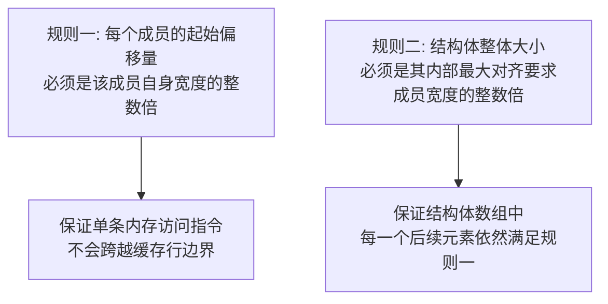
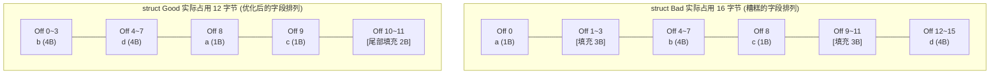
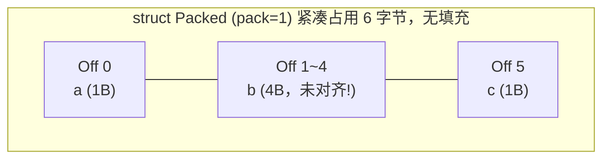
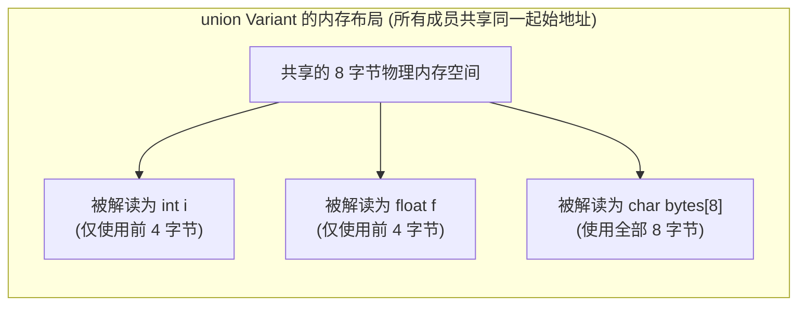
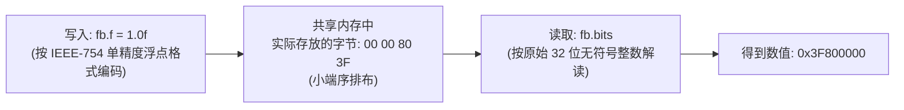
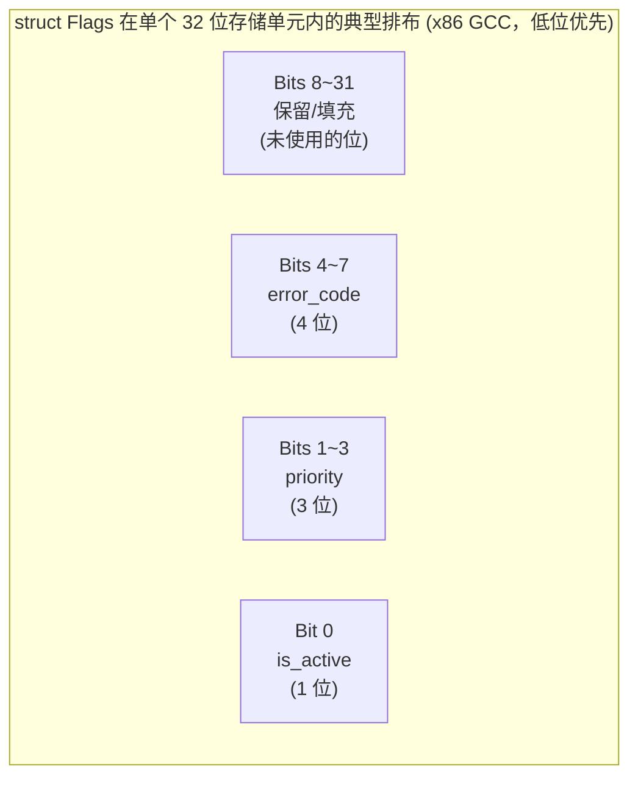
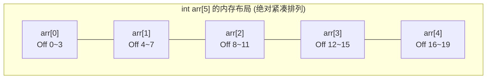
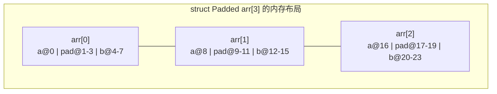
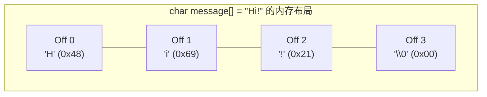
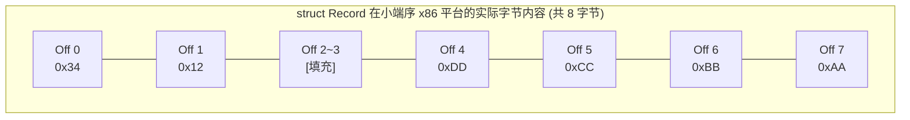

本篇将从硬件寻址的底层视角，系统拆解这些复合数据类型在内存中的真实排布规则，这是理解结构体指针运算、联合体类型双关、以及逆向分析中还原数据结构的核心基础。

---

## 一、 结构体对齐的核心规则回顾

### 1. 两条黄金法则

C/C++ 编译器在为结构体分配内存布局时，严格遵循两条规则：



* **规则一（成员对齐）**：若某个成员宽度为 $N$ 字节，则它在结构体内部的偏移量必须满足 $\text{Offset} \bmod N = 0$。
* **规则二（整体对齐，又称尾部填充 Tail Padding）**：结构体的总大小必须是其**最大对齐要求字段宽度**的整数倍，这是为了确保当若干个该结构体连续排列成数组时，数组中的第二个、第三个……元素依然能满足规则一。

### 2. 典型案例：字段顺序如何影响内存占用

同样的三个字段，仅仅因为声明顺序不同，占用的实际内存就可能产生巨大差异：

```c
struct Bad {
    char  a;     // 1 字节
    int   b;     // 4 字节
    char  c;     // 1 字节
    int   d;     // 4 字节
};

struct Good {
    int   b;     // 4 字节
    int   d;     // 4 字节
    char  a;     // 1 字节
    char  c;     // 1 字节
};
```



**同样的四个字段，`struct Good` 比 `struct Bad` 节省了 25% 的内存占用**。这是实际工程中常见的"结构体瘦身"优化技巧：**将宽度较大的字段集中排列在前，宽度较小的字段放在后面**，可以显著减少编译器插入的无效填充字节。在需要处理海量数据的场景（如游戏引擎的实体组件、网络协议解析、数据库记录），这种优化往往能带来可观的内存与缓存命中率收益。

### 3. `#pragma pack` 与手动控制对齐

编译器也提供了手动干预对齐策略的指令，但需要清楚其代价：

```c
#pragma pack(push, 1)     // 强制按 1 字节对齐，不插入任何填充
struct Packed {
    char a;
    int  b;
    char c;
};
#pragma pack(pop)
```



**代价**：字段 `b` 此时的起始地址（Offset 1）并不是 4 的倍数，这是一次**非对齐内存访问（Unaligned Access）**。虽然 x86 硬件允许非对齐访问（不同于某些严格要求对齐的 RISC 架构会直接触发硬件异常），但会产生**跨缓存行访问的性能惩罚**，且在使用某些要求严格对齐的 SIMD 指令（如 `movaps`）时会直接导致程序崩溃。`#pragma pack` 通常只应用于需要与外部二进制协议（如网络包头、文件格式）精确匹配字节布局的场景。

---

## 二、 联合体（Union）：内存复用与类型双关

### 1. 联合体的核心特性：共享同一块内存

与结构体"每个成员各自占据独立空间"不同，**联合体的所有成员共享同一块起始地址相同的内存区域**，联合体的总大小等于其**最大成员的大小**（并同样向上取整到最大对齐要求的倍数）。

```c
union Variant {
    int    i;      // 4 字节
    float  f;      // 4 字节
    char   bytes[8];  // 8 字节，决定了整个联合体的大小
};
```



### 2. 类型双关（Type Punning）：用联合体"重新解释"二进制位模式

联合体最经典的底层应用是**以一种类型写入数据，用另一种类型读出，从而直接观察或操纵某个值的原始二进制表示**，这在计算机图形学、网络编程、底层算法优化中极为常见。

```c
union FloatBits {
    float    f;
    uint32_t bits;
};

union FloatBits fb;
fb.f = 1.0f;
printf("%08X\n", fb.bits);   // 输出 1.0f 的 IEEE-754 二进制表示: 3F800000
```



#### 对应的汇编层面本质

从汇编的视角看，类型双关"没有做任何实际工作"——它根本不涉及任何数据转换指令（不同于 `(int)some_float` 这种真正的数值类型转换，后者会调用 `cvttss2si` 等浮点转整数指令）。类型双关**仅仅是把同一块内存地址，用不同的指令重新解读**：

```nasm
section .bss
    fb  resd  1          ; 预留 4 字节空间 (联合体整体大小)

section .text
    ; 写入: fb.f = 1.0f
    mov dword [fb], 0x3F800000   ; 直接写入 1.0f 的 IEEE-754 位模式

    ; 读取: fb.bits (当作整数读)
    mov eax, [fb]                ; EAX = 0x3F800000 (普通整数寄存器读取)

    ; 读取: fb.f (当作浮点读)
    movss xmm0, [fb]             ; XMM0 = 1.0f (浮点寄存器读取，解读方式完全不同)
```

**同一个内存地址 `[fb]`，用 `mov` 读出来就是整数视角，用 `movss` 读出来就是浮点视角**——指令本身决定了如何解读这串比特，这与前面章节反复强调的"内存只有比特流，没有类型"的原则完全一致。

### 3. 字节序对类型双关结果的影响

类型双关在跨平台代码中需要格外小心字节序差异。以下例子展示了联合体结合字节数组观察多字节整数内部字节排布的经典手法：

```c
union EndianCheck {
    uint32_t value;
    uint8_t  bytes[4];
};

union EndianCheck ec;
ec.value = 0x12345678;
// 在小端序 x86 平台: ec.bytes[0] == 0x78, ec.bytes[3] == 0x12
// 在大端序平台:       ec.bytes[0] == 0x12, ec.bytes[3] == 0x78
```

这正是前面章节介绍的小端序规则在联合体视角下的直接体现——**低地址存放的是数值的最低有效字节**。

---

## 三、 位域（Bitfield）：比特级别的内存压缩

当某些字段只需要表达很小范围的取值（如布尔开关、3 位的枚举状态）时，C 语言允许通过**位域语法**将多个字段压缩进同一个底层存储单元，以节省内存。

### 1. 位域的声明语法

```c
struct Flags {
    unsigned int is_active   : 1;   // 占用 1 位
    unsigned int priority    : 3;   // 占用 3 位
    unsigned int error_code  : 4;   // 占用 4 位
    unsigned int             : 0;   // 强制对齐到下一个存储单元边界 (无名位域)
};
```

### 2. 典型内存布局（因编译器实现而异）

位域是 C 标准中**明确声明为"实现定义行为"（Implementation-Defined Behavior）**的特性——标准不强制规定位域的填充方向、跨存储单元时的处理方式。以下是 x86 平台上 GCC/Clang 的典型实现（从低位开始填充）：



> **重要警示**：**位域的具体比特排列方向（从低位还是高位开始）、是否允许跨越存储单元边界，这些细节完全取决于编译器与目标平台的实现约定，C/C++ 标准并未对此做出强制规定**。这意味着：
> * 同一份位域结构体代码，在不同编译器（GCC vs MSVC）、不同架构（x86 vs ARM）下编译，其**实际内存布局可能完全不同**。
> * **绝对不应该将位域结构体用于需要精确控制字节级布局的场景**（如网络协议头解析、文件格式解析），这些场景应改用显式的位运算（`&`、`|`、`<<`、`>>`）手动操控整数来保证跨平台一致性。

### 3. 位域访问的汇编本质：移位与掩码

编译器在底层访问位域字段时，实际生成的指令等价于手动的位运算操作，并不存在任何硬件层面的"位域专用指令"：

```c
struct Flags f;
f.priority = 5;             // 将 priority 字段设置为 5 (二进制 101)
int p = f.priority;         // 读取 priority 字段
```

对应的底层汇编近似逻辑（假设 `f` 的地址在 `RDI`，`priority` 位于 Bit 1~3）：

```nasm
; 写入 f.priority = 5 的底层等价操作
mov eax, [rdi]            ; 读取整个 32 位存储单元的当前值
and eax, 0xFFFFFFF1       ; 清空目标比特位 (Bit 1~3)，保留其余位不变
or  eax, (5 << 1)         ; 将新值 5 左移到对应比特位置，再合并进去
mov [rdi], eax             ; 写回整个存储单元

; 读取 f.priority 的底层等价操作
mov eax, [rdi]             ; 读取整个存储单元
shr eax, 1                 ; 右移至最低位
and eax, 0x7               ; 掩码取出低 3 位 (对应 3 位宽度)
```

这正是为什么**位域访问的性能通常略低于普通整型字段访问**——每一次读写位域都隐含了额外的移位与掩码运算，而普通字段只需一次直接的内存读写。

---

## 四、 数组与字符串的内存排布

### 1. 数组：绝对紧凑、无任何填充的连续内存

与结构体不同，**数组内部元素之间绝不会插入任何填充字节**——数组的本质就是把同一种类型的元素严格按照其自身宽度首尾相连地排列：

```c
int arr[5];   // 严格占用 5 × 4 = 20 字节，元素间无间隙
```



**数组整体作为一个变量声明时，依然需要遵守对齐规则**（例如 `int arr[5]` 整体的起始地址仍须是 4 的倍数），但**数组内部元素之间绝不会因为对齐问题而产生空隙**，因为元素类型相同、宽度一致，天然满足对齐要求。

### 2. 结构体数组：结构体内部填充被放大 N 倍

当数组元素本身是带有填充的结构体时，这些填充会随着数组的每一个元素被重复叠加：

```c
struct Padded {
    char a;    // 1 字节
    int  b;    // 4 字节 (需要 3 字节填充)
};             // sizeof(struct Padded) == 8

struct Padded arr[3];   // sizeof(arr) == 8 × 3 == 24 字节
```



每个元素内部浪费的 3 字节填充，在数组中被重复了 3 次，总共浪费了 9 字节——这进一步印证了前文"结构体瘦身"优化在大规模数组场景下的重要性：**单个结构体节省的几个字节，乘以数组元素个数后，可能形成相当可观的内存开销差异**。

### 3. 字符串：以空字符结尾的字节数组约定

C 风格字符串本质上就是一个 `char` 数组，并通过一个**社区约定（而非硬件强制）**的规则来标记字符串的结束：**以数值为 0 的字节（`'\0'`，空终止符 NUL）作为结尾标志**。

```c
char message[] = "Hi!";   // 实际占用 4 字节: 'H', 'i', '!', '\0'
```



#### 汇编层面的字符串结束检测

正因为字符串的结束完全依赖这个"哨兵字节"的约定，几乎所有操作字符串的汇编代码都遵循"逐字节扫描，检测是否为 0"的模式：

```nasm
section .data
    message db "Hi!", 0      ; 显式写出结尾的 0 字节

section .text
; 计算字符串长度的经典汇编实现 (类似 strlen 的核心逻辑)
strlen_impl:
    xor rax, rax              ; 计数器清零
.loop:
    cmp byte [rdi + rax], 0   ; 检测当前字节是否为结束符
    je  .done
    inc rax
    jmp .loop
.done:
    ret                        ; RAX 中存放最终计算出的字符串长度
```

#### NASM 中两种等价但风格不同的字符串定义方式

```nasm
; 方式一：显式手动追加 0 字节 (NASM 不会自动帮你加)
str1 db "Hello", 0

; 方式二：利用 equ 配合 $ 计算长度，不依赖结束符，适合搭配 write() 系统调用 (需要显式长度参数)
str2     db "Hello"
str2_len equ $ - str2            ; str2_len == 5 (不含结束符，因为这里没写 0)
```

> **工程提示**：在使用 Linux 的 `sys_write` 系统调用（需要显式传入字符串长度，不依赖结束符）时，通常采用第二种不含 `\0` 的写法并手动计算长度；而在调用 C 标准库的 `printf`、`strlen` 等依赖空终止符约定的函数时，必须采用第一种显式带 `0` 结尾的写法，否则这些函数会持续读取越界内存直到意外遇到某个恰好为 0 的字节，造成难以预料的崩溃或信息泄露（这也是经典的字符串格式化漏洞与信息泄露类漏洞的成因之一）。

---

## 五、 大小端对复合数据布局的交叉影响

字节序不仅影响单个多字节整数的内部排布，也会影响我们**通过联合体、指针类型转换等手段"跨类型观察"复合数据时所看到的结果**。

### 1. 结构体整体的字节序呈现

考虑一个包含多字节字段的结构体，若将其当作原始字节序列逐字节查看（例如通过网络发送或写入文件），每个多字节字段内部依然遵循该平台的字节序规则：

```c
struct Record {
    uint16_t id;      // 2 字节
    uint32_t value;   // 4 字节 (注意: 需要 2 字节填充对齐)
};

struct Record r = { .id = 0x1234, .value = 0xAABBCCDD };
```



**观察要点**：`id` 字段的两个字节（`0x34, 0x12`）与 `value` 字段的四个字节（`0xDD, 0xCC, 0xBB, 0xAA`）**各自独立地按小端序排列**，字段与字段之间的相对顺序（先 `id` 后 `value`）保持不变，字节序只影响**每个字段内部**的字节排列方向，不影响字段之间的宏观排列顺序。

### 2. 网络协议解析中的常见陷阱

在编写需要解析网络数据包或跨平台二进制文件格式的汇编/C 混合代码时，一个经典的错误是**直接将接收到的大端序网络数据强制转换为本地结构体指针并解引用**：

```c
// 危险示例：假设 buffer 中是从网络接收到的大端序数据
struct Record *r = (struct Record *)buffer;
printf("%u\n", r->value);   // 错误！在小端序 x86 平台上会得到字节颠倒的错误数值
```

正确做法是先通过 `ntohs`/`ntohl`（network-to-host）等转换函数，或手动使用 `bswap` 指令对每个多字节字段进行字节序转换，再进行解读：

```nasm
; 假设 EAX 中是从网络读取到的大端序 32 位数值
bswap eax                  ; 一条指令完成大小端互换，使其符合本地小端序解读习惯
```

---

## 六、 实战演练：综合验证内存布局

通过一段汇编配合内存查看命令，直观验证结构体填充、联合体共享、字符串终止符三个核心概念。

### 1. 源码：`layout_demo.asm`

```nasm
default rel
global _start

section .data
    ; 模拟 struct { char a; int b; short c; } 的手动布局 (含填充)
    struct_demo:
        db  0x11                  ; a, Off 0
        db  0, 0, 0               ; 填充 3 字节, Off 1~3
        dd  0x22222222            ; b, Off 4~7
        dw  0x3333                ; c, Off 8~9
        dw  0                     ; 尾部填充 2 字节, Off 10~11 (凑满 4 的倍数)

    ; 模拟联合体: 同一地址分别用 int 和 4 个 char 观察
    union_demo dd 0x12345678

    ; 带结束符的字符串
    str_demo db "END", 0

section .text
_start:
    ; 1. 验证结构体字段读取
    movzx eax, byte [struct_demo + 0]      ; 读取字段 a
    mov   ebx, [struct_demo + 4]           ; 读取字段 b
    movzx ecx, word [struct_demo + 8]      ; 读取字段 c

    ; 2. 验证联合体类型双关: 按 int 和按单字节分别读取同一地址
    mov   edx, [union_demo]                ; 按 32 位整数读取: 0x12345678
    movzx esi, byte [union_demo]           ; 按单字节读取第 0 个字节: 0x78 (小端序最低字节)

    ; 3. 验证字符串结束符扫描
    xor   r8, r8
.strlen_loop:
    cmp   byte [str_demo + r8], 0
    je    .strlen_done
    inc   r8
    jmp   .strlen_loop
.strlen_done:
    ; R8 此刻应为 3 (字符串 "END" 的长度)

    ; 正常退出
    mov eax, 60
    xor edi, edi
    syscall
```

### 2. 编译链接与 GDB 验证

```bash
nasm -f elf64 -g -F dwarf layout_demo.asm -o layout_demo.o
ld layout_demo.o -o layout_demo
gdb -q ./layout_demo
```

```text
pwndbg> b *_start+40
pwndbg> r
pwndbg> info registers rax rbx rcx rdx rsi r8
rax            0x11      17          # 验证字段 a
rbx            0x22222222 572662306  # 验证字段 b
rcx            0x3333    13107       # 验证字段 c
rdx            0x12345678 305419896  # 验证联合体按 int 读取
rsi            0x78      120         # 验证联合体按单字节读取 (小端序最低字节)
r8             0x3       3           # 验证字符串长度扫描结果

pwndbg> x/12xb &struct_demo               # 以字节为单位查看结构体原始内存内容
pwndbg> x/4xb &union_demo                  # 以字节为单位查看联合体原始内存内容
```

