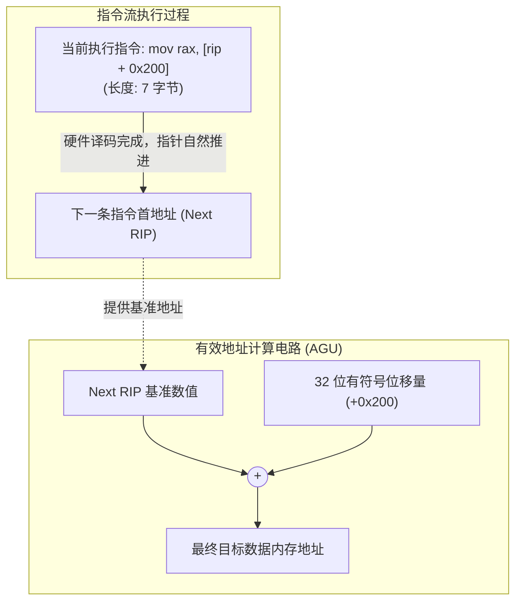
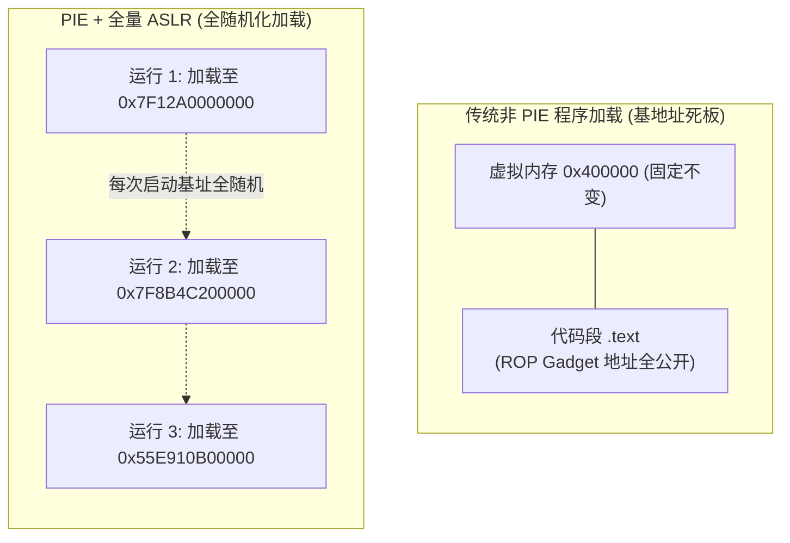
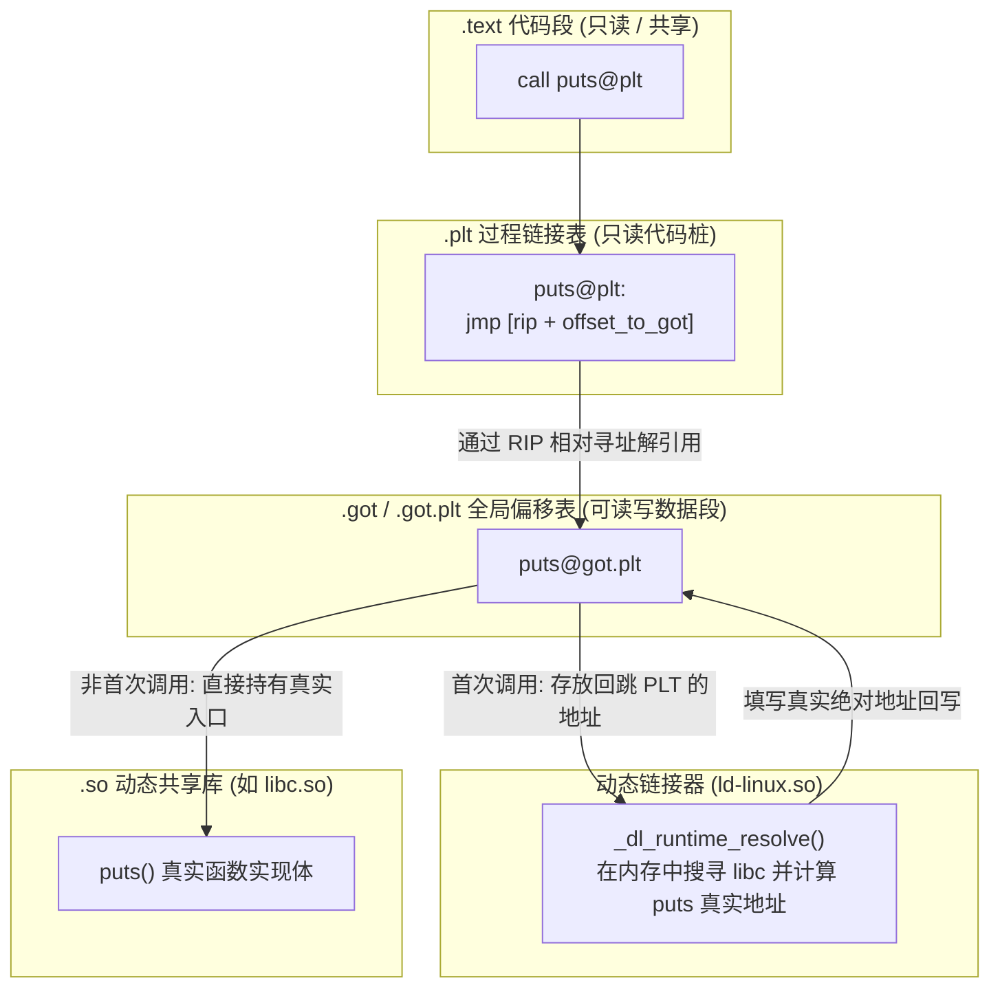

在 32 位（IA-32）时代，编写能够被加载到内存任意位置运行的代码是一件痛苦且性能开销高昂的事情。由于 32 位指令集缺乏直接相对于当前指令指针读取数据的硬件指令，编译器必须通过调用伪函数、执行出栈操作（例如经典的 `call __x86.get_pc_thunk.bx`）来曲线获取当前指令地址。

AMD64（x86-64）体系吸取了这一历史教训，在硬件指令编码层面原生引入了 **RIP 相对寻址（RIP-Relative Addressing）**。这一改进不仅让共享动态库（`.so` / `.dll`）的访问性能大幅提升，更成为了现代操作系统安全防护基石——**ASLR（地址空间布局随机化）** 与 **PIE（位置无关可执行文件）** 的底层硬件支柱。

---

## 一、 RIP 相对寻址原理

### 1. 核心寻址公式与时序特点

RIP 相对寻址是指：**指令操作数的有效内存地址，是由当前指令指针寄存器（RIP）的内容加上指令中硬编码的一个 32 位有符号位移量（Displacement）计算得出的**。

$$\text{有效线性地址} = \text{Next RIP} + \text{Displacement32}$$



这里包含一个极易混淆的关键硬件细节：**基准 RIP 到底指向哪里？**
* 现代 CPU 在取指单元（Fetch Unit）将指令读入并译码后，`RIP` 寄存器内部已经**自动递增并指向了下一条指令的首字节**。
* 因此，位移量（Displacement）计算的起点是**紧随其后的下一条指令的起始地址（Next RIP）**，而非当前指令的起始地址。

---

### 2. 寻址范围与代码模型（Code Models）

在机器码中，RIP 相对寻址的位移量被限制为一个 **32 位有符号整数（`disp32`）**。

这意味着，单条 RIP 相对指令能够覆盖的内存跨度为：
$$-2^{31} \sim +2^{31} - 1 \quad (\text{即 } -2\text{ GB} \sim +2\text{ GB})$$

对于拥有 64 位寻址能力（理论寻址高达 16 EB）的 CPU 来说，$\pm 2\text{ GB}$ 显然无法覆盖整个内存空间。为此，系统软件与编译器划分了不同的代码模型：

* **小代码模型（Small Code Model，默认推荐）**：
  * 编译器假设程序的所有代码段（`.text`）和静态数据段（`.data`、`.bss`、`.rodata`）在虚拟内存中的总跨度不超过 2 GB。
  * 在这个模型下，所有模块内部的函数调用（`call rel32`）和静态数据访问（`mov reg, [rip + disp32]`）均可 100% 使用 RIP 相对寻址，无需引入臃肿的 64 位绝对地址，代码紧凑且性能最优。
* **大代码模型（Large Code Model）**：
  * 用于单个模块体积或静态数据超过 2 GB 的特种超大型程序。
  * 放弃全量 RIP 相对寻址，数据访问退化为通过 64 位绝对立即数（`movabs`）或重定位间接寻址，代码膨胀且执行效率下降。

---

## 二、 [rel symbol] 与 NASM 语法规范

在手写汇编或反编译分析中，正确理解汇编器如何处理符号地址至关重要。

### 1. 绝对寻址 vs. 相对寻址机器码对比

以读取一个定义在数据段的变量 `msg` 为例：

```nasm
section .data
    val dq 0x12345678

section .text
    ; 写法 A: 强制绝对地址寻址 (非 PIC)
    mov rax, [abs val]

    ; 写法 B: 显式使用 RIP 相对寻址 (PIC)
    mov rax, [rel val]
    
    ; 写法 C: 获取变量自身的内存地址指针
    lea rax, [rel val]
```

#### 机器指令底层差异分析：
* **`[abs val]`（绝对寻址）**：
  * 机器码中直接写入该变量在链接期的绝对线性地址（需要 32 位或 64 位重定位支持）。
  * 一旦操作系统将可执行文件加载到其他基地址，此绝对地址直接失效，必须依赖动态链接器在启动时逐条重写二进制指令（Text Relocation），严重破坏代码段的只读共享机制。
* **`[rel val]`（RIP 相对寻址）**：
  * 汇编器计算公式为：$\text{disp32} = \text{Address}(val) - \text{Address}(\text{Next Instruction})$。
  * 机器码中只记录一个**差值**。无论操作系统把整个程序加载到 `0x00000000_00400000` 还是 `0x00007FFF_DEAD0000`，**代码与数据之间的相对偏移永远恒定不变**，CPU 无需任何修正即可直接命中目标数据。

---

### 2. 现代工程规范：`default rel` 指令

在早期 NASM 中，方括号内的符号默认会被汇编为绝对寻址（`[abs symbol]`）。为了强制生成位置无关代码，必须在每个变量访问处繁琐地加上 `rel` 修饰符。

现代 64 位汇编项目的最佳实践是**在文件最顶端添加 `default rel` 伪指令**：

```nasm
default rel              ; 开启全局默认 RIP 相对寻址模式

section .data
    buffer db "Hello", 0

section .text
_start:
    mov al, [buffer]     ; 自动等价于 mov al, [rel buffer]
    lea rdi, [buffer]    ; 自动等价于 lea rdi, [rel buffer]
```

添加该指令后，所有类似 `[symbol]` 的内存引用都会被自动编码为 RIP 相对寻址；如果确实需要绝对寻址，必须显式声明 `[abs symbol]`。

---

## 三、 安全防护基石：ASLR 与 PIE

RIP 相对寻址的普及，彻底改变了现代操作系统的安全攻防格局。

### 1. 传统非 PIE 二进制文件的安全缺陷

在 32 位系统或早期 64 位程序中，可执行文件通常以非位置无关模式编译：
* 链接器在生成 ELF 时，将代码段的加载基地址固定写死为 `0x400000`。
* 虽然操作系统对栈、堆、动态共享库开启了 **ASLR（Address Space Layout Randomization，地址空间布局随机化）**，但主程序自身的 `.text` 代码段地址是固定不变的。
* **安全风险**：攻击者在漏洞利用（Pwn）时，可以直接利用主程序代码段中那些固定地址的指令片段（ROP Gadgets），绕过栈不可执行保护（NX/DEP），发起面向返回编程（ROP）攻击。

---

### 2. PIE（位置无关可执行文件）机制

为了封死这一攻击面，现代编译器引入了 **PIE（Position-Independent Executable）**。



* **本质特征**：开启 PIE 的可执行文件，在 ELF 文件类型标记上不再是 `ET_EXEC`（普通可执行文件），而是被标记为与动态共享库相同的 **`ET_DYN`（共享对象文件）**。
* **运作机制**：操作系统的 ELF 加载器在每次启动程序时，会调用内核的随机数生成器产生一个随机基地址，并将整段程序映射至该随机基址。
* **硬件代价**：在 x86-64 之前，实现全程序位置无关需要耗费大量额外指令计算基址；而得益于 **RIP 相对寻址**，x86-64 运行 PIE 程序的额外性能损耗通常低于 1%，使得现代 Linux 发行版（如 Ubuntu、Fedora、Arch）能够默认全量开启 PIE 编译。

---

## 四、 跨模块动态链接：GOT 与 PLT 的配合

RIP 相对寻址解决了**本模块内部**（模块内部代码访问模块内部数据）的位置无关问题。但是，当程序需要调用**外部共享库**（例如 libc 中的 `printf`、`malloc`）时，新的挑战出现了：

1. 共享库加载到内存的绝对地址在编译期根本未知。
2. 动态库可能被加载到距离主程序超过 2 GB 的极其遥远的虚拟地址，超出了 `disp32` 的直接覆盖范围。
3. 多个进程可能共享同一份物理内存中的 `.text` 代码段，代码段必须保持绝对只读，**绝不能为了填入外部绝对地址而动态修改代码段内容**。

为了兼顾“代码段只读共享”与“跨模块动态重定位”，动态链接器设计了 **GOT（全局偏移表）** 与 **PLT（过程链接表）** 机制。



---

### 1. 全局偏移表（GOT, Global Offset Table）
* **存放位置**：位于数据段（`.got` 与 `.got.plt`）。
* **核心属性**：它是一个**指针数组**，存放在**可写（或加载完成后置为只读）的数据段**中。
* **分工**：主程序代码段不直接写死外部函数地址，而是通过 RIP 相对寻址访问本模块的 GOT 条目（因为本模块的代码段与本模块的数据段之间的相对距离是编译期确定的常数！）：
  ```nasm
  ; 编译器生成的访问外部变量语句:
  mov rax, [rip + extern_var@GOTPCREL] ; 从 GOT 提取外部变量的真实指针
  mov eax, [rax]                       ; 解引用获取真实数值
  ```

---

### 2. 过程链接表（PLT, Procedure Linkage Table）与延迟绑定（Lazy Binding）
对于外部函数调用，如果程序启动时就要解析成千上万个函数符号，加载延迟会极其严重。因此引入了 **延迟绑定（Lazy Binding）**：**外部函数只有在第一次被真正调用时，才由链接器解析其真实地址**。

#### 首次调用与后续调用的时序演化：

1. **第一次调用 `puts@plt`**：
   * 代码执行 `call puts@plt` 进入 PLT 桩代码。
   * PLT 第一行指令为：`jmp [rip + puts@got.plt]`。
   * **此时 GOT 里的初始值并不指向 puts 真实地址，而是指向 PLT 桩指令的下一行！**
   * 程序紧接着将该符号的重定位编号压栈，并跳转至动态链接器的解析入口 `_dl_runtime_resolve()`。
   * 链接器在符号表中完成名称查找与计算，将算出的 libc 中 `puts` 的真实绝对地址**覆写写入 `puts@got.plt` 槽位中**。
   * 链接器顺带调用真实的 `puts()` 完成本次执行。
2. **第二次及后续调用 `puts@plt`**：
   * 代码再次执行 `call puts@plt`。
   * PLT 再次执行：`jmp [rip + puts@got.plt]`。
   * 由于 GOT 已经被覆写，本次跳转**一步直达 libc 中的真实 `puts()` 实现**，不再经过任何链接器解析，执行效率接近原生直接调用。

---

### 3. 安全加固机制：RELRO（只读重定位）

延迟绑定虽然加快了程序启动速度，但也带来了一个严重的内存安全弱点：**`.got.plt` 必须在程序运行期间保持可写状态**。在二进制漏洞利用中，攻击者常常利用格式化字符串或任意写漏洞篡改某个高频调用的 GOT 表项（如把 `free@got` 改成 `system` 的地址），从而实现劫持执行流。

现代编译器和链接器引入了 **RELRO（Relocation Read-Only）** 防护选项：

| RELRO 级别 | 链接器编译参数 | 保护机制 | 对动态绑定的影响 |
| :--- | :--- | :--- | :--- |
| **No RELRO** | `-Wl,-z,norelro` | GOT 区域完全可读写，无任何特殊保护。 | 允许延迟绑定。 |
| **Partial RELRO** | `-Wl,-z,relro` | 将部分内部数据段重排并在加载后置为只读，但保留 `.got.plt` 可写。 | 允许延迟绑定（兼容性折中）。 |
| **Full RELRO** | `-Wl,-z,relro,-z,now` | **关闭延迟绑定**。程序在启动加载的瞬间由链接器解析所有外部符号并全量填入 GOT，随后将**整个 GOT 表段直接修改为物理只读（`R--`）**。 | 彻底免疫 GOT 篡改攻击；大型程序启动耗时略有增加。 |

---

## 五、 实战演练：编写 PIC 共享模块与符号重定位分析

编写一段纯汇编代码，分别展示**模块内部静态数据的 RIP 相对寻址**以及**跨模块调用 libc 函数**的标准写法。

### 1. 源码：`pic_demo.asm`
```nasm
default rel                     ; 声明全局默认使用 RIP 相对寻址

extern puts                     ; 声明引用外部 libc 函数
global my_print_func            ; 导出本模块函数符号

section .rodata
    internal_str db "Position-Independent String via RIP!", 0

section .text
my_print_func:
    ; 函数序言 (保持 16 字节栈对齐要求)
    push rbp
    mov  rbp, rsp
    sub  rsp, 8

    ; 1. 提取模块内部只读数据的指针
    ; 汇编器在此生成 RIP 相对的 LEA 指令
    lea rdi, [internal_str]

    ; 2. 调用外部动态库函数
    ; 链接器会将其解析为跳转至 puts@plt
    call puts

    ; 函数尾声
    add rsp, 8
    pop rbp
    ret
```

### 2. 编译为真正的共享库（Shared Object）

```bash
# 1. 汇编为 64 位目标文件
nasm -f elf64 -g -F dwarf pic_demo.asm -o pic_demo.o

# 2. 链接为动态链接库 (.so)，显式要求完全重定位与 Full RELRO
gcc -shared -fPIC -Wl,-z,relro,-z,now pic_demo.o -o libpic_demo.so
```

### 3. 使用二进制工具剖析重定位项与机器码

使用 `objdump` 查看反汇编：

```bash
objdump -d -M intel libpic_demo.so
```

#### 关键反汇编输出片段：
```text
00000000000010f9 <my_print_func>:
    10f9:   55                      push   rbp
    10fa:   48 89 e5                mov    rbp,rsp
    10fd:   48 83 ec 08             sub    rsp,0x8
    
    ; 验证 1: 模块内寻址采用 RIP 相对
    1101:   48 8d 3d f8 0e 00 00    lea    rdi,[rip+0xef8]        # 2000 <internal_str>
    
    ; 验证 2: 外部函数通过 PLT 桩代码中转
    1108:   e8 f3 fe ff ff          call   1000 <puts@plt>
    
    110d:   48 83 c4 08             add    rsp,0x8
    1111:   5d                      pop    rbp
    1112:   c3                      ret
```

使用 `readelf` 查看其重定位类型：

```bash
readelf -r libpic_demo.so
```

```text
Relocation section '.rela.plt' at offset 0x420 contains 1 entry:
  Offset          Info           Type           Sym. Value    Sym. Name + Addend
000000003fd8  000100000007 R_X86_64_JUMP_SLOT 0000000000000000 puts + 0
```
* **`R_X86_64_JUMP_SLOT`**：这是专门用于 PLT/GOT 绑定的重定位记录，通知系统加载器在加载完成时或首次调用时将 `puts` 的物理地址填入 `0x3fd8` 处的 GOT 槽位中。代码段自身无需经历任何指针重写，保持只读纯洁性。

