x86 硬件工程师很早就预见到了这个高频需求——遍历数组几乎是所有程序最核心的操作之一。因此，从 80386 开始，CPU 在 32 位寻址模式中引入了一个专门的编码字节：**SIB（Scale-Index-Base，比例-变址-基址）字节**，让"索引 × 比例因子"这一步乘法运算**完全由硬件在译码阶段一次性完成**，不需要额外的 `shl` 或 `imul` 指令。

本篇将深入这个字节级别的硬件编码细节，并展示它在数组、多维数组和结构体访问中的真实应用。

---

## 一、 通用寻址公式与 SIB 的意义

x86 复合寻址的完整数学公式为：

$$\text{有效地址 (Effective Address)} = \text{Base} + (\text{Index} \times \text{Scale}) + \text{Displacement}$$

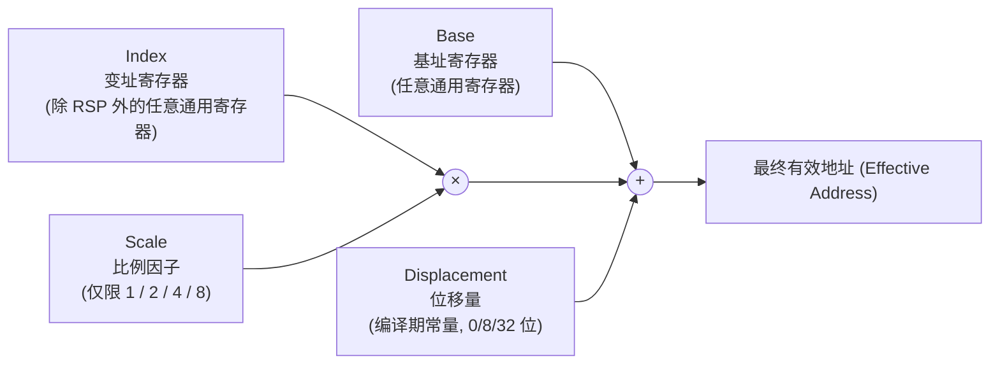

### 1. 为什么比例因子只能是 1、2、4、8？
这并非随意设计，而是**精确匹配了 x86 基础数据类型的字节宽度**：

| 比例因子 | 对应的 C 语言数据类型宽度 |
| :--- | :--- |
| **× 1** | `char`, `int8_t`（1 字节） |
| **× 2** | `short`, `int16_t`（2 字节） |
| **× 4** | `int`, `float`, `int32_t`（4 字节） |
| **× 8** | `long`, `double`, 指针, `int64_t`（8 字节） |

这意味着对于绝大多数常见类型的数组，CPU 可以**用一条指令、零额外开销**地完成 `array[i]` 的寻址计算，无需程序员显式编写乘法指令。

---

## 二、 ModR/M 字节：SIB 存在的前提条件

要理解 SIB 字节，必须先简单了解它的"上级字节"——**ModR/M**。每一条涉及内存操作数的 x86 指令，在 Opcode 之后紧跟着一个 ModR/M 字节，用于描述寻址的基本形态。

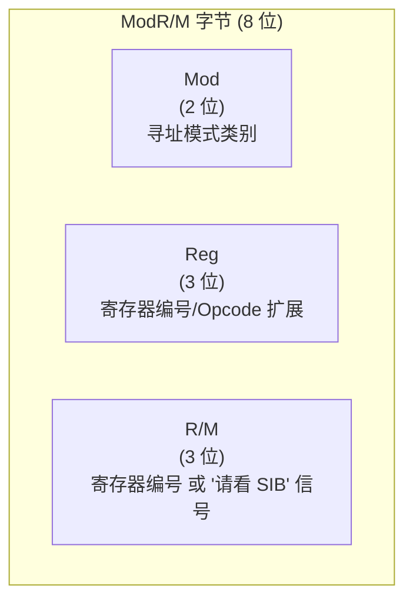

**关键的硬件约定**：当 `ModR/M` 字节的 `R/M` 字段的值恰好为 **`100`（二进制，即十进制 4）**时，这不代表某个具体寄存器编号，而是一个**特殊信号**——它告诉 CPU 译码器："**接下来还有一个 SIB 字节，请继续读取并解析它**"。

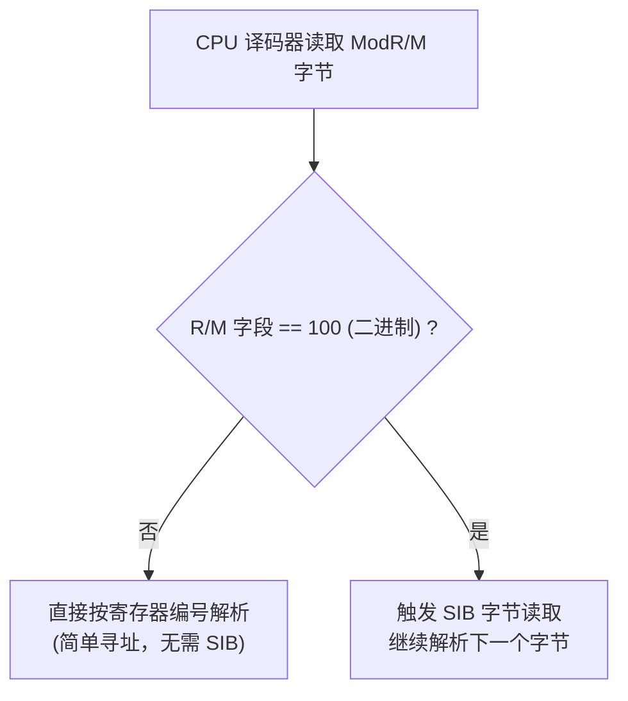

> **为什么 `R/M = 100` 不能直接表示 `ESP` 寄存器？**
> 正是因为这个编码位置被硬件征用作为"SIB 存在"的信号旗，所以在没有 SIB 字节的简单寻址模式下，**`[esp]` 这种写法在 ModR/M 层面无法被直接编码**。因此，即便你写的是看似简单的 `mov eax, [esp]`，汇编器在背后也**必须自动追加一个 SIB 字节**（取值为"无变址、仅基址为 ESP"的特殊编码）才能完成这条指令。这是初学者反汇编时经常疑惑"为什么访问栈指针的简单指令也带了额外字节"的根本原因。

---

## 三、 SIB 字节的位级拆解

SIB 字节同样是 8 位，但被切割成三个不均等的字段：

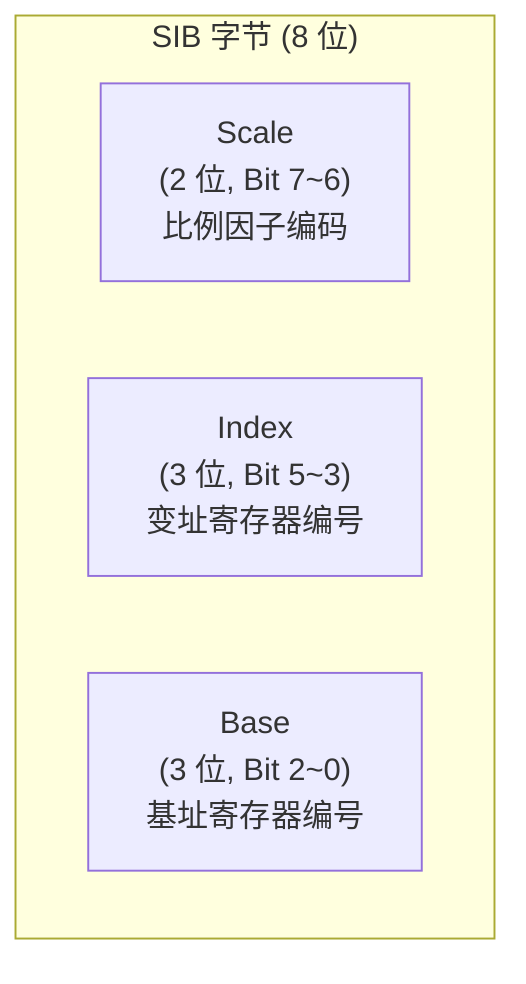

### 1. Scale 字段（2 位）：比例因子的编码映射

| Scale 字段二进制 | 实际比例因子 |
| :--- | :--- |
| `00` | × 1 |
| `01` | × 2 |
| `10` | × 4 |
| `11` | × 8 |

### 2. Index 字段（3 位）：变址寄存器编号与"无变址"特例

Index 字段使用标准的寄存器编号表（`000`=EAX/RAX, `001`=ECX/RCX, `010`=EDX/RDX, `011`=EBX/RBX, `100`=ESP/RSP, `101`=EBP/RBP, `110`=ESI/RSI, `111`=EDI/RDI）。

> **硬件铁律：`ESP`（编号 `100`）永远不能作为变址寄存器！**
> 当 Index 字段的值为 `100` 时，硬件将其解读为**"本次寻址不含变址寄存器"**（即只有 `Base + Disp`，跳过乘法这一步）。这是一条无法绕过的编码规则——**无论在 32 位还是 64 位模式下，`ESP`/`RSP` 永远无法出现在 `[base + index*scale]` 形式的 Index 位置**。
> ```nasm
> mov eax, [ebx + esp*4]   ; 非法！汇编器会直接报错，因为 ESP 的编码位置被"无变址"占用
> mov eax, [esp + ebx*4]   ; 合法：把 ESP 放在 Base 位置，EBX 放在 Index 位置即可
> ```

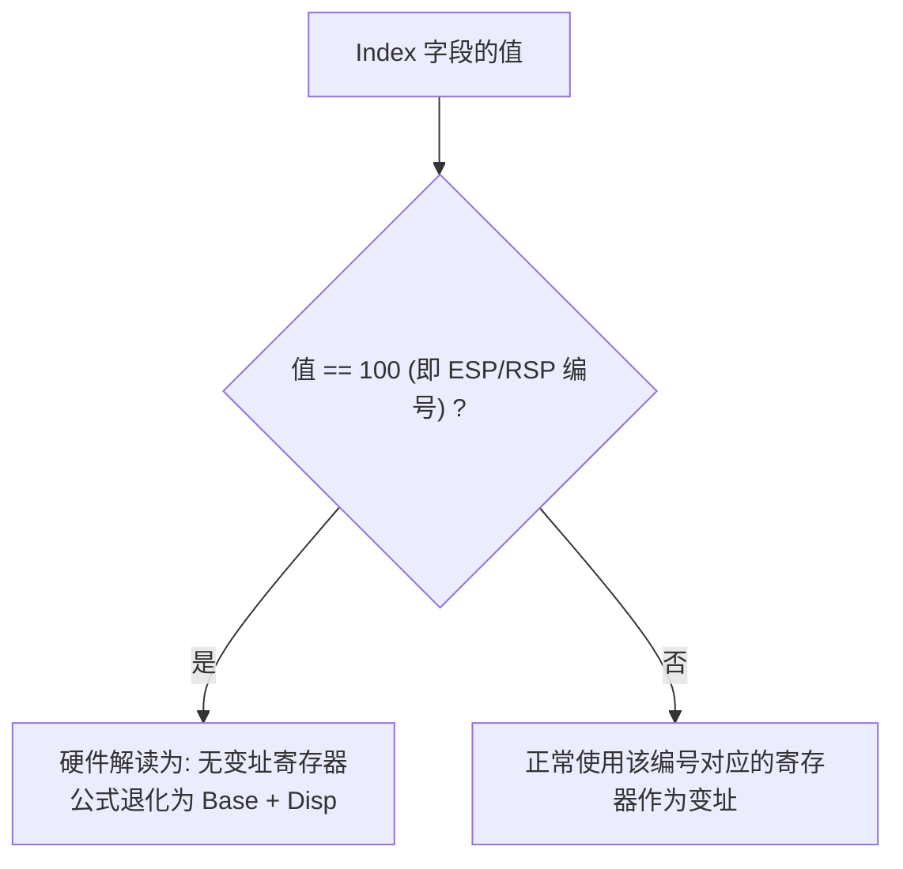

### 3. Base 字段（3 位）：基址寄存器编号与"无基址"特例

同样地，Base 字段也存在一个与 `ModR/M.Mod` 字段联动的特殊情况：

> **硬件铁律：当 `Mod = 00` 且 `Base 字段 = 101`（即 EBP/RBP 编号）时，不代表使用 EBP 作为基址，而是代表"无基址寄存器，改为携带一个 32 位的绝对/相对位移量"！**

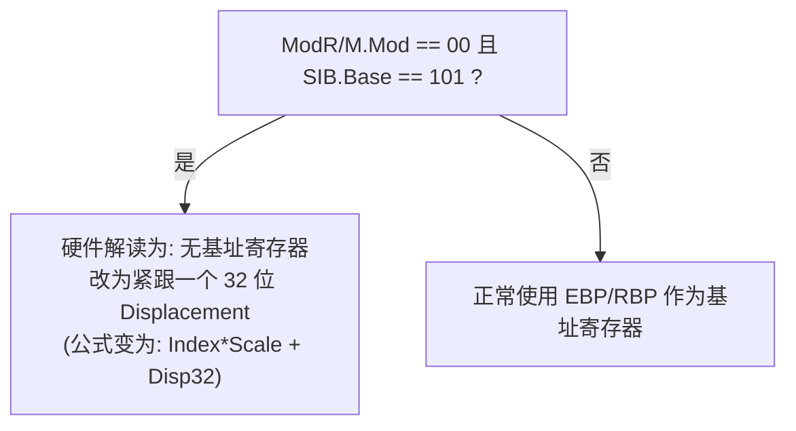

**这个规则带来了一个实战中非常重要的推论**：如果程序员确实想要"以 `EBP` 为基址，且没有任何位移量"（即 `[ebp]`），汇编器**不能**使用 `Mod = 00` 编码，因为那会被曲解为"无基址 + 32位位移"。因此，汇编器会**自动强制改用 `Mod = 01`（8 位位移模式），并把位移量硬编码为 `0`**，生成形如 `[ebp + 0]` 的等价机器码，以此规避歧义。这也是为什么在反汇编代码中，经常能看到看似多余的 `[ebp+0x0]` 写法——这不是编译器的失误，而是**硬件编码规则强制要求的妥协**。

---

### 4. 64 位模式下的 REX 前缀扩展

在 64 位长模式下，Index 和 Base 字段依然只有 3 位（最多表示 8 个寄存器编号），但 64 位需要访问 16 个通用寄存器（含 `R8`~`R15`）。解决方案是引入 **REX 前缀**，从中借用两个额外的扩展位：

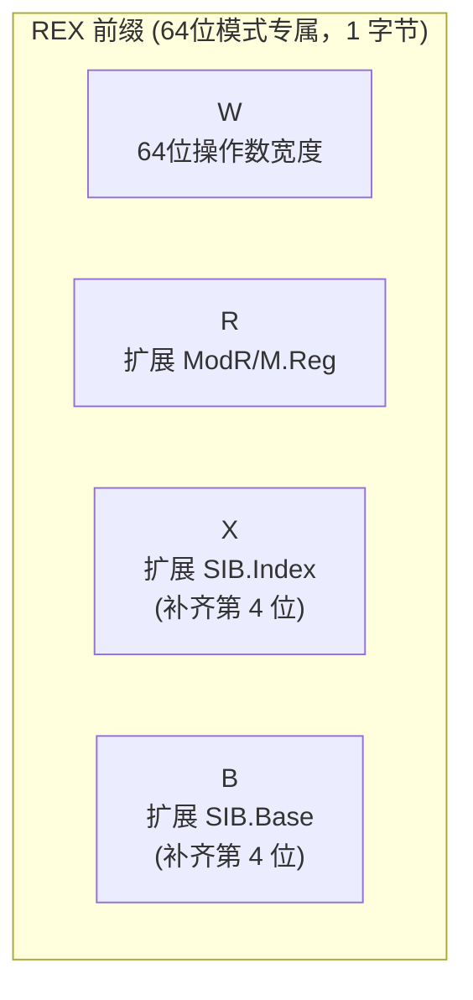

* **`REX.X`**：与 SIB 的 3 位 Index 字段拼接，构成完整的 4 位编号，从而能够表示 `R8`~`R15` 作为变址寄存器。
* **`REX.B`**：与 SIB 的 3 位 Base 字段拼接，同理扩展基址寄存器的可选范围。

---

## 四、 一维数组寻址：比例因子的实战应用

有了 SIB 字节的硬件支持，访问一维数组元素 `array[i]` 终于可以用一条指令、不假思索地完成，无需任何额外的乘法运算指令。

### 1. 地址计算过程可视化

```c
int array[10];
int value = array[i];
```

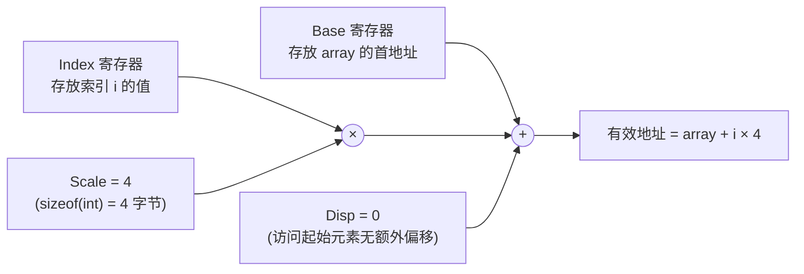

### 2. NASM 汇编实现
```nasm
section .data
    array dd 10, 20, 30, 40, 50     ; int array[5] = {10, 20, 30, 40, 50};

section .text
    ; 假设 RSI 存放 array 的基址, RCX 存放索引 i
    lea rsi, [array]
    mov rcx, 2                       ; i = 2

    ; 一条指令完成 array[i] 的寻址: 硬件自动计算 rsi + rcx*4
    mov eax, [rsi + rcx*4]           ; EAX = array[2] = 30
```

对应生成的机器码中会携带一个 SIB 字节，其 `Scale` 字段编码为 `10`（对应 × 4），`Index` 字段编码为 `RCX`，`Base` 字段编码为 `RSI`——**整个"索引乘以元素宽度"的运算，在硬件地址生成单元（AGU, Address Generation Unit）内部一步完成，完全不占用 ALU 的运算周期**。

### 3. 当比例因子不够用时：手动预乘

如果数组元素宽度不是 1/2/4/8 中的任何一个（例如结构体数组，元素宽度为 12 或 24 字节），硬件的比例因子字段就无能为力了，必须退回到手动乘法：

```nasm
; 假设每个元素占 12 字节 (如某个 struct 大小为 12)，12 不属于 1/2/4/8 之一
mov eax, 12
imul eax, ecx          ; EAX = i * 12 (手动计算字节偏移)
mov edx, [rsi + rax]   ; 将预先算好的偏移量作为 "Base + Index(比例恒为1)" 使用
```

或者使用 `lea` 指令，利用其隐藏的"免费乘法"能力，通过多次嵌套凑出任意整数倍数（例如 `12 = 4 × 3`，先用比例因子算出 ×4，再手动加一次）：
```nasm
lea eax, [rcx + rcx*2]    ; EAX = i + i*2 = i*3
lea eax, [rsi + rax*4]    ; EAX = base + (i*3)*4 = base + i*12
```

---

## 五、 多维数组的地址计算：行主序展开

多维数组在内存中并不存在真正的"二维网格"，它们在编译期被**展开（Flatten）为一段连续的一维内存**，再由编译器自动生成相应的地址计算公式。C/C++ 采用 **行主序（Row-Major Order）** 存储。

### 1. 行主序的物理布局

```c
int matrix[3][4];   // 3 行 4 列的二维数组
```

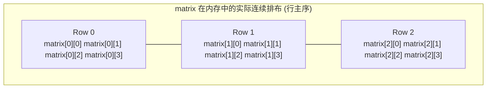

### 2. 二维数组寻址公式推导

访问 `matrix[i][j]` 的通用公式为：
$$\text{地址} = \text{Base} + (i \times \text{列数} + j) \times \text{元素宽度}$$

展开为具体数值（`matrix[3][4]`，`int` 占 4 字节，列数为 4）：
$$\text{地址} = \text{Base} + (i \times 4 + j) \times 4 = \text{Base} + i \times 16 + j \times 4$$

### 3. NASM 实现：访问 `matrix[i][j]`
```nasm
section .data
    ; int matrix[3][4] 初始化为 0~11
    matrix dd 0, 1, 2, 3, 4, 5, 6, 7, 8, 9, 10, 11

section .text
    ; 假设 RDI 存放 matrix 基址, RSI = i, RDX = j
    lea rdi, [matrix]
    mov rsi, 1          ; i = 1
    mov rdx, 2          ; j = 2

    ; 第一步: 计算行偏移 i * 16 (每行占 4个int = 16字节)
    ; 利用 lea 的隐藏乘法能力一次性算出 i*4 (即每行的 int 个数)，再结合 SIB 的比例因子完成 *4 字节
    lea rax, [rsi*4]          ; RAX = i * 4  (代表跳过的"元素个数"，而非字节数)
    add rax, rdx               ; RAX = i*4 + j (这就是展开后的一维等效下标)

    ; 第二步: 利用 SIB 一步完成 "基址 + 一维下标*4字节" 的最终寻址
    mov eax, [rdi + rax*4]     ; EAX = matrix[i][j] = matrix[1][2] = 6
```

> **编译器实战优化视角**：当"列数"在编译期已知为固定常量时（如本例的 4），GCC/Clang 通常会利用 **移位指令代替乘法**（因为 4 是 2 的幂次，`i*4` 等价于 `i << 2`），或者更进一步直接利用一次 SIB 寻址中的 `index*scale` 完成其中一维的计算，仅对另一维使用加法常量合并，从而将上述多步计算压缩为一两条指令。

---

## 六、 结构体数组的复合寻址：三要素协同工作

这是 SIB 寻址能力的"集大成"场景：**遍历一个结构体数组，并访问其中某个具体字段**，需要同时利用 **基址（数组首地址）+ 变址×比例（第几个元素）+ 位移（字段在结构体内的偏移）** 三个要素。

### 1. 结构体定义与内存布局

```c
struct Point {
    int x;    // 偏移 0
    int y;    // 偏移 4
};
struct Point points[10];
int get_y(int i) {
    return points[i].y;
}
```

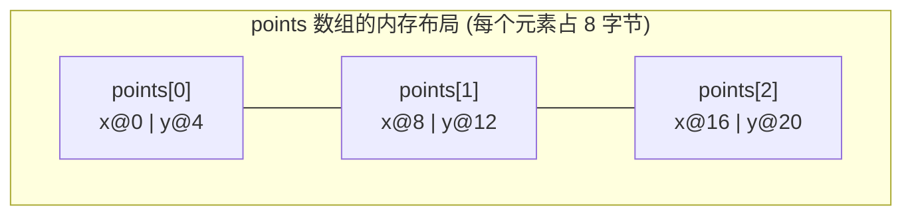

### 2. 地址计算公式
$$\text{\&points[i].y} = \text{points 基址} + (i \times 8) + 4$$

由于 `sizeof(struct Point) = 8` **恰好落在合法比例因子 {1,2,4,8} 范围内**，这个寻址可以用**单条指令、完整利用 SIB 的全部三要素**一步到位完成：

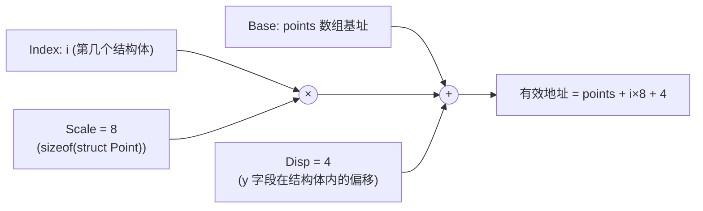

### 3. NASM 实现
```nasm
; 假设 RDI 存放 points 数组基址, RSI 存放索引 i (作为函数参数传入)
get_y:
    mov eax, [rdi + rsi*8 + 4]   ; 一条指令: Base(rdi) + Index(rsi)*Scale(8) + Disp(4)
    ret
```

**这条指令的精妙之处在于**：无论数组有多少个元素、访问第几个元素的哪个字段，CPU 的**地址生成单元（AGU）都能在一个时钟周期内、不占用 ALU 资源的情况下完成全部三项运算**，这正是 x86 CISC 架构"将复杂寻址下沉到硬件"设计哲学的集中体现。

### 4. 当结构体大小不是合法比例因子时

如果 `struct Point` 包含 3 个 `int` 字段（`sizeof = 12`），12 不属于 `{1,2,4,8}`，此时编译器会生成"手动预乘 + SIB 比例恒为1"的组合指令：

```nasm
; 假设 sizeof(struct Point3D) = 12
get_z:
    lea rax, [rsi + rsi*2]        ; RAX = i + i*2 = i*3  (巧妙利用 lea 凑出 ×3)
    mov eax, [rdi + rax*4 + 8]    ; 最终地址 = points + (i*3)*4 + 8 = points + i*12 + 8
    ret
```

---

## 七、 实战演练：完整反汇编验证

编写一段综合性测试代码，涵盖一维数组、二维数组和结构体数组三种场景，通过 GDB 观察编译器/汇编器实际生成的 SIB 编码。

### 1. 源码：`sib_demo.asm`
```nasm
default rel
global _start

section .data
    arr1d   dd  100, 200, 300, 400         ; 一维 int 数组
    arr2d   dd  0, 1, 2, 3, 4, 5, 6, 7     ; 展开后的 2x4 二维数组
    ; struct Point { int x; int y; } points[3];
    points  dd  1, 2,  3, 4,  5, 6         ; 3 个 Point 结构体 (每个 8 字节)

section .text
_start:
    ; --- 场景一：一维数组 arr1d[2] ---
    lea rsi, [arr1d]
    mov rcx, 2
    mov eax, [rsi + rcx*4]            ; EAX = arr1d[2] = 300

    ; --- 场景二：二维数组 arr2d[1][2] (等价于一维下标 1*4+2=6) ---
    lea rdi, [arr2d]
    mov rdx, 6
    mov ebx, [rdi + rdx*4]            ; EBX = arr2d[1][2] = 6

    ; --- 场景三：结构体数组 points[1].y ---
    lea r8, [points]
    mov r9, 1
    mov r10d, [r8 + r9*8 + 4]         ; R10D = points[1].y = 4

    ; 正常退出
    mov eax, 60
    xor edi, edi
    syscall
```

### 2. 编译链接与 GDB 验证
```bash
nasm -f elf64 -g -F dwarf sib_demo.asm -o sib_demo.o
ld sib_demo.o -o sib_demo
gdb -q ./sib_demo
```

```text
pwndbg> disassemble _start
   lea    rsi, [rip+0x...]              # arr1d
   mov    rcx, 0x2
   mov    eax, DWORD PTR [rsi+rcx*4]    # SIB: Base=RSI, Index=RCX, Scale=4, Disp=0

   lea    rdi, [rip+0x...]              # arr2d
   mov    rdx, 0x6
   mov    ebx, DWORD PTR [rdi+rdx*4]    # SIB: Base=RDI, Index=RDX, Scale=4, Disp=0

   lea    r8, [rip+0x...]               # points
   mov    r9, 0x1
   mov    r10d, DWORD PTR [r8+r9*8+0x4] # SIB: Base=R8, Index=R9, Scale=8, Disp=4 (REX.X/B 扩展生效)
```

```text
pwndbg> info registers rax rbx r10
rax            0x12c    300        # 验证一维数组访问结果
rbx            0x6      6          # 验证二维数组访问结果
r10            0x4      4          # 验证结构体字段访问结果
```

> **观察要点**：`mov r10d, [r8 + r9*8 + 4]` 这一行在机器码层面同时用到了 **REX 前缀**（扩展 Base 和 Index 字段以访问 `R8`/`R9`）与 **完整的 SIB 三要素**（Scale=8, Index=R9, Base=R8）外加一个 8 位 Displacement（值为 4）。这是本篇讲解的全部硬件编码规则在一条真实指令中的完整体现。

