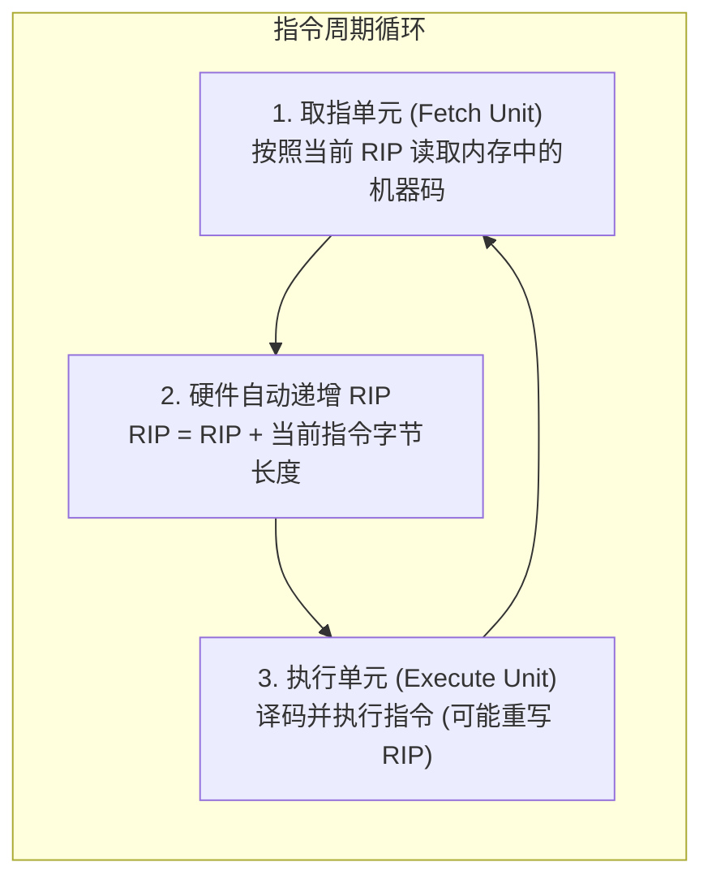
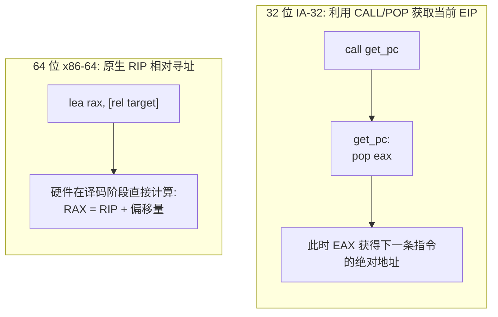
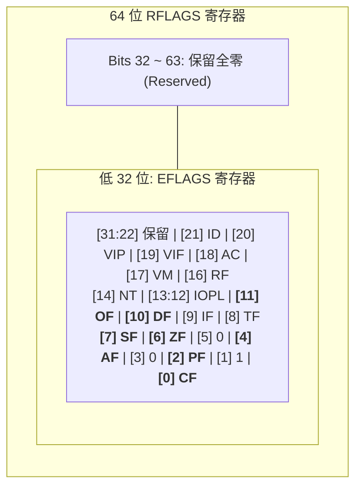
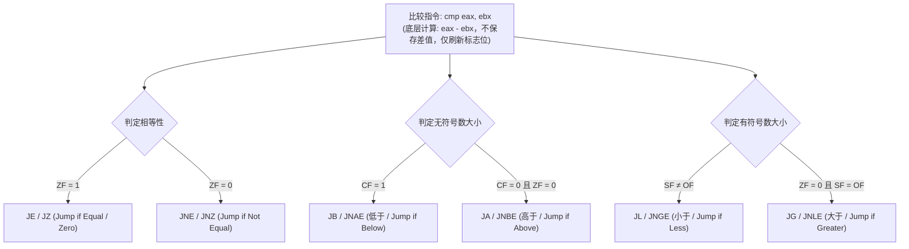
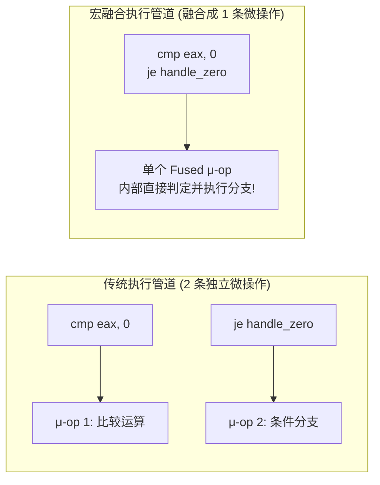

通用寄存器为程序提供了临时存放数据的地方，但 CPU 若想执行逻辑推演，仅有数据暂存是远远不够的。

CPU 必须时刻回答两个基本问题：
1. **下一步该去哪里取指令？** —— 由 **指令指针寄存器（IP / EIP / RIP）** 决定。
2. **上一步运算得到了什么状态？当前是否满足跳转条件？** —— 由 **标志寄存器（FLAGS / EFLAGS / RFLAGS）** 记录。

这两个寄存器构成了整个计算机程序的**控制流中枢**。无论是高级语言中的 `if-else` 分支、`while` 循环、异常处理，还是操作系统级的单步调试与硬件中断响应，底层都依赖它们协同运转。

---

## 一、 指令指针（IP / EIP / RIP）

指令指针寄存器是 CPU 内部最重要的专用寄存器之一，它时刻存储着 **CPU 即将拉取并执行的下一条机器指令的内存地址**。



### 1. 位宽演进与向下兼容
* **16 位（8086）**：**`IP`**（配合代码段寄存器构成 `CS:IP` 实模式寻址）。
* **32 位（IA-32）**：**`EIP`**（在平坦内存模型下寻址 $4\text{ GB}$ 空间）。
* **64 位（x86-64）**：**`RIP`**（支持 64 位线性地址空间，目前硬件通常实现 48 位或 57 位虚拟地址）。

### 2. 访问限制与控制流篡改
程序员**不能像操作普通寄存器那样直接读取或写入指令指针**：
* 试图执行 `mov rip, rax` 或 `mov rax, rip` 会直接导致编译错误，硬件未提供此类通用操作码。
* 修改指令指针的唯一途径是**控制流指令**：
  * **无条件跳转**：`jmp target`（将 `RIP` 强制覆写为目标地址）。
  * **条件跳转**：`jz`, `jge` 等（根据标志位状态决定是否将 `RIP` 更新为跳转目标）。
  * **函数调用与返回**：`call func`（硬件自动将下一条指令的 `RIP` 压栈，再重写 `RIP` 为函数入口）；`ret`（从栈顶弹出保存的地址并写入 `RIP`）。

---

### 3. 获取当前指令指针的技巧演进

在需要编写位置无关代码（PIC）或 Shellcode 时，程序常常需要知道“当前代码正在内存的哪一个绝对地址运行”：



* **32 位的经典技巧（Get-PC Trick）**：
  ```nasm
      call get_my_eip
  get_my_eip:
      pop eax              ; call 指令自动把返回地址压栈，pop 出来即为当前 EIP
  ```
  *局限*：会破坏 CPU 内部用于预测函数返回的**返回地址栈（Return Stack Buffer, RSB）**，引发微架构层面的流水线停顿。
* **64 位的现代方案（RIP 相对寻址）**：
  ```nasm
  lea rax, [rel my_buffer] ; 由编译器计算静态相对差值，硬件以当前 RIP 为基准瞬间相加
  ```
  无需执行任何栈操作或跳转，彻底消除了性能损失。

---

## 二、 标志寄存器（FLAGS / EFLAGS / RFLAGS）全貌

标志寄存器不是一个存储单一数值的容器，而是由 **数个互相独立的 1 位布尔状态位（Flags）** 拼装而成的位图（Bitmap）。



标志位根据功能可以清晰划分为三大阵营：

### 1. 状态标志位（Status Flags，由 ALU 运算动态修改）
这 6 个标志位是汇编分支判断的核心基石：

| 标志位 | 英文全称 | 核心作用与判定条件 | 适用场景 |
| :--- | :--- | :--- | :--- |
| **CF** (Bit 0) | **Carry Flag**（进位标志） | **无符号运算溢出**。最高位产生向外的进位或借位时置 1。 | 无符号数比大小、多精度超长整数加减法。 |
| **PF** (Bit 2) | **Parity Flag**（奇偶标志） | 计算结果**最低 8 位（LSB）**中二进制 `1` 的个数。若为偶数则置 1，奇数置 0。 | 通信数据校验（现代编程极少使用）。 |
| **AF** (Bit 4) | **Auxiliary Flag**（辅助进位） | 运算中 **Bit 3 向 Bit 4** 产生进位时置 1（半字节进位）。 | BCD 码（二进制编码十进制数）算术调整。 |
| **ZF** (Bit 6) | **Zero Flag**（零标志） | **运算结果为 0 时置 1**；结果非 0 则置 0。 | 检测两数是否相等、循环计数终结检测。 |
| **SF** (Bit 7) | **Sign Flag**（符号标志） | 直接复制运算结果的**最高位（符号位）**。结果为负数时置 1。 | 有符号数正负性判定。 |
| **OF** (Bit 11) | **Overflow Flag**（溢出标志） | **有符号补码运算溢出**。超出当前位宽的有符号数表示范围时置 1。 | 有符号数边界保护、防止整型溢出漏洞。 |

### 2. 控制标志位（Control Flag）
* **DF (Direction Flag, Bit 10)**：
  * 控制字符串处理指令（`movsb`, `lodsd`, `stosq`, `scasb` 等）的指针自增方向。
  * `DF = 0`（通过 **`cld`** 指令清除）：指针（RSI/RDI）**自动递增**（从低地址向高地址扫描）。
  * `DF = 1`（通过 **`std`** 指令设置）：指针（RSI/RDI）**自动递减**（从高地址向低地址扫描）。
  * *ABI 规范铁律*：在遵循 C 调用约定跨函数调用时，**DF 必须始终保持为 0**；若临时用 `std` 改变了方向，返回前必须使用 `cld` 复原。

### 3. 系统与调试标志位（System Flags）
* **IF (Interrupt Flag, Bit 9)**：
  * 中断允许标志。为 1 时 CPU 响应外部硬件中断；为 0 时屏蔽中断。特权指令 **`cli`**（关中断）和 **`sti`**（开中断）只能在内核态（Ring 0）执行。
* **TF (Trap Flag, Bit 8)**：
  * 单步调试陷阱标志。当置为 1 时，CPU 每执行完一条机器指令，就会在硬件层面抛出 **`#DB` 调试异常（向量号 1）**。GDB、x64dbg 等调试器的“单步步进（Step Into）”底层正是基于此硬件机制实现。

---

## 三、 条件跳转（jcc）与标志位决策矩阵

汇编中的分支判断通常由两步构成：
1. **产生标志位**：执行算术运算或专门的测试指令（`cmp`, `test`）。
2. **依据标志位跳转**：执行条件跳转指令（`jcc`，`cc` 代表 Condition Code）。



### 1. `cmp` 与 `test` 的区别

| 指令 | 底层实际操作 | 是否保存计算结果？ | 对标志位的修改特征 |
| :--- | :--- | :--- | :--- |
| **`cmp A, B`** | 执行 $A - B$（减法） | **不保存**（丢弃结果） | 全量更新 **CF, OF, SF, ZF, AF, PF**。 |
| **`test A, B`**| 执行 $A \ \& \ B$（按位与） | **不保存**（丢弃结果） | 更新 **SF, ZF, PF**；**强制将 CF 与 OF 清零**。 |

* **工业标准惯用法**：
  * 检测指针是否为空：`test rdi, rdi` 紧接 `jz null_pointer`（比 `cmp rdi, 0` 机器码更短且执行更快）。
  * 检测特定比特是否为 1：`test al, 00000001b` 紧接 `jnz is_odd`。

### 2. 条件跳转速查矩阵

#### A. 无符号数比较（使用 Above / Below 体系，基于 CF 和 ZF）：
* **`ja` / `jnbe`**：高于跳转（Above） $\implies$ 条件：$\text{CF} = 0 \text{ 且 } \text{ZF} = 0$
* **`jae` / `jnb`**：高于或等于跳转 $\implies$ 条件：$\text{CF} = 0$
* **`jb` / `jnae`**：低于跳转（Below） $\implies$ 条件：$\text{CF} = 1$
* **`jbe` / `jna`**：低于或等于跳转 $\implies$ 条件：$\text{CF} = 1 \text{ 或 } \text{ZF} = 1$

#### B. 有符号数比较（使用 Greater / Less 体系，基于 SF、OF 和 ZF）：
* **`jg` / `jnle`**：大于跳转（Greater） $\implies$ 条件：$\text{ZF} = 0 \text{ 且 } \text{SF} = \text{OF}$
* **`jge` / `jnl`**：大于或等于跳转 $\implies$ 条件：$\text{SF} = \text{OF}$
* **`jl` / `jnge`**：小于跳转（Less） $\implies$ 条件：$\text{SF} \neq \text{OF}$
* **`jle` / `jng`**：小于或等于跳转 $\implies$ 条件：$\text{ZF} = 1 \text{ 或 } \text{SF} \neq \text{OF}$

> **💡 为什么有符号小于判定条件是 $\text{SF} \neq \text{OF}$？**
> * 正常情况下，小减大应为负数（$\text{SF}=1, \text{OF}=0$），此时 $\text{SF} \neq \text{OF}$ 成立。
> * 若发生正下溢（两个极值相减发生翻转，产生正数），此时虽然 $\text{SF}=0$，但溢出标志 $\text{OF}=1$，两者依然不相等（$\text{SF} \neq \text{OF}$）。补码溢出被数学上完美抵消！

---

## 四、 指令对标志位的隐式副作用与特例

并不是所有指令都会修改标志位，搞清楚哪些指令“动”标志位、哪些指令“不动”，是写出无 Bug 汇编的关键。

### 1. 经典暗坑：`inc` / `dec` 不影响 CF 标志位
大部分算术指令（`add`, `sub`, `neg`）会刷新所有算术标志位，但 **`inc`（自增）和 `dec`（自减）故意不修改 CF（进位标志）**：

```nasm
clc                  ; 清空进位标志: CF = 0
mov al, 255
add al, 1            ; AL 变为 0，产生进位 -> CF 被置为 1

clc                  ; 清空进位标志: CF = 0
mov al, 255
inc al               ; AL 变为 0，ZF 置为 1，但 CF 顽固保持为 0！
```
* **历史原因**：在 8086 时代，程序员经常编写超长整数（如 128 位）加法循环。循环体使用 `adc`（带进位加法）累加数据，同时需要用 `inc` 递增循环计数器。如果 `inc` 改变了 CF，就会破坏前一次加法留给下一次循环的进位链。

### 2. 标志位保护型指令
* **`mov` / `movzx` / `movsx`**：**完全不影响任何标志位**。搬运数据绝对安全。
* **`lea`（Load Effective Address）**：虽然能做加法和乘法（如 `lea eax, [ebx + ecx*4 + 1]`），但它**完全不修改任何标志位**。在性能敏感代码中，常用 `lea` 代替 `add` 来避免污染当前的条件分支状态。
* **`push` / `pop`**：常规通用寄存器压栈不影响标志位。

### 3. 直接存取标志寄存器的指令
* **`pushfq` / `popfq`**：将 64 位的整个 RFLAGS 压入/弹出栈空间（32 位为 `pushfd` / `popfd`），常用于上下文保存或黑客技术中篡改陷阱标志 TF。
* **`lahf` / `sahf`**：Load/Store AH from/into Flags。将 RFLAGS 的低 8 位直接复制到 `AH` 寄存器或从 `AH` 恢复。
* **单标志位操作**：`clc`（清零 CF）、`stc`（置位 CF）、`cmc`（翻转 CF）、`cld`（清零 DF）、`std`（置位 DF）。

---

## 五、 现代微架构视角：宏融合（Macro-Fusion）

在现代超标量处理器（Intel Sandy Bridge 以后及 AMD Zen 架构）中，硬件前端的译码器引入了 **宏融合（Macro-Fusion）** 技术。



* 当译码器发现一条比较指令（如 `cmp` 或 `test`）后面紧跟着一条兼容的条件跳转指令（如 `je`, `jne`, `jl` 等）时，**硬件会自动将它们粘合为一个单一的微操作（$\mu$-op）**。
* **收益**：不仅节省了流水线执行带宽，使得单周期能够处理更多的指令，而且能更早让分支预测器介入，显著降低分支预测失败的概率。

---

## 六、 实战演练：在 GDB 中动态剖析标志位流转

编写一段测试代码，动态制造无符号进位与有符号溢出，观察 RFLAGS 的真实变化。

### 1. 源码：`flags_demo.asm`
```nasm
default rel
global _start

section .text
_start:
    ; 1. 测试无符号进位 (触发 CF)
    mov al, 0xFF
    add al, 1            ; 255 + 1 -> 结果 AL = 0, CF = 1, ZF = 1

    ; 2. 测试有符号溢出 (触发 OF)
    mov al, 0x7F         ; 正数 +127
    add al, 1            ; 127 + 1 = 128 (有符号视角变为 -128) -> OF = 1, SF = 1, CF = 0

    ; 3. 测试 TEST 清零 CF/OF
    mov eax, 0x1234
    test eax, eax        ; 仅刷新 SF/ZF/PF，强行使 CF = 0, OF = 0

    ; 4. 正常退出
    mov eax, 60
    xor edi, edi
    syscall
```

### 2. 使用 GDB + pwndbg 单步追踪

```bash
# 编译与链接
nasm -f elf64 -g -F dwarf flags_demo.asm -o flags_demo.o
ld flags_demo.o -o flags_demo

# 启动调试
gdb -q ./flags_demo
```

在 GDB 中单步并查看 RFLAGS 的输出片段：

```text
pwndbg> b _start
pwndbg> r
pwndbg> ni             # 执行 mov al, 0xFF
pwndbg> ni             # 执行 add al, 1

# 此时观察控制台高亮输出的 EFLAGS:
EFLAGS: 0x246 [ PF ZF IF ] (注: 部分调试器会显式打印进位标志 [ CF ])
pwndbg> info registers rflags
rflags         0x257    [ CF PF AF ZF IF ]

pwndbg> ni             # 执行 mov al, 0x7F
pwndbg> ni             # 执行 add al, 1 (有符号溢出)

pwndbg> info registers rflags
rflags         0xa86    [ PF SF IF OF ]  <-- 注意: OF (溢出) 与 SF (负数) 同时亮起，CF 熄灭！
```


