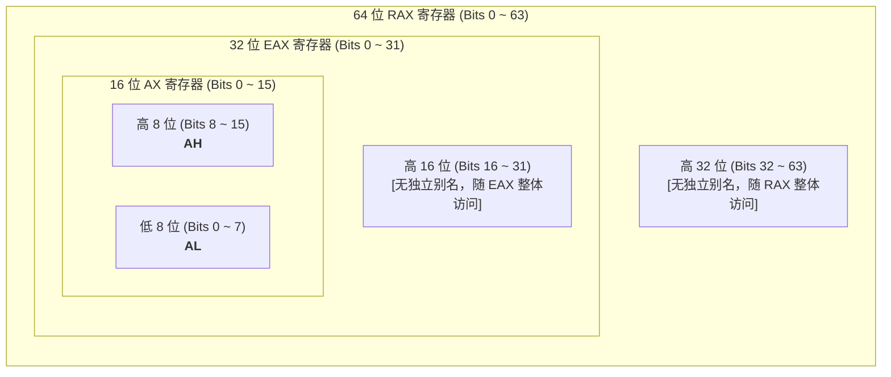
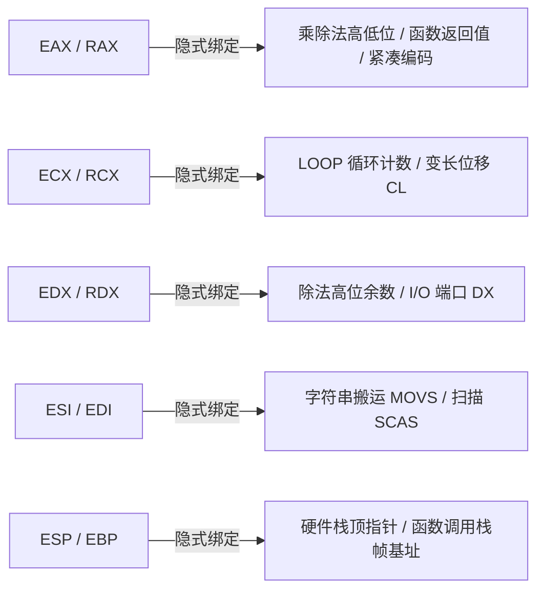
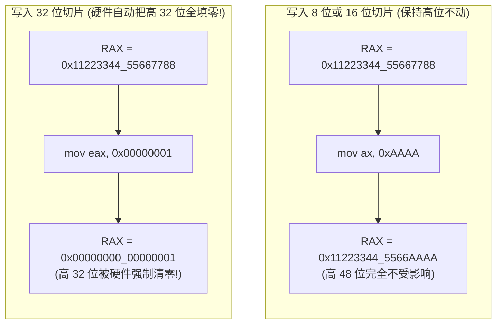

在 RISC 架构（如 ARM、MIPS、RISC-V）中，通用寄存器通常具有高度的正交性与一致性（例如 ARM64 的 `X0` ~ `X30` 几乎拥有相同的地位与功能）。

然而，**x86 架构是一个典型的 CISC（复杂指令集）系统，其通用寄存器带有强烈的非对称性与历史演进痕迹**。在 8086 时代，芯片内部的晶体管资源极其珍贵，硬件工程师为了精简指令编码，将许多运算与控制操作强行与特定寄存器绑定。随着 32 位（IA-32）和 64 位（x86-64）的演进，这些寄存器虽然扩展为完全通用的存储单元，但其原有的**隐式指令绑定**与**物理切片机制**被完整地保留了下来。

深入理解通用寄存器的切片拓扑与底层行为，是掌握汇编内存交互、调用约定与逆向分析的核心基本功。

---

## 一、 命名演进与硬件切片拓扑

x86 的通用寄存器并非每代推倒重来，而是采取了**“俄罗斯套娃”式的物理嵌套扩充**。新一代架构的寄存器直接向下囊括上一代寄存器的物理存储单元。

### 1. 经典寄存器的物理切片模型

以累加器 `RAX` 为例，同一个 64 位物理寄存器根据访问位宽的不同，被拆分出了多个维度的逻辑别名：



* **`RAX` (64 bits)**：访问整个 64 位寄存器（Quadword）。
* **`EAX` (32 bits)**：访问 `RAX` 的**低 32 位**（Doubleword）。前缀 `E` 代表 Extended。
* **`AX` (16 bits)**：访问 `EAX` 的**低 16 位**（Word）。
* **`AL` (8 bits)**：访问 `AX` 的**低 8 位**（Byte）。后缀 `L` 代表 Low。
* **`AH` (8 bits)**：访问 `AX` 的**高 8 位**（Byte，即物理位的第 8 到 15 位）。后缀 `H` 代表 High。

> **⚠️ 寻址边界注意**：CPU 内部没有为 `EAX` 的高 16 位或 `RAX` 的高 32 位分配像 `AH` 这样的独立访问别名。若要单独访问它们，必须借助位移指令（如 `shr` / `ror`）将其移至低位。

---

### 2. 全量通用寄存器位宽对照表

在 64 位长模式下，CPU 拥有 **16 个通用寄存器**。经典 8 个寄存器沿用历史命名规则，而 64 位新增的 8 个扩展寄存器（`R8` ~ `R15`）则采用了更为规整的数字后缀命名法：

| 64 位原生 | 32 位低切片 | 16 位低切片 | 8 位低切片 | 8 位高切片 | 寄存器历史角色与助记全称 |
| :--- | :--- | :--- | :--- | :--- | :--- |
| **RAX** | EAX | AX | AL | **AH** | **Accumulator**（累加器） |
| **RCX** | ECX | CX | CL | **CH** | **Counter**（计数器） |
| **RDX** | EDX | DX | DL | **DH** | **Data**（数据寄存器） |
| **RBX** | EBX | BX | BL | **BH** | **Base**（基址寄存器） |
| **RSP** | ESP | SP | SPL | *无* | **Stack Pointer**（栈指针寄存器） |
| **RBP** | EBP | BP | BPL | *无* | **Base Pointer**（基址指针 / 栈帧指针） |
| **RSI** | ESI | SI | SIL | *无* | **Source Index**（源变址寄存器） |
| **RDI** | EDI | DI | DIL | *无* | **Destination Index**（目的变址寄存器） |
| **R8** | R8D | R8W | R8B | *无* | 64 位新增通用扩展寄存器 8 |
| **R9** | R9D | R9W | R9B | *无* | 64 位新增通用扩展寄存器 9 |
| **R10** | R10D | R10W | R10B | *无* | 64 位新增通用扩展寄存器 10 |
| **R11** | R11D | R11W | R11B | *无* | 64 位新增通用扩展寄存器 11 |
| **R12** | R12D | R12W | R12B | *无* | 64 位新增通用扩展寄存器 12 |
| **R13** | R13D | R13W | R13B | *无* | 64 位新增通用扩展寄存器 13 |
| **R14** | R14D | R14W | R14B | *无* | 64 位新增通用扩展寄存器 14 |
| **R15** | R15D | R15W | R15B | *无* | 64 位新增通用扩展寄存器 15 |

> **💡 REX 前缀的冲突限制**：在 64 位机器码编码中，一旦指令包含访问 `R8`~`R15` 或 `SPL/BPL/SIL/DIL` 所需的 **REX 前缀**，指令就**无法在同一行中编码访问 `AH`, `BH`, `CH`, `DH`**。这是硬件操作码空间不足导致的编码互斥。

---

## 二、 经典寄存器的约定用途与隐式指令绑定

虽然在现代 32 位和 64 位代码中，大部分寄存器可以作为算术中转自由使用，但 CPU 的许多核心硬件指令依然**强制绑定特定寄存器**：



### 1. RAX / EAX（累加器 Accumulator）
* **函数返回值**：无论在 32 位（`cdecl`, `stdcall`）还是 64 位（System V, MS x64）ABI 中，整数与指针类型的函数返回值**永远优先存放在 EAX / RAX 中**。
* **算术乘除法**：
  * 无符号乘法 `mul ebx`：隐式将 `EAX * EBX`，结果的 64 位积跨寄存器存放在 `EDX:EAX`（高 32 位在 EDX，低 32 位在 EAX）。
  * 除法 `div ebx`：隐式将 `EDX:EAX` 构成的 64 位被除数除以 `EBX`，商存入 `EAX`，余数存入 `EDX`。
* **编码特权（紧凑机器码）**：针对 `AL/AX/EAX` 与立即数的运算指令，x86 提供了特化的单字节/短操作码。例如 `add eax, 5` 比 `add ebx, 5` 的机器码更短。

### 2. RCX / ECX（计数器 Counter）
* **循环控制**：传统的 `loop` 指令在每次执行时，会自动将 `ECX/RCX` 递减 1，并在非零时跳转。
* **变长位移操作**：当位移指令（`shl`, `shr`, `sar`, `rol`, `ror`）的位移量不是常数时，**硬件强制要求必须使用 `CL` 寄存器传递位移量**：
  ```nasm
  mov cl, 4
  shl eax, cl       ; 合法：将 EAX 逻辑左移 4 位
  ; shl eax, bl     ; 非法！x86 硬件不支持除 CL 以外的通用寄存器控制位移
  ```

### 3. RDX / EDX（数据寄存器 Data）
* **大数运算扩展**：作为 `EAX` 的高位孪生伴侣，共同构成 `EDX:EAX` 配合完成乘除法。
* **I/O 端口寻址**：在执行硬件级输入输出指令时，若端口号超过 255，必须写入 `DX` 寄存器：
  ```nasm
  mov dx, 0x3F8     ; 串口 COM1 端口号
  in  al, dx        ; 从指定端口读入一字节
  ```

### 4. RSI 与 RDI（源变址与目的变址）
* **块内存/字符串操作**：指令 `movsb` / `movsd` / `movsq`（Move String）强制将 `[RSI]` 处的内存块复制到 `[RDI]`，并在执行后根据标志位 `DF` 自动自增或自减指针。
* **64 位传参核心**：在 Linux/macOS 的 System V AMD64 ABI 中，`RDI` 和 `RSI` 获得了极高地位，被钦定为**第 1 个与第 2 个函数调用传参寄存器**。

### 5. RSP 与 RBP（栈顶与基址指针）
* **`RSP` (Stack Pointer)**：**严格受硬件保护与管理**。执行 `push`、`pop`、`call`、`ret` 指令时，CPU 内部电路会自动加减 `RSP` 的值。任何代码都不应将 `RSP` 当作通用寄存器暂存临时数据。
* **`RBP` (Base Pointer)**：传统上用于锚定函数的栈帧起点（Stack Frame）。通过固定偏移（如 `[rbp - 8]` 访问局部变量、`[rbp + 16]` 访问入栈参数）。现代优化编译在开启 `-fomit-frame-pointer` 后，可将 `RBP` 释放为普通通用寄存器使用。

---

## 三、 硬件行为陷阱与微架构细节

通用寄存器的切片机制看似简单，但在现代超标量（Superscalar）、乱序执行（Out-of-Order Execution）的 CPU 中，隐藏着两个极其关键的底层细节。

### 1. 致命特例：32 位写入自动清零高 32 位

这是 x86 演进至 64 位（AMD64）时引入的最关键规则，初学者极易踩坑：



#### 为什么 AMD 当年要这样设计？
* **消除伪依赖（False Dependency）与寄存器重命名优化**：
  * 在 CPU 乱序执行流水线中，如果一条指令修改 `AX`，CPU 必须等待前一条修改 `RAX` 的指令彻底执行完毕，才能把两者合并拼装起来，这会引发流水线停顿（Stall）。
  * AMD64 规范规定：**任何向 32 位寄存器的写入，直接将其对应的 64 位寄存器高 32 位清零**。这意味着 CPU 可以直接视其为一次对全新寄存器的完整重写，无须等待旧值，硬件重命名单元（Register Renaming Unit）可以直接调度后续指令并行执行！

#### 实战启示：
在 64 位汇编中，将一个 64 位寄存器清零的最优写法**不是** `xor rax, rax`，而是：
```nasm
xor eax, eax       ; 硬件不仅将 EAX 置零，还会自动把 RAX 的高 32 位也置零！
                   ; 优点: 机器码仅 2 字节 (少一个 64 位 REX 前缀字节)，无依赖停顿
```

---

### 2. 部分寄存器停顿（Partial Register Stall）

在过去，很多程序员喜欢利用小位宽切片来“节省内存或指令”，例如：

```nasm
mov al, [rsi]      ; 仅加载 1 字节到 AL
add eax, 10        ; 紧接着读取整个 32 位 EAX
```

这种代码在现代微架构下会触发 **部分寄存器停顿（Partial Register Stall）** 或付出 **合并微操作（Merge $\mu$-op）** 的性能惩罚：
* 因为写入 `AL` 并不会修改 `EAX` 的高 24 位，导致在流水线内部，`EAX` 依赖于两部分：旧的 `EAX[31:8]` 和新的 `AL[7:0]`。
* 当紧接着执行 `add eax, 10` 时，执行引擎必须停滞若干个时钟周期，强行将分离的物理数据拼接成完整的 32 位寄存器状态。

#### 现代工业标准的破局之道：
永远优先使用 **零扩展（`movzx`）** 将小数据直接铺展到完整寄存器中：
```nasm
movzx eax, byte ptr [rsi]  ; 一步到位读取 1 字节并把高位全部填零
add   eax, 10              ; 零性能惩罚，寄存器完全独立
```

---

## 四、 寄存器切片动态变化实战演练

为了建立最直观的物理印象，通过一段简单的测试程序，观察一个 64 位寄存器在各个切片写入指令下的实际数值流转。

### 1. 实验代码：`regs_slice.asm`
```nasm
default rel
global _start

section .text
_start:
    ; 1. 将 RAX 铺满测试数据
    mov rax, 0x1122334455667788

    ; 2. 写入低 8 位 (AL)
    mov al, 0xAA

    ; 3. 写入次低 8 位 (AH)
    mov ah, 0xBB

    ; 4. 写入 16 位 (AX)
    mov ax, 0xCCCC

    ; 5. 见证奇迹：写入 32 位 (EAX)
    mov eax, 0x12345678

    ; 6. 正常退出程序
    mov eax, 60
    xor edi, edi
    syscall
```

### 2. 寄存器值变化全程跟踪分析

| 执行指令 | 物理寄存器 `RAX` 的十六进制全景 (64 bits) | 核心原理解析 |
| :--- | :--- | :--- |
| **初始状态** | `0x1122334455667788` | 设定全量初始测试模式 |
| `mov al, 0xAA` | `0x11223344556677`**`AA`** | 仅覆盖最低 8 位，其余 56 位完好无损 |
| `mov ah, 0xBB` | `0x112233445566`**`BB`**`AA` | 仅覆盖 Bits 8~15，其余 56 位完好无损 |
| `mov ax, 0xCCCC` | `0x112233445566`**`CCCC`** | 覆盖低 16 位，同时冲刷掉刚才写入的 AH 和 AL |
| `mov eax, 0x12345678` | **`0x00000000`**`12345678` | **触发硬件清零！** 原本高位的 `0x11223344` 彻底抹除！ |

---
