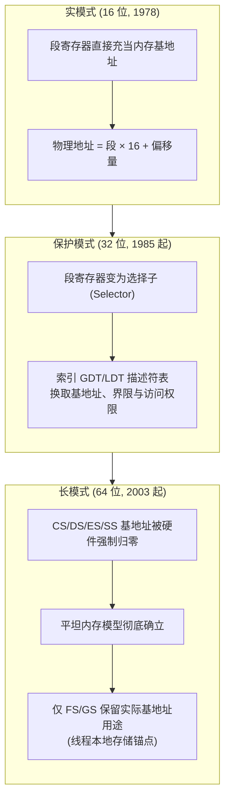
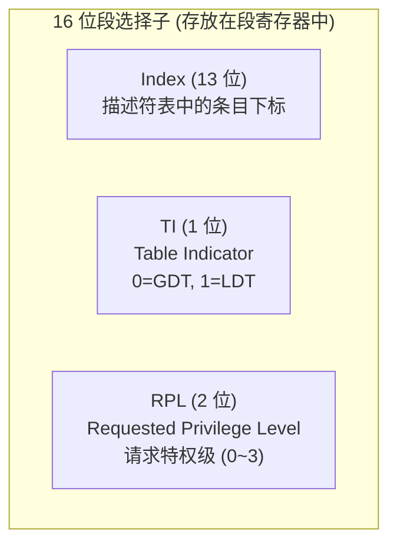
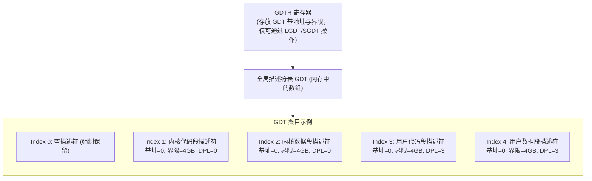
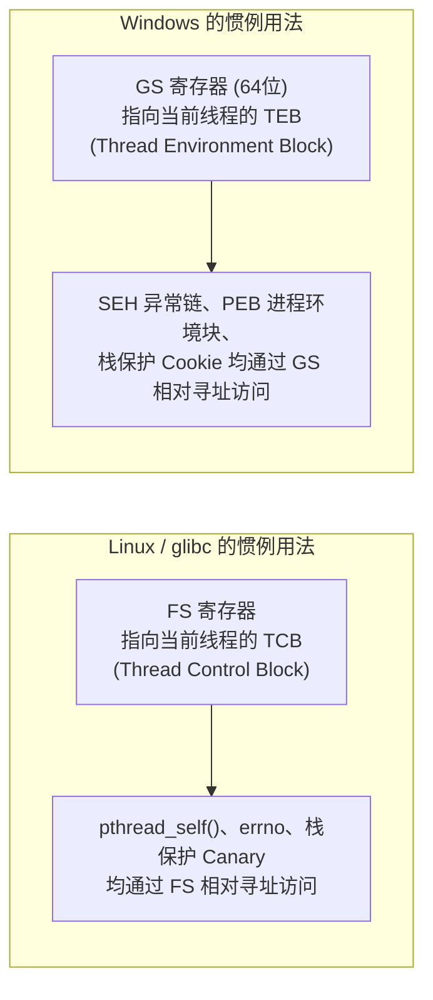
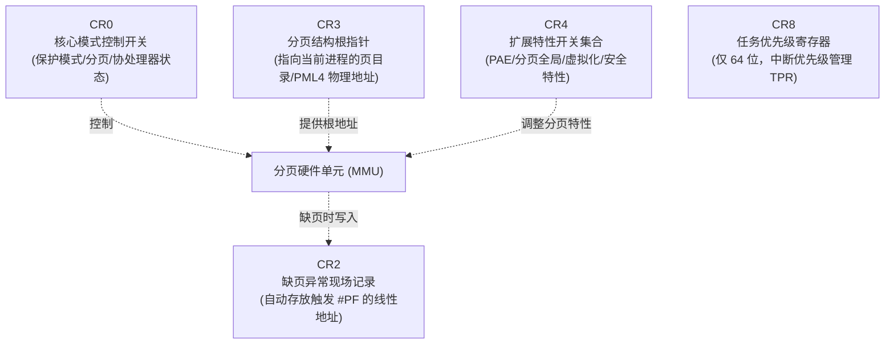
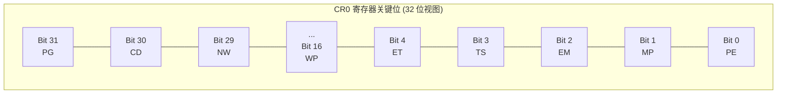
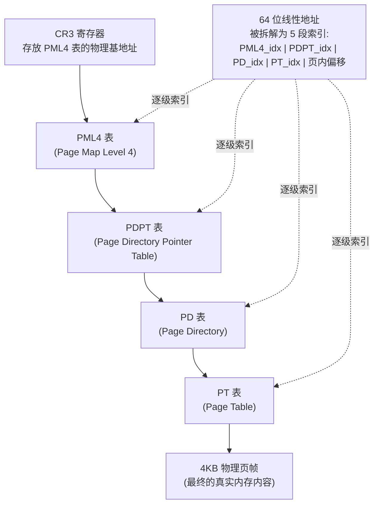

通用寄存器负责搬运和计算数据，指令指针与标志寄存器负责决定控制流走向，而**段寄存器（Segment Registers）**与**控制寄存器（Control Registers）**则共同构成了 x86 架构中**内存访问权限、地址转换规则与 CPU 工作模式**的底层治理体系。

这两类寄存器在应用层编程中几乎“隐身”——普通用户态程序几乎不会显式操作它们。但正是它们在幕后默默工作，才使得操作系统能够实现：**进程间内存隔离、虚拟内存分页、特权级保护，以及线程局部存储（TLS）**。深入理解它们，是从“应用层汇编程序员”迈向“系统级开发者 / 内核逆向工程师”的分水岭。

---

## 一、 段寄存器（Segment Registers）的历史与现状

x86 拥有 6 个段寄存器：`CS`、`DS`、`ES`、`SS`、`FS`、`GS`。它们的含义随着 CPU 运行模式的演进发生了根本性的转变。



### 1. 实模式：段寄存器即基地址
在 8086 时代，段寄存器中存放的数值**本身就是内存基地址的高位部分**。完整的物理地址计算公式为：
$$\text{物理地址} = (\text{段寄存器} \times 16) + \text{偏移量}$$

例如 `DS = 0xDEAD`，`offset = 0xCAFE`，则物理地址为：
$$0xDEAD \times 16 + 0xCAFE = 0xDEAD0 + 0xCAFE = 0xEB5CE$$

这套机制允许 20 位地址总线（$1\text{ MB}$ 寻址空间）用两个 16 位寄存器拼凑出来，但也带来了**内存别名问题**（同一物理地址可被无数种 `段:偏移` 组合表达）。

### 2. 四大经典段寄存器的专属角色
即便在实模式下，硬件也为不同段寄存器绑定了隐式的用途：

| 段寄存器 | 全称 | 隐式绑定场景 |
| :--- | :--- | :--- |
| **CS** | Code Segment（代码段） | 与 `IP/EIP/RIP` 组合，决定取指令的物理地址来源。不可通过 `mov` 直接赋值，只能通过 `jmp far`、`call far` 等远跳转指令隐式更新。 |
| **DS** | Data Segment（数据段） | 绝大多数默认内存操作数（如 `mov eax, [ebx]`）的默认段。 |
| **SS** | Stack Segment（栈段） | 与 `SP/ESP/RSP`、`BP/EBP/RBP` 组合使用，`push`/`pop`/`call`/`ret` 默认访问此段。 |
| **ES** | Extra Segment（附加段） | 字符串操作指令（`movs`, `stos`, `scas`）中，**目的指针 `DI/EDI/RDI` 强制绑定 ES 段**，不可通过段前缀覆写。 |

---

## 二、 保护模式：段选择子与描述符表

80286 引入保护模式后，段寄存器的角色发生了质变：它不再直接是地址，而变成了一个**索引值（选择子，Selector）**，用于查询一张描述符表，换取真正的段属性。

### 1. 段选择子（Segment Selector）的位级结构



* **Index（索引，13 位）**：指明该描述符在表中的第几项（$2^{13} = 8192$ 个条目）。
* **TI（表指示位，1 位）**：决定去查全局描述符表（GDT）还是局部描述符表（LDT）。
* **RPL（请求特权级，2 位）**：标明发起此次访问请求的代码运行在哪个特权环（Ring 0 最高权限 ~ Ring 3 最低权限）。

### 2. 全局描述符表（GDT）与段描述符



每一条 **段描述符（Segment Descriptor）** 占用 8 字节，核心字段包括：
* **Base（基地址）**：段的起始物理/线性地址。
* **Limit（界限）**：段的最大长度（结合粒度位可表示到 4GB）。
* **DPL（Descriptor Privilege Level）**：该段所要求的特权级别（0~3）。
* **Type（类型位）**：标明这是代码段、数据段还是系统段（如 TSS、调用门）。

> **💡 现代操作系统的“平坦化欺骗”**：Linux 和 Windows 在初始化 GDT 时，几乎所有段描述符的 **Base 均被设置为 0，Limit 均被设置为最大值**。这使得保护模式下的分段机制在数值计算上名存实亡，所有地址翻译的实际重任完全转交给了后文的**分页机制**。段机制仅保留下来**用于区分特权级（Ring 0 内核 / Ring 3 用户）**这一核心职能。

---

## 三、 现代长模式下的特例：FS 与 GS 段

进入 64 位长模式后，硬件**强制将 CS、DS、ES、SS 的基地址视为 0**（即便你写入非零的 Base 字段，硬件也会忽略）。然而，`FS` 和 `GS` 是**唯二被长模式保留实际基地址功能的段寄存器**，通过专用的 **MSR（Model-Specific Register，型号特定寄存器）** 配置：

* `FSBASE`（MSR 地址 `0xC0000100`）
* `GSBASE`（MSR 地址 `0xC0000101`）
* `KERNEL_GSBASE`（MSR 地址 `0xC0000102`，配合 `swapgs` 指令在用户态/内核态之间切换）



### 1. 反汇编中识别段前缀的实战意义
在逆向分析二进制文件时，看到如下带段前缀的指令是极其重要的信号：

```nasm
; Linux x86-64：从 FS 段基址偏移 0x28 处读取栈保护哨兵值 (Stack Canary)
mov rax, fs:[0x28]

; Windows x64：访问 TEB 结构体中偏移 0x30 处的自引用指针
mov rax, gs:[0x30]
```
* 这类指令通常出现在函数的**序言（Prologue）**与**尾声（Epilogue）**部分，是**编译器自动插入的栈溢出防护机制（Stack Canary / `/GS` 编译选项）**的典型特征。
* 在 Windows 内核调试与反调试对抗中，`gs:[0x30]` 访问 PEB（Process Environment Block）中的 `BeingDebugged` 字段，是经典的反调试检测手法之一。

### 2. 用户态直接操作段基址
Linux 提供了 `arch_prctl` 系统调用，允许用户态程序（如语言运行时、协程库）直接设置自己的 `FS`/`GS` 基址，这也是 Go 语言运行时（goroutine 调度）和某些高性能协程库实现"每个执行单元拥有独立快速访问区域"的底层原理：

```nasm
; 设置当前线程的 FS 段基址 (ARCH_SET_FS = 0x1002)
mov rax, 158          ; sys_arch_prctl
mov rdi, 0x1002       ; ARCH_SET_FS
mov rsi, my_tls_block ; 新的 FS 基址
syscall
```

---

## 四、 控制寄存器（Control Registers）

控制寄存器是一组决定 **CPU 当前工作模式、内存分页行为与硬件特性开关** 的特权级寄存器。它们**只能在 Ring 0（内核态）通过 `mov` 指令读写**，用户态程序试图访问会直接触发 **`#GP`（通用保护异常）**。



---

### 1. CR0：核心运行模式总开关



| 位 | 标志名 | 含义与作用 |
| :--- | :--- | :--- |
| **Bit 0** | **PE** (Protection Enable) | 置 1 即从实模式切入保护模式。**操作系统启动时跨入现代模式的第一枪**。 |
| **Bit 1** | **MP** (Monitor Coprocessor) | 配合 TS 位，控制 `WAIT`/`FWAIT` 指令是否检查协处理器任务切换状态。 |
| **Bit 2** | **EM** (Emulation) | 置 1 表示没有硬件浮点单元，所有 x87/SSE 指令需触发异常转交软件模拟。现代 CPU 恒为 0。 |
| **Bit 3** | **TS** (Task Switched) | 任务切换后置位。下次执行浮点/SIMD 指令时触发 `#NM` 异常，供操作系统实现**惰性 FPU 状态保存（Lazy FPU Save）**。 |
| **Bit 16** | **WP** (Write Protect) | 置 1 后，**即便 CPU 处于 Ring 0 内核态，也无法写入标记为“只读”的用户态页面**。是内核防止意外破坏只读内存（如代码段自保护）的关键防线。 |
| **Bit 31** | **PG** (Paging) | **分页使能总开关**。置 1 后，CPU 的内存管理单元（MMU）开始依据 `CR3` 指向的页表结构，将所有线性地址转换为物理地址。 |

> **🔑 现代操作系统启动的黄金公式**：几乎所有 64 位操作系统内核初始化时，都需要依次置位 `CR0.PE = 1`（进保护模式）与 `CR0.PG = 1`（开分页），再配合 `CR4` 和 `EFER` MSR 寄存器中的 `LME` 位，才能最终跃迁进入 64 位长模式。

---

### 2. CR2：缺页异常的“案发现场”记录仪

`CR2` 的职责极其单一而关键：**当硬件触发 `#PF`（Page Fault，缺页异常，向量号 14）时，CPU 会自动将引发该异常的线性（虚拟）地址写入 CR2**，供操作系统的缺页异常处理程序读取。


* 这正是 **写时复制（Copy-on-Write, COW）**、**按需分页（Demand Paging）** 与 **`SIGSEGV` 段错误信号** 的底层硬件触发点。

---

### 3. CR3：分页结构的根指针

`CR3` 存放着当前进程**顶层页表结构的物理基地址**。在 64 位长模式下，它指向四级页表体系的最顶层——**PML4（Page Map Level 4）**。



* **进程切换的本质**：操作系统进行多任务上下文切换时，核心动作之一就是**切换 `CR3` 的值**，让 MMU 瞬间切换到另一个进程专属的页表体系，从而实现进程间内存空间的完全隔离。
* **PCID（Process-Context Identifier）**：现代 CR3 的低 12 位可以携带一个进程上下文标识符（需 `CR4.PCIDE` 使能），使得进程切换时无需清空整个 **TLB（Translation Lookaside Buffer，页表项高速缓存）**，大幅降低了上下文切换的性能开销（这也是修复 **Meltdown 熔断漏洞** 的 KPTI 补丁中的关键优化点）。

---

### 4. CR4：现代特性开关集合

`CR4` 是伴随 80486 之后新增特性不断膨胀的“开关面板”，集中了大量影响分页粒度、虚拟化支持与底层安全特性的控制位：

| 位 | 标志名 | 含义与作用 |
| :--- | :--- | :--- |
| **Bit 4** | **PSE** (Page Size Extension) | 启用 4MB 大页（32 位模式下），减少多级页表遍历开销。 |
| **Bit 5** | **PAE** (Physical Address Extension) | 启用物理地址扩展，32 位系统借此突破 4GB 物理内存上限（扩展至 36 位）。**x86-64 长模式下此位恒为强制开启**。 |
| **Bit 7** | **PGE** (Page Global Enable) | 允许将常驻内核的页表项标记为“全局”，进程切换刷新 TLB 时可保留这些高频页表项，提升性能。 |
| **Bit 13**| **VMXE** (Virtual Machine Extensions Enable) | Intel VT-x 硬件虚拟化总开关。KVM、VMware、Hyper-V 等 Hypervisor 启动的第一个前置条件。 |
| **Bit 17**| **PCIDE** (PCID Enable) | 启用上文提及的进程上下文标识符功能，配合 `CR3` 加速进程切换。 |
| **Bit 20**| **SMEP** (Supervisor Mode Execution Prevention) | **安全加固关键特性**：禁止内核态（Ring 0）代码跳转执行位于用户态页面中的指令。是对抗经典提权漏洞利用（劫持内核流程跳转到用户态 Shellcode）的硬件级防线。 |
| **Bit 21**| **SMAP** (Supervisor Mode Access Prevention) | 禁止内核态代码直接读写用户态内存（除非显式执行 `stac`/`clac` 指令临时放行）。进一步压缩内核态漏洞利用面。 |

> **安全研究视角**：在 Linux Kernel Pwn（内核漏洞利用）领域，**绕过 `SMEP` 与 `SMAP`** 几乎是攻克现代内核保护的必经之路，常见技术包括通过 ROP 链翻转 `CR4` 寄存器中对应的开关位，使内核态重新"允许"执行或访问用户态数据。

---

### 5. CR8：任务优先级寄存器（仅 64 位长模式）

`CR8` 是伴随长模式新增的寄存器，对应 **APIC（高级可编程中断控制器）** 的 **TPR（Task Priority Register，任务优先级寄存器）**。操作系统可通过设置 `CR8` 的值（0~15）来临时屏蔽优先级低于该阈值的硬件中断，常用于内核关键区段的精细化中断管理，相较传统的 `cli`/`sti` 全局开关中断提供了更细粒度的控制。

---

## 五、 实战演练：用户态读取 FS/GS 基址

在不借助任何调试器的前提下，纯用户态汇编也可以通过系统调用间接验证线程本地存储的工作机制。

### 1. 源码：`read_fsbase.asm`（Linux x86-64）
```nasm
default rel
global _start

section .bss
    fs_val resq 1          ; 预留 8 字节存放 FS 基址

section .text
_start:
    ; 使用 arch_prctl 系统调用读取当前 FS 寄存器基址
    ; int arch_prctl(int code, unsigned long *addr);
    mov rax, 158           ; sys_arch_prctl
    mov rdi, 0x1003        ; ARCH_GET_FS
    lea rsi, [fs_val]      ; 输出缓冲区地址
    syscall

    ; 退出程序 (退出码设为无关紧要的 0)
    mov eax, 60
    xor edi, edi
    syscall
```

### 2. GDB 验证
```bash
nasm -f elf64 -g -F dwarf read_fsbase.asm -o read_fsbase.o
ld read_fsbase.o -o read_fsbase
gdb -q ./read_fsbase
```
```text
pwndbg> b *_start+22      # 定位到 syscall 执行完毕之后
pwndbg> r
pwndbg> x/1gx &fs_val      # 查看读取到的 FS 基址数值
pwndbg> info registers fs_base   # 对比 GDB 直接提供的 FS_BASE 寄存器值，二者应完全一致
```

